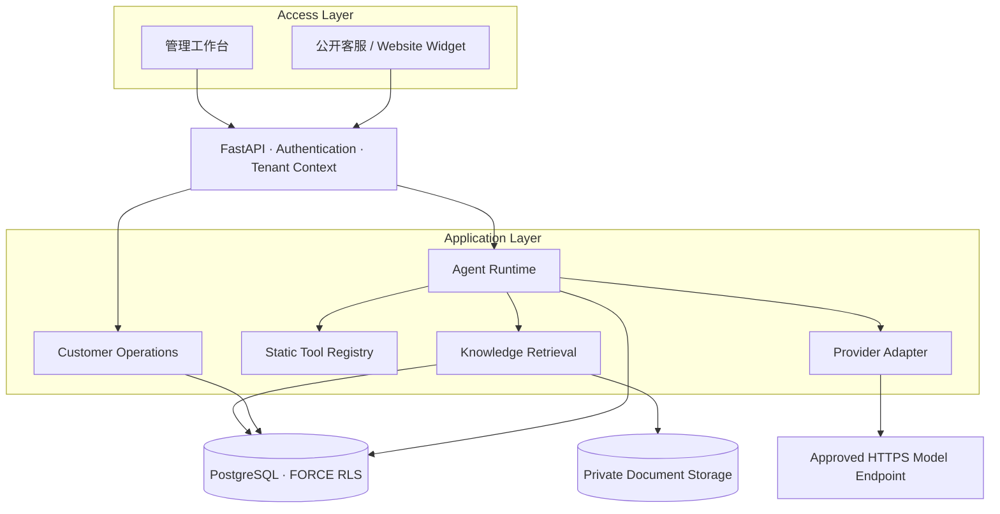

<div align="center">

<h1>✦ kefuagent</h1>

<p><strong>Open-source AI Customer Support Platform</strong></p>

<p>面向企业的多租户 AI 客服平台<br>连接知识检索、Agent 工具调用与人工客服协作。</p>

<p>
  <a href="https://www.python.org/"></a>
  <a href="https://fastapi.tiangolo.com/"></a>
  <a href="https://www.postgresql.org/"></a>
  <a href="https://www.sqlalchemy.org/"></a>
  <a href="https://alembic.sqlalchemy.org/"></a>
  <a href="https://developer.mozilla.org/en-US/docs/Web/JavaScript"></a>
  <a href="https://docs.astral.sh/uv/"></a>
  <a href="LICENSE"></a>
</p>

<p>
  <a href="#-features">Features</a> ·
  <a href="#-architecture">Architecture</a> ·
  <a href="#-quick-start">Quick Start</a> ·
  <a href="#-documentation">Documentation</a>
</p>

<sub>v0.7.1 · P9 Quality Governance · Modular Monolith</sub>

</div>

---

## 🚀 Overview

**kefuagent** 是一个可独立部署的 AI 客服平台，为企业提供从知识导入、智能问答到人工接管和运营分析的完整工作流。

项目采用 **Python + FastAPI + PostgreSQL**，以模块化单体组织业务能力。管理工作台和访客聊天使用原生 JavaScript ES Modules，前端资源随 Python 包提供，无需 Node 构建或 CDN。

## ✨ Features

| 🧠 AI & Agent | 📚 Knowledge & RAG |
| --- | --- |
| OpenAI-compatible 模型接入 | PDF / DOCX / TXT / Markdown |
| 有界 Agent 推理与模型路由 | PostgreSQL 全文检索 |
| 静态注册、授权的只读工具 | 中文词面扩展与多路召回 |
| Token 预算、调用记录与审计 | 可追溯来源与原文摘录校验 |
| SSE 阶段事件与结果交付 | 文档分块、重处理与显式删除 |

| 💬 Customer Operations | 📊 Analytics |
| --- | --- |
| 企业工作区与客服会话队列 | 会话量与处理效率 |
| 负责人分配、转交与优先级 | AI / 人工处理指标 |
| 人工接管、内部备注与 SLA | 模型 Token 与调用统计 |
| 会话级摘要和上下文压缩 | 趋势分析与访客满意度 |
| 公开客服链接与网站嵌入 | 未知费用单独呈现 |

| 🛡️ Security | ⚙️ Deployment |
| --- | --- |
| PostgreSQL FORCE RLS | 本机 Python 启动 |
| Argon2id 密码哈希 | 只读配置预检 |
| AES-256-GCM 凭证加密 | Liveness / Readiness / Setup |
| 管理身份与访客身份隔离 | 可选 Docker Compose |
| 工具静态注册与逐次授权 | 增量迁移与备份恢复文档 |

## 🧱 Tech Stack

| Layer | Technology |
| --- | --- |
| Backend | Python 3.11–3.14 · FastAPI · Pydantic |
| Database | PostgreSQL 15+ · SQLAlchemy 2.x · Alembic |
| Frontend | HTML · CSS · Native JavaScript ES Modules |
| AI | OpenAI-compatible Provider · Bounded Agent Runtime · PostgreSQL FTS |
| Runtime & Tooling | Uvicorn · uv · Ruff |
| Security | FORCE RLS · Argon2id · AES-256-GCM |

## 🏗️ Architecture



> 架构示意：模块化单体，业务数据由 PostgreSQL 管理，文档保存在私有目录；模型请求只访问部署方批准的 HTTPS 主机。

## ⚡ Quick Start

### Requirements

- Python **3.11–3.14**
- PostgreSQL **15+**
- [uv](https://docs.astral.sh/uv/)
- macOS 本机脚本默认使用 Homebrew PostgreSQL 17

### Fresh local setup · macOS

```bash
git clone https://github.com/koajsj/kefuagent.git
cd kefuagent

uv sync --locked

# 仅限全新安装：创建本项目独立 PostgreSQL dev/test 库并生成私有 .env
./scripts/local-postgres.sh init

# 显式执行数据库迁移
uv run alembic upgrade head

# 首次交互创建平台管理员；不会生成默认账号
uv run python -m support_agent.cli create-admin

# 启动服务
uv run uvicorn support_agent.main:create_app --factory --host 127.0.0.1 --port 8000 --no-access-log
```

打开：

- [管理工作台](http://127.0.0.1:8000)
- [Swagger API](http://127.0.0.1:8000/docs)
- [ReDoc](http://127.0.0.1:8000/redoc)
- [Health](http://127.0.0.1:8000/api/v1/health)

**已有安装注意：** `init` 只用于全新本机环境；检测到已有 `.env` 或 `.local/pgdata` 时会拒绝执行，不要通过删除数据目录解决启动问题。已初始化但停止的本机集群使用 `./scripts/local-postgres.sh start`。外部 PostgreSQL、Linux、HTTPS、密钥和权限配置请先阅读[部署与恢复文档](docs/DEPLOYMENT.md)。

### First-use workflow

1. 创建企业及企业管理员。
2. 配置兼容模型凭证，或先选择离线演示 Agent。
3. 创建知识库并导入资料。
4. 创建 Agent，授权知识库和只读工具。
5. 创建客服入口，体验访客对话、人工接管和运营分析。

离线演示用于验证产品流程，不代表真实模型回答质量。公开访客会话还需要单独配置随机的 `PUBLIC_RATE_KEY`；第三方模型默认关闭，需由部署方明确配置主机白名单、预算和调用开关。

## 🔒 Security & Design Boundaries

- **Tenant isolation**：业务表使用 PostgreSQL FORCE RLS，并结合服务端成员授权和复合外键。
- **Credential protection**：模型凭证使用 AES-256-GCM；主密钥由部署方单独保管。
- **Bounded tools**：仅允许静态注册且经过授权的低风险只读能力；不执行任意 Python、Shell 或 SQL。
- **Public access**：访客令牌独立于管理身份，并绑定公开入口和会话。
- **Evidence handling**：知识内容和摘要均视为不可信数据；引用校验不等于事实真实性或语义正确性。

## ⚖️ Current Scope & Limitations

为保持部署和维护简单，项目有意控制技术边界：

- 检索使用 PostgreSQL 全文检索、中文词面扩展和有界多路召回；**没有向量语义检索或独立向量数据库**。
- Provider 使用兼容 Chat Completions 的接口；SSE 展示运行阶段并在最终校验后交付答案，**不代表上游模型逐 token 输出**。
- 工具执行采用静态注册和只读授权；尚不支持任意插件或审批写操作。
- 客服工作台支持企业内部协作与人工接管；不是完整的全渠道客服系统。
- 真实模型与摘要语义质量、浏览器 GUI、Docker 实际运行及生产部署尚未完成验收。

## 📚 Documentation

| Document | Description |
| --- | --- |
| [Architecture](docs/ARCHITECTURE.md) | 架构、模块职责与设计决策 |
| [Deployment & Recovery](docs/DEPLOYMENT.md) | 本机 / Linux 部署、升级、备份与恢复 |
| [Operations & Security](docs/OPERATIONS.md) | 运行安全、凭证与数据保留 |
| [P7 Quality](docs/P7_QUALITY.md) | 离线检索评估与指标口径 |
| [P7 Runtime](docs/P7_RUNTIME.md) | SSE、密钥轮换、保留策略与 CI |
| [P8 Acceptance](docs/P8_ACCEPTANCE.md) | 客服运营、会话记忆与分析验收 |
| [P8 Compose](docs/P8_DEPLOYMENT.md) | 可选 Docker Compose 方案及限制 |
| [P9 Quality Governance](docs/P9_ACCEPTANCE.md) | 测试精简、静态审查与验收记录 |
| [Dependency Licenses](docs/DEPENDENCY_LICENSES.md) | 第三方依赖许可证 |

## 🧭 Project Principles

**Small surface · Explicit boundaries · Verifiable behavior**

- 保持模块化单体，避免不必要的基础设施。
- 优先明确权限、数据边界和失败语义。
- 以静态审查和少量高价值原子检查控制维护成本。
- 不把 Mock、离线演示或源码审查描述成生产验收。

## 📄 License

项目代码采用 [MIT License](LICENSE)。第三方依赖遵循各自许可证，详见[依赖授权清单](docs/DEPENDENCY_LICENSES.md)。

<div align="center">
  <sub>✦ Built for practical, bounded and maintainable AI customer support.</sub>
</div>

## P10 性能与资源治理

检索排序使用预计算 rank/coverage，运营统计下推 PostgreSQL，历史关联批量读取；SSE 按缓冲和时间重新验权后交付。知识库删除新增预览和有界批次，未完成时由界面“继续清理”，不自动无限重试。详情与离线证据见 [P10 验收与限制](docs/P10_ACCEPTANCE.md)。

当前迁移 head 为 `0010_http_ingress`。仅本机新隔离 P10 库已获授权升级；已有 dev/test 未变，应用启动前需先经授权备份并升级目标库。总入口保护须显式设置 `HTTP_LIMITS_ENABLED=true` 和共享 `HTTP_RATE_KEY`（或复用 PUBLIC_RATE_KEY），阈值见 `.env.example`；关闭时 preflight 会提示。所有实例共享数据库、密钥与阈值，生产代理、容量和多实例部署仍需独立验收，不把本机检查当生产通过。
