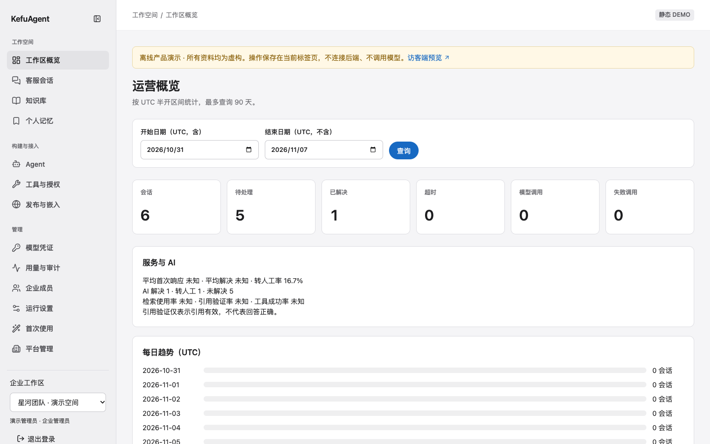
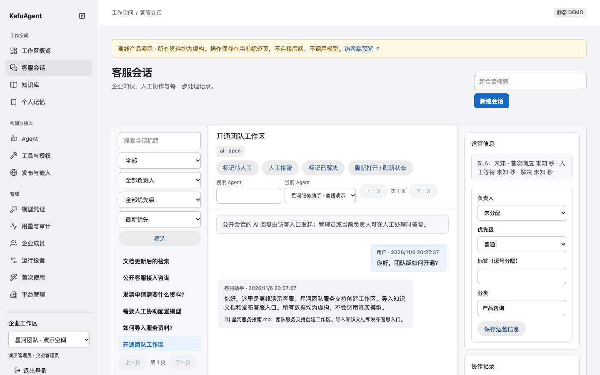
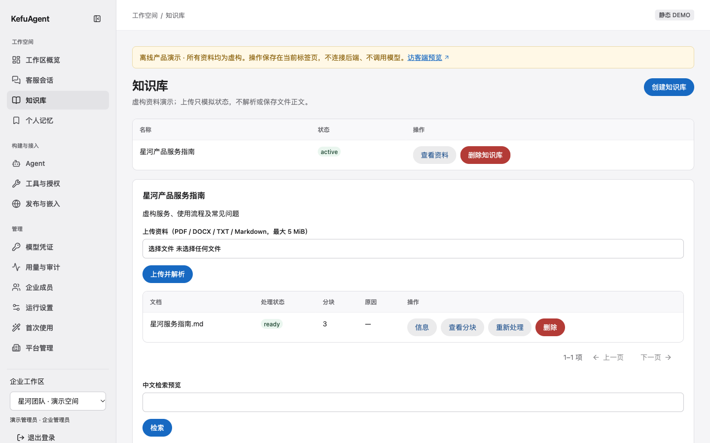

<div align="center">

# KefuAgent

**Open-source AI Customer Support Platform**

单实例单企业的私有 AI 客服平台，连接知识检索、Agent、客户工单与人工协作；保留 tenant_id 与 RLS 数据隔离。

[](https://www.python.org/) [](https://fastapi.tiangolo.com/) [](https://www.postgresql.org/) [](https://react.dev/) [](LICENSE)

[静态演示入口](https://koajsj.github.io/kefuagent/) · [快速开始](docs/QUICK_START.md) · [部署指南](docs/DEPLOYMENT.md) · [网站集成](docs/WEBSITE_INTEGRATION.md)

</div>

## 产品概览

KefuAgent 采用 FastAPI 和 PostgreSQL 模块化单体，提供 React 管理工作台、独立访客聊天和网站 Widget。企业可以管理知识与 Agent 配置，在会话中查看来源、分配负责人、人工接管和添加内部备注，并查看用量与运营信息。

- **知识与回答**：导入 PDF、DOCX、TXT、Markdown 和 HTML，发布确认后参与检索；使用 PostgreSQL 全文/CJK 与可选 pgvector 召回、RRF 融合和付费重排，回答关联来源并校验引用。
- **有界 Agent**：接入兼容 Chat Completions 的模型服务，工具须静态注册并授权，支持预算、调用记录和审计；仅通过固定服务命令执行经授权的 R2 工单和交接操作，不开放任意 SQL 或 Shell；R3 固定命令须独立管理员一次性批准，付费模型须原子金额预留。
- **人工协作**：会话队列、转交、优先级、内部备注和 SLA 与公开访客入口协同工作；人工接管后访客可继续发送消息，双端通过轮询同步。
- **客户导出与草稿**：管理员审核客户范围后异步生成 JSONL/附件 ZIP，下载有权限和有效期；人工工作台可生成带引用的内部草稿、编辑和反馈，只有明确人工确认才发送。
- **企业隔离**：服务端成员授权结合 PostgreSQL FORCE RLS；访客身份独立于管理身份，模型凭证加密保存。
- **运营与记忆**：展示会话、模型用量与未知费用；个人记忆需要明确同意，可查看、修改、删除和撤回。

工作台新增个人快捷回复与筛选视图、标签过滤、低评价会话定位、回答人工反馈、配置变更记录及安全执行时间线；知识页提供真实命中排序与来源预览。当前改动只完成静态审查，运行时边界及会话、知识物理清理的安全阻断原因见[深度审查记录](docs/DEEP_AUDIT_REPORT.md)。

## 界面预览







## 静态演示

[打开静态 Demo](https://koajsj.github.io/kefuagent/)。站点由[手动 Pages 工作流](https://github.com/koajsj/kefuagent/actions/workflows/pages-demo.yml)发布。演示使用虚构数据和浏览器本地 Adapter，不连接 API、数据库或真实模型；上传、检索与回答均为模拟，不代表正式环境或模型效果。

本地体验需要 Node 22.12+：

```bash
npm ci --prefix frontend
npm run dev:demo --prefix frontend
# 或构建并预览
npm run build:demo --prefix frontend
npm run preview:demo --prefix frontend
```

访问终端显示地址下的 `/kefuagent/`。Pages 工作流仅支持管理员授权后的手动 `workflow_dispatch`，详见[前端说明](docs/FRONTEND.md)。

## 本机运行

需要 Python 3.11–3.14、PostgreSQL 15+（预先安装并启用 pgvector）、Node 22.12+ 和 [uv](https://docs.astral.sh/uv/)。全新 macOS 开发环境：

```bash
git clone https://github.com/koajsj/kefuagent.git
cd kefuagent
uv sync --locked
npm ci --prefix frontend
npm run build --prefix frontend
uv run python -m support_agent.cli setup --configure
# 确认目标数据库并获得授权后执行
uv run alembic upgrade head
uv run python -m support_agent.cli create-admin
uv run python -m support_agent.cli setup
uv run uvicorn support_agent.main:create_app --factory --host 127.0.0.1 --port 8000 --no-access-log --no-proxy-headers
```

打开 <http://127.0.0.1:8000>；浏览器地址须与 `WEB_ORIGIN` 一致。已有数据库先备份，配置和首次使用详见[快速开始](docs/QUICK_START.md)。正式 React 资源随 Python 包交付，运行服务无需 Node；未构建时暂时回退旧界面。

Dockerfile 提供 Node 构建阶段，Compose 及生产配置、权限、备份和恢复要求见[部署指南](docs/DEPLOYMENT.md)。部署方应先检查配置和数据库授权；Docker 实际运行及生产环境尚未完成验收。

## 架构与边界

React 管理台、访客页和 Widget 通过 FastAPI 接入同一个模块化单体；应用使用 PostgreSQL 保存业务数据，私有目录保存文档，模型请求访问部署方批准的 HTTPS 端点。向量复用 PostgreSQL pgvector，不引入独立向量数据库；来源校验不保证事实或语义正确。SSE 展示运行阶段并在校验后交付结果，不表示上游逐 token 输出。工具只允许静态注册、逐次授权的能力与固定服务命令；本项目也不是完整的全渠道客服系统。

离线、本机和隔离环境的验收范围见 [P15-C 记录](docs/P15_C_ACCEPTANCE.md)；真实模型质量、生产容量、Docker 与实际生产部署仍需单独验证。不要将静态 Demo 视为生产验收。

## 静态质量检查

长期规则见 [AGENTS.md](AGENTS.md)。不保留专用测试体系；未经明确授权，不运行测试、不为检查启动应用或数据库。使用现有工具：

```bash
uv run python scripts/check.py
npm run check --prefix frontend
uv run python scripts/check_delivery.py
git diff --check
```

检查覆盖 Ruff、Python AST、离线迁移/RLS 声明、TypeScript、JavaScript 模块和 HTML 资源、Markdown 链接及敏感文件。CI 同样仅执行静态检查，不启动数据库或构建。真实权限、并发、浏览器与模型效果须单独授权确认，静态通过不代表运行时通过。以下历史阶段记录只保留当时证据，不是当前执行指令。

## 文档

- [首次使用](docs/FIRST_RUN.md) · [前端与 Demo](docs/FRONTEND.md) · [网站集成](docs/WEBSITE_INTEGRATION.md)
- [架构](docs/ARCHITECTURE.md) · [部署与恢复](docs/DEPLOYMENT.md) · [生产检查清单](docs/PRODUCTION_CHECKLIST.md) · [运维与安全](docs/OPERATIONS.md)
- [AI 能力与离线验收](docs/P15_B_AI_UPGRADE.md) · [产品与生产准备记录](docs/P15_C_ACCEPTANCE.md)
- [第一阶段收口](docs/FINALIZATION_PHASE_1.md)
- [第二阶段完善](docs/FINALIZATION_PHASE_2.md)
- [最终产品验收与待授权项目](docs/FINAL_PRODUCT_ACCEPTANCE.md)
- [Prompt 质量与智能执行优化](docs/PROMPT_QUALITY_REPORT.md)
- [全项目深度审查与集中修复](docs/COMPREHENSIVE_AUDIT_AND_REMEDIATION.md)
- [开源源码研究与选择性优化](docs/COMPREHENSIVE_AUDIT_AND_UPGRADE.md)
- [产品质量专项验收](docs/PRODUCT_QUALITY_ACCEPTANCE.md) · [人工发布清单](docs/RELEASE_ACCEPTANCE.md) · [静态质量审查边界](docs/QUALITY_REVIEW.md)

当前源码要求迁移 `0020_conversation_idempotency`，0013–0020 均未在本轮应用；历史迁移保持不变。0020 为员工会话创建增加持久幂等标识，`POST /conversations` 现在要求 UUID `idempotency_key`，外部客户端须同步；兼容性与升级闸门见[部署说明](docs/DEPLOYMENT.md#会话创建幂等升级0020未执行)。已有客户、工单、站内提醒、附件与有来源的客户记忆成果保留，没有修改历史数据库。升级前须另行授权、备份并审查迁移，不能直接用旧库启动新代码。成员已读游标、人工期访客消息与个人记忆使用记录继续保留；产品化进度、明确未实现项与运行边界见[实施矩阵](docs/PRODUCTIZATION.md)；安全专项及未解除阻断见[专项记录](docs/DEEP_AUDIT_REPORT.md#专项-b核心产品能力2026-11-10)。

项目采用 [MIT License](LICENSE)，第三方依赖许可证见[依赖授权记录](docs/DEPENDENCY_LICENSES.md)。
