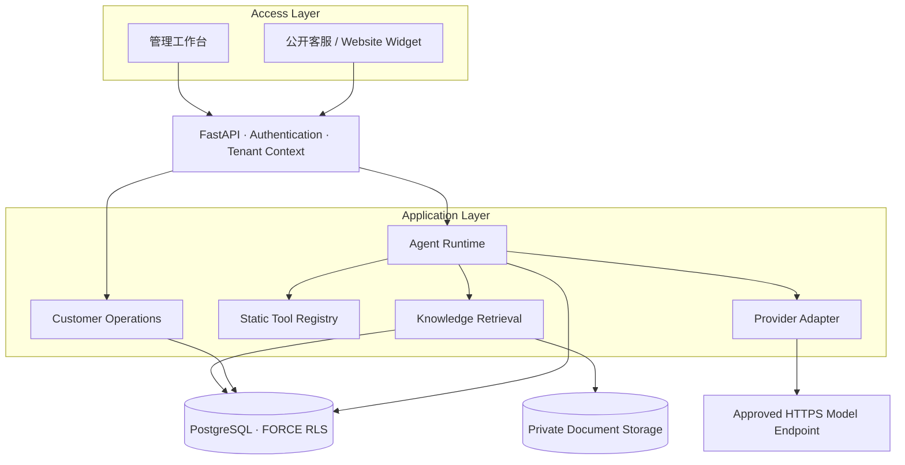

<h1>✦ kefuagent</h1>

<strong>Open-source AI Customer Support Platform</strong>

面向企业的多租户 AI 客服平台 连接知识检索、Agent 工具调用与人工客服协作。

  
  
  
  
  
  
  
  

  <a href="#-features">Features</a> ·
  <a href="#-architecture">Architecture</a> ·
  <a href="#-quick-start">Quick Start</a> ·
  <a href="#-documentation">Documentation</a>

v0.7.1 · Modular Monolith

---

## 🚀 Overview

**kefuagent** 是一个可独立部署的 AI 客服平台，为企业提供从知识导入、智能问答到人工接管和运营分析的完整工作流。

项目采用 **Python + FastAPI + PostgreSQL**，以模块化单体组织业务能力。管理工作台和访客聊天使用原生 JavaScript ES Modules，前端资源随 Python 包提供，无需 Node 构建或 CDN。

## ✨ Features

| 🧠 AI & Agent | 📚 Knowledge & RAG |
| --- | --- |
| OpenAI-compatible 模型接入 | PDF / DOCX / TXT / Markdown |
| 有界 Agent 推理与模型路由 | PostgreSQL 全文检索 |
| 静态注册、授权的只读工具 | 中文词面扩展与多路召回 |
| Token 预算、调用记录与审计 | 可追溯来源与原文摘录校验 |
| SSE 阶段事件与结果交付 | 文档分块、重处理与显式删除 |

| 💬 Customer Operations | 📊 Analytics |
| --- | --- |
| 企业工作区与客服会话队列 | 会话量与处理效率 |
| 负责人分配、转交与优先级 | AI / 人工处理指标 |
| 人工接管、内部备注与 SLA | 模型 Token 与调用统计 |
| 会话级摘要和上下文压缩 | 趋势分析与访客满意度 |
| 公开客服链接与网站嵌入 | 未知费用单独呈现 |

| 🛡️ Security | ⚙️ Deployment |
| --- | --- |
| PostgreSQL FORCE RLS | 本机 Python 启动 |
| Argon2id 密码哈希 | 只读配置预检 |
| AES-256-GCM 凭证加密 | Liveness / Readiness / Setup |
| 管理身份与访客身份隔离 | 可选 Docker Compose |
| 工具静态注册与逐次授权 | 增量迁移与备份恢复文档 |

## 🧱 Tech Stack

| Layer | Technology |
| --- | --- |
| Backend | Python 3.11–3.14 · FastAPI · Pydantic |
| Database | PostgreSQL 15+ · SQLAlchemy 2.x · Alembic |
| Frontend | HTML · CSS · Native JavaScript ES Modules |
| AI | OpenAI-compatible Provider · Bounded Agent Runtime · PostgreSQL FTS |
| Runtime & Tooling | Uvicorn · uv · Ruff |
| Security | FORCE RLS · Argon2id · AES-256-GCM |

## 🏗️ Architecture

> 架构示意：模块化单体，业务数据由 PostgreSQL 管理，文档保存在私有目录；模型请求只访问部署方批准的 HTTPS 主机。

## ⚡ Quick Start

全新 macOS 开发环境可按照[本机快速开始](docs/QUICK_START.md)使用 `setup --configure` 交互配置，明确执行迁移和创建管理员后启动；`setup` 默认只读检查。已有数据库、Linux 或生产环境请先阅读[部署与恢复](docs/DEPLOYMENT.md)。

登录后按[首次使用](docs/FIRST_RUN.md)创建企业并导入虚构 SaaS「青禾协作」的离线演示。演示不调用外部模型，不代表真实模型质量；公开入口需要另行发布，网站接入见[网站集成](docs/WEBSITE_INTEGRATION.md)。

P14 已在现有 macOS 上用全新临时源码目录、独立虚拟环境和临时空库复现上述离线流程；这不等于全新主机、浏览器或生产部署验收，具体边界见首次使用记录。

### Production deployment

生产部署须显式设置 `DEPLOYMENT_ENVIRONMENT=production`，启动前会强制执行生产预检。也可在不改变环境模式时执行 `uv run python -m support_agent.cli preflight --production` 做严格只读检查：错误返回退出码 1，警告和预检通过均不等于生产验收。HTTPS、入口保护、密钥、存储权限、数据库运行角色及管理员等要求见[生产部署检查清单](docs/PRODUCTION_CHECKLIST.md)；不要向 HTTP 进程注入迁移账户连接。

容器默认关闭代理头解析。部署可信反向代理时，需覆盖容器启动命令，使用 `--proxy-headers --forwarded-allow-ips=实际代理IP`，只信任确定的代理 IP，不能使用 `*`；代理还须覆盖客户端传入的转发头。主机本地代理的 `127.0.0.1` 不一定是容器看到的代理地址，须按实际网络配置。参见[部署与恢复文档](docs/DEPLOYMENT.md)。

默认以单实例部署为前提；多实例须共享同一私有文档存储、数据库、限流密钥和阈值。共享存储和多实例部署尚未完成验收。

镜像中新建的文档目录权限为 `0700`；已有命名卷不会因此自动修改，部署方需核对卷内目录的所有者和权限，确保服务账号可访问且符合生产预检要求。

## 🔒 Security & Design Boundaries

- **Tenant isolation**：业务表使用 PostgreSQL FORCE RLS，并结合服务端成员授权和复合外键。
- **Credential protection**：模型凭证使用 AES-256-GCM；主密钥由部署方单独保管。
- **Bounded tools**：仅允许静态注册且经过授权的低风险只读能力；不执行任意 Python、Shell 或 SQL。
- **Public access**：访客令牌独立于管理身份，并绑定公开入口和会话。
- **Evidence handling**：知识内容和摘要均视为不可信数据；引用校验不等于事实真实性或语义正确性。

## ⚖️ Current Scope & Limitations

为保持部署和维护简单，项目有意控制技术边界：

- 检索使用 PostgreSQL 全文检索、中文词面扩展和有界多路召回；**没有向量语义检索或独立向量数据库**。
- Provider 使用兼容 Chat Completions 的接口；SSE 展示运行阶段并在最终校验后交付答案，**不代表上游模型逐 token 输出**。
- 工具执行采用静态注册和只读授权；尚不支持任意插件或审批写操作。
- 客服工作台支持企业内部协作与人工接管；不是完整的全渠道客服系统。
- 真实模型与摘要语义质量、浏览器 GUI、Docker 实际运行及生产部署尚未完成验收。

## 🔍 Checks

`uv run python scripts/check.py` 执行 Ruff、格式、Python AST 和迁移链等静态检查；仅在全新隔离 CI 数据库检查 schema 时，显式设置目标 `DATABASE_URL` 并运行 `uv run python scripts/check.py --database`。该选项执行只读 Alembic 差异检查，不执行迁移。先用 `uv build --wheel --out-dir .local/dist` 构建 wheel，再用 `uv run python scripts/check_delivery.py --wheel .local/dist/具体文件.whl` 检查 JavaScript、HTML、资源、wheel 许可证及文档；这些检查不运行测试，也不能替代运行时验收。

## 📚 Documentation

| Document | Description |
| --- | --- |
| [Quick Start](docs/QUICK_START.md) | 全新本机开发环境启动 |
| [First Run](docs/FIRST_RUN.md) | 企业、离线演示和首次使用 |
| [Website Integration](docs/WEBSITE_INTEGRATION.md) | 公开链接和网站嵌入 |
| [Architecture](docs/ARCHITECTURE.md) | 架构、模块职责与设计决策 |
| [Deployment & Recovery](docs/DEPLOYMENT.md) | 本机 / Linux 部署、升级、备份与恢复 |
| [Production Checklist](docs/PRODUCTION_CHECKLIST.md) | 生产预检、配置与上线验收边界 |
| [Operations & Security](docs/OPERATIONS.md) | 运行安全、凭证与数据保留 |
| [P7 Quality](docs/P7_QUALITY.md) | 离线检索评估与指标口径 |
| [P7 Runtime](docs/P7_RUNTIME.md) | SSE、密钥轮换、保留策略与 CI |
| [P8 Acceptance](docs/P8_ACCEPTANCE.md) | 客服运营、会话记忆与分析验收 |
| [P8 Compose](docs/P8_DEPLOYMENT.md) | 可选 Docker Compose 方案及限制 |
| [P9 Quality Governance](docs/P9_ACCEPTANCE.md) | 测试精简、静态审查与验收记录 |
| [P12 生产准备审查](docs/P12_READINESS.md) | 审查发现、修复与生产验收缺口 |
| [P11 清理与边界](docs/P11_ACCEPTANCE.md) | 自动化测试移除、静态交付与未验收项 |
| [Dependency Licenses](docs/DEPENDENCY_LICENSES.md) | 第三方依赖许可证 |

## 🧭 Project Principles

**Small surface · Explicit boundaries · Verifiable behavior**

- 保持模块化单体，避免不必要的基础设施。
- 优先明确权限、数据边界和失败语义。
- 以静态审查和少量高价值原子检查控制维护成本。
- 不把 Mock、离线演示或源码审查描述成生产验收。

## 📄 License

项目代码采用 [MIT License](LICENSE)。第三方依赖遵循各自许可证，详见[依赖授权清单](docs/DEPENDENCY_LICENSES.md)。

  ✦ Built for practical, bounded and maintainable AI customer support.

## P10 性能与资源治理

检索排序使用预计算 rank/coverage，运营统计下推 PostgreSQL，历史关联批量读取；SSE 按缓冲和时间重新验权后交付。知识库删除新增预览和有界批次，未完成时由界面“继续清理”，不自动无限重试。详情与离线证据见 [P10 验收与限制](docs/P10_ACCEPTANCE.md)。

当前迁移 head 为 `0010_http_ingress`。P10 阶段仅本机新隔离库获授权升级；应用启动前需先经授权备份并升级目标库。总入口保护须显式设置 `HTTP_LIMITS_ENABLED=true` 和共享 `HTTP_RATE_KEY`（或复用 PUBLIC_RATE_KEY），阈值见 `.env.example`；生产预检要求启用。所有实例共享数据库、密钥与阈值，生产代理、容量和多实例部署仍需独立验收，不把本机检查当生产通过。
