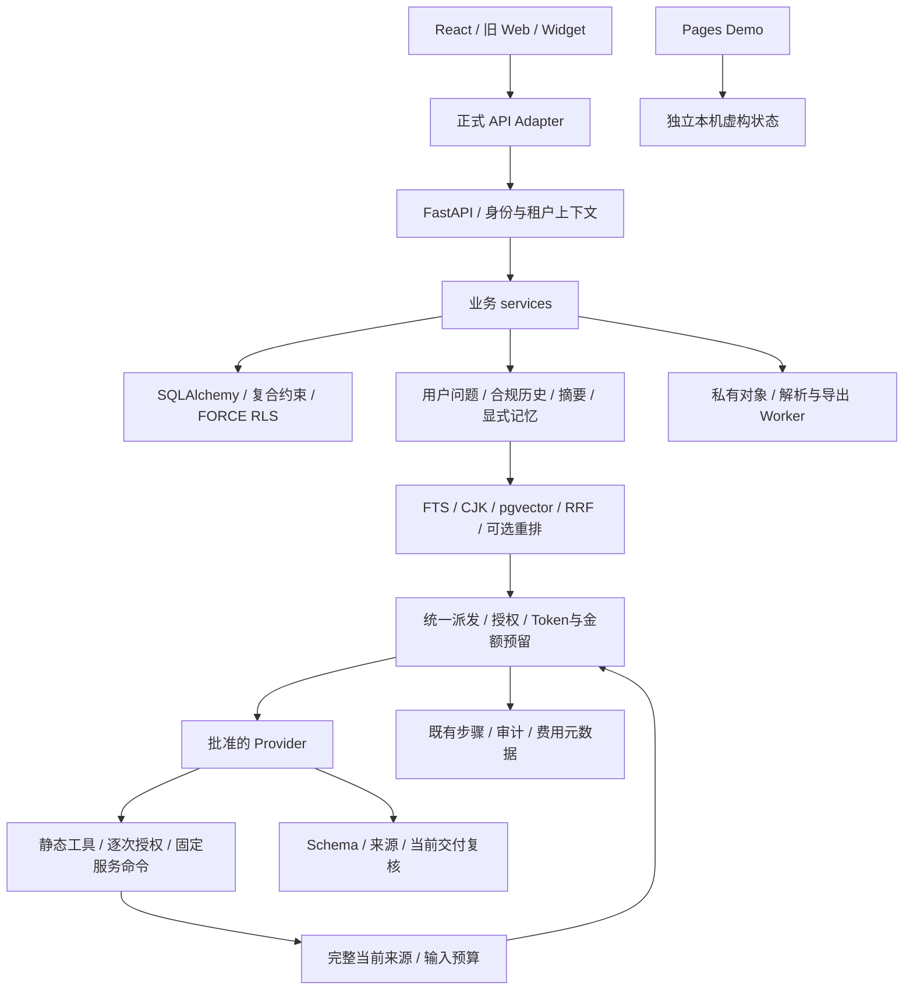
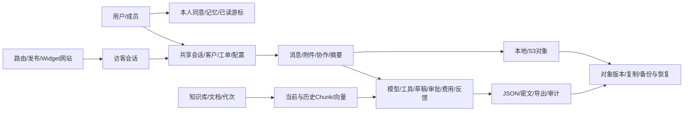

# 全项目深度审查与集中修复

日期：2026-11-13。结论：本轮确认的 9 项缺陷已完成源码修复和静态核对；没有确认新增 P0。**真实业务、模型效果、数据库并发及部署仍未验收，不能标记生产就绪。**

`FIXED` 表示源码修改；`PASS` 只指列明的静态检查；`VERIFIED` 需要对应实际行为证据，本轮没有业务运行 VERIFIED 项。`NOT_RUN` 为未执行，`BLOCKED` 为安全或外部条件不足，`DEFERRED` 为明确延期。静态检查不能证明回答准确率、SQL 实际行为或浏览器可用性。

## 1. 基线、范围与保护

- 实际仓库 `support-agent-platform`，分支 `main`，HEAD `49fc85fbb5ba827507e4a6334a3a4daf995beb73`；暂存区为空，已有大量修改、删除和未跟踪成果。
- 已读取 AGENTS.md、README、FINAL_PRODUCT_ACCEPTANCE、两阶段 Finalization、DEEP_AUDIT_REPORT、PROMPT_QUALITY_REPORT、PRODUCT_QUALITY_ACCEPTANCE；历史结论按当时范围理解，当前以实际源码为准。
- 修改前在仓库外保存 267 个现存交付文件的内容及 SHA-256。下文文件清单只计算相对该脏基线的本轮增量，没有回撤或覆盖此前成果。
- 主代理负责跨模块证据衔接、派发授权、整合和检查；三个 Terra 分别负责 AI、后端安全、前端工程，事先划分写入所有权；跨域修改由主代理接管，没有并行写同一文件。
- 盘点覆盖全部源码、迁移、配置、依赖锁、交付资源及文档；深读以下关键调用链。全项目静态扫描和重点链路审查不等于逐分支形式化证明。

## 2. 模块清单与依赖关系

当前有 106 个后端 Python 模块（含包入口），共 129 个 Python 文件含脚本/迁移；16 个 API 路由模块及 API 包入口、41 个服务模块及服务包入口、47 个根层 Python 文件。前端含 36 个 TSX、15 个 TS 文件；旧 Web/Widget 共 19 个资源文件；迁移为 0001–0019。

| 范围 | 当前模块及审查重点 |
| --- | --- |
| 身份/管理 API | identity、tenants、administration、security_controls、workspace、audit；身份、成员、运行能力与操作授权 |
| 业务 API | agents、model_access、conversations、public_delivery、desk、attachments、tools、user_memory、knowledge、product_capabilities；参数、响应、权限及状态 |
| 身份/配置服务 | identity、tenants、onboarding、workspace、agents、model_configs、resources、audit；企业范围、配置版本及凭证解析 |
| AI/知识服务 | agent_turns、chat、drafts、memory、user_memory、search、model_runtime、vector_index、knowledge_provenance、knowledge、chunk_versions；输入、证据、代次与交付 |
| 客服/客户服务 | conversations、operations、public_delivery、widget_identity、handoff、desk、customer_memory、attachments、customer_exports；接管、消息、归属、文件与导出 |
| 执行/治理服务 | tools、tool_execution、tool_connectors、desk_tools、approvals、budgets、costs、limits、analytics、traces、answer_feedback、background、erasure；授权、幂等、账本与阻断 |
| 核心基础设施 | models/db/preflight、全部 Schema、providers/demo_provider、prompting/autonomy、retrieval/search_text/vector_type、ingestion/storage/s3_storage、security/credentials、widget_verification、http_limits/streaming/observability/stream_events、worker/tool_worker、retention/maintenance/bootstrap/CLI/main/errors；声明、边界、生命周期 |
| React | App/context、管理/客服/客户工单/知识/访客页面、共享组件、hooks、类型；账号/企业隔离、请求、分页、状态、反馈及附件 |
| Adapter/Web | 正式 API/SSE/身份/存储 Adapter、独立 Demo/data、旧管理与访客页面、Widget/bootstrap/demo loader；协议及隔离 |
| 工程 | pyproject/uv.lock、npm 清单与锁、许可证、Dockerfile、三份 Compose、Nginx、CI/Pages/Dependabot、环境示例、静态脚本及文档链接 |

保持 API → services → ORM 的模块化单体、React → Adapter 和 Demo 分离。静态顶层导入图未发现模块循环；函数内延迟导入的业务依赖另按调用链审查，不把该图当完整运行导入证明。没有新增框架、业务工具、页面或基础设施。

## 3. 全部确认缺陷、优先级与修复

以下为本轮新确认的问题，全部为 FIXED；影响由源码和时序推导，没有运行复现或性能比例。

| 编号 | 等级 | 根因与触发条件 | 实际修复及边界 |
| --- | --- | --- | --- |
| A1 | P1 | Provider 响应同时含 refusal/content_filter 与 tool_calls 时，原条件可继续解析工具请求 | 矛盾响应统一 invalid_response，不执行夹带工具；已解析的用量仍保留 |
| A2 | P1 | knowledge_search 二次召回的 ID 只在工具收据中，最终 verify_selection 仅接受首轮 evidence；真实补召回也无法引用 | 下一轮在当前授权与锁内取得同 ID 完整 Chunk，预算内扩展原问题 evidence，复用既有引用/代次/交付校验；不截断来源，不增加召回或模型次数 |
| A3 | P1 | 外层工具交付检查后 commit，模型网关新事务及 fallback 未复查工具授权；grant 变更不必增加配置版本 | 每次 Agent 模型派发预检重新 ensure_delivery 本轮及历史工具执行，已提交撤权阻断派发；结果交付继续复查，不承诺网络期间不存在异步撤权窗口 |
| B1 | P1 | 上传恢复遇到正式对象字节不符时先 delete 再覆盖，把损坏/误绑定对象当临时文件处理 | 移除自动删除，复用本地/S3 不可变 write 校验；保留原对象，处理失败并返回 storage_unavailable，等待人工调查 |
| C1 | P1 | 客服历史请求与轮询并行，较旧历史响应可覆盖已追加消息并倒退 latest 游标 | 历史 in-flight 标记使轮询等待；保留 epoch 拒绝旧轮询、取消和卸载清理，数据库消息未被修改 |
| C2 | P1 | 访客页存在同类历史覆盖轮询竞态 | 同步历史 in-flight 与既有 epoch；取消不误清新请求标记，轮询和历史分页边界保持 |
| A4 | P2 | HTML 隐藏块或未匹配结束标签也追加换行，可凭空拆分可见段落中的条件/否定 | 仅匹配且可见元素闭合时追加块边界；保留原解析资源限制，不实现浏览器 CSS 语义 |
| C3 | P2 | 草稿首次列表加载期间可生成，旧列表响应可能覆盖新付费任务 | 已有草稿成功加载前禁用生成；失败独立显示并提供重试，不生成第二份请求来掩盖未知任务 |
| C4 | P2 | 上传接口可返回成功 HTTP 状态及 failed 文档，React/旧页却固定提示处理成功 | 上传和重新处理按 DocumentOut.status 区分完成、失败及其他状态；存储失败提示保留原文件，Demo 明示未解析/保存正文 |

没有确认新的可利用跨租户 P0。未确认缺陷的模块保持原实现；这不等于证明其没有缺陷。

## 4. Prompt 全量审查

| 模板/调用 | 当前职责、输入与输出 | 审查结果 |
| --- | --- | --- |
| agent.conversation | BASE、必要工具决策、受限 company_preferences；最终自由文本标未验证 | 保留缺参澄清、真实写请求/假设区分、结果状态及未知不重试；没有模型自授权 |
| agent.knowledge | 上述规则加 EVIDENCE_OUTPUT 与可选 synthesis | 版本升至 2，记录本轮完整工具证据装配变化；System 静态 hash 不代表动态输入存档 |
| rag.selection | 当前问题、完整证据、合规历史及可选记忆；JSON 证据选择 | 保留三条引用上限、条件/否定和无证据拒答，Schema 与消费者一致 |
| staff.draft | 客户问题和有效知识；内部待人工审核稿 | 仍无工具、无自动发送，不表示业务已执行；复用引用验证 |
| memory.summary | 用户来源摘录、上一合规摘要；有界逐字段 JSON | 完整段落和原消息校验；合法空结果推进水位是既有决策，未改回重复摘要 |
| retrieval.rerank | 有界完整候选及问题；全部 UUID 的唯一排列 | 仅排相关性、不判断事实；输入不容纳则回 RRF，不新增修复调用 |
| provider.connection | 固定 JSON ok 请求/响应 | 既有 Schema、预算及用量治理保留；未执行连接诊断 |
| 两处 Embedding | 查询文本/完整 Chunk，非文本 Prompt | 1536 维、模型空间/版本及用量校验；Prompt ID 明确 None |

当前八个统一网关调用位置覆盖七个文本模板 ID 和两个 Embedding 位置，其中 Agent 按是否有知识选择模板。没有新增模型意图分类、模型规划、查询改写或最终润色请求。autonomy.plan/infer_task、同义词表和指代扩展仍是本地启发式，语义确定性 UNKNOWN。

用户、文档、历史、记忆、工具及文件内容是任务数据，不得提升为 system 或授权。Prompt 只能引导行为，真正的权限、Schema、风险审批、租户与资源归属由服务器执行。没有宣称 Prompt 可阻断所有注入或敏感复述。

## 5. Agent 推理、工具与派发边界

A2 不修改已绑定 v1 的 knowledge_search 参数/输出 Schema：对外收据仍是最多三条、每条最多 500 字符。服务端在下一轮取得 Conversation → ModelCall → AgentConfig 既有锁后，复查工具记录和当前完整来源；只读取本轮选定与 Agent 当前授权知识库的交集、当前代次/当前修订、已发布/有效且通过既有安全筛查的 Chunk。

完整 Chunk 逐块按完整 messages/tools 的 input_size 试装至原问题 envelope；不增加 user 消息、不改当前问题/记忆位置、不移除或改写已有证据、不把工具摘录冒充完整来源。预算不足整块跳过，仍可保守未解决。最多四个工具和已有候选上限不变，去重后不重复装入同一 ID。

来源通过 knowledge_sources 进入 model_runtime 的预检事务；来源、记忆、工具授权/快照、配置/凭证、模型能力、步骤/Token/金额及时间限制均通过后才提交运行步骤。预检失败 rollback，不遗留本次新来源。主备各自重新检查；最后一轮没有后续派发时，不会为待处理工具来源创建依赖。

运行步骤提交之后，Provider 仍可能 attempts=0 拒绝，或网络结果未知，因此依赖是保守的派发准备/使用范围，**不是已发送或供应商已接收的证明**；不删掉此前真实输入的来源。提交边界后的异步撤权由后续交付复查处理，数据库锁不跨网络等待。

静态目录仍为五项通用能力及六项客服能力。工具成功、空查询、业务成功、失败/拒绝/未知保持区分；没有任意代码、Shell、SQL、模型指定 URL、动态处理器或新增未经审批写操作。五次模型派发、四次工具、120 秒整轮与业务幂等未扩大。

## 6. RAG、知识与文档

复核保留中文二字组、单字/多个孤立汉字受限路径、英文完整词/同义表达、多库共同候选、FTS/pgvector、RRF、可选重排和最终有效来源过滤。汉字回退仍有 1000 个可见 Chunk 范围、60 个候选、返回 1–10 和 SQL 时间限制；不无界扩大召回。

引用仍验证实际输入 ID、原文、完整段落、generation/修订及当前授权；多来源可选互补证据，明显标签冲突保守拒答。综合稿逐项关联来源、区分 fact/inference/uncertain，始终 semantic_verified=false。带引用、完整段落或 rerank 均不能证明不同适用条件可以组合，也不能证明语义蕴含。

TXT/Markdown/HTML/PDF/DOCX、标题/段落/表格/列表、5 MiB、解包/页数/文本/Chunk/隔离进程预算、处理 token/租约、摘要去重及发布状态均纳入审查。A4 只影响将来解析；不重处理现有文档、不改旧 Chunk。1200 字自然边界、最多 200 字重叠和修订历史保留；长表跨块表头、多列 PDF、跨段条件仍需人工核实。

B1 的失败对象保留供排查，本地 pending 恢复和 S3 条件写入继续由原存储实现处理。相同摘要重新上传不再覆盖异常正式对象；ready/processing 的既有去重路径保持。没有新增物理清理或假称数据库与对象存储拥有分布式事务。

## 7. 上下文、摘要和记忆

复核当前问题优先、合规完整历史轮次、摘要来源/水位、否定段落、显式个人记忆来源/版本/同意/有效期和预算。助手、工具结果、内部备注不提升为可信用户事实；客户记忆仍由员工明确确认，默认不注入模型；没有自动长期记忆采集。

个人记忆仍词法筛选至多六条、去重，未装入输入时清除未派发依赖；已经派发的依赖不因后续裁剪撤销。A2 扩展原 envelope，保持 dispatched_entries 对原始 user_memory 的匹配和使用记录。摘要合法空项推进水位的既有行为保留：避免重复收费，不证明没有漏选重要条件。

词法无重合可能漏掉有用记忆；摘要长段限制、跨段依赖、条件纠正/冲突、指代和话题切换的实际效果 NOT_RUN。不能将可追溯来源等同于用户事实真实性。

## 8. Provider、模型路由、费用与效率

复核 Chat Completions 风格 system/user/assistant/tool、配置能力、JSON 模式和严格消费、主备类别、输入/输出/步骤/时间限制、SSRF/DNS/IP/TLS、精确批准端点、凭证密文及价格快照。A1 拒绝矛盾响应；A3 对每次主备派发再核工具权限，不靠配置版本替代授权。

没有增加收费调用、Embedding、重排或自动重试。模型补知识复用工具已有 IDs，以有界数据库读取补全内容；完整来源可能多占输入，超预算跳过，不给出 Token/成本节省比例。input_size 是 UTF-8 JSON 加 framing 的保守准入口径，不是实测 tokenizer。

金额继续原子预留并按实际用量结算；价格未知、费用上界不明或额度不足拒绝。未知结果不盲目 fallback，未知费用不补零；跨日未知占用、币种小计、调用时价格与超额冻结保留。Provider/模型能力声明不代表真实端点兼容性，供应商账单与未知用量对账未验收。

已有单次上下文构造、请求内查询向量复用、草稿列表 digest 复用、个人记忆 JOIN、索引批量复核和解析 join 优化保留。本轮 C1/C2 串行历史与轮询、C3 避免初始加载竞态导致重复草稿；未测量时延、SQL 次数或吞吐。

## 9. 数据库、权限、安全与数据生命周期

当前声明为 44 表、48 显式索引、37 张 tenant FORCE RLS 表。三张个人表 user_memories/user_memory_consents/conversation_read_cursors 叠加 user 范围；PublicRoute 等七张身份/定位/管理表沿用专门服务端边界，不机械增加破坏定位的策略。

0001–0019 单链、FK 唯一目标、复合租户/会话/Agent/访客/网站关系、Chunk 根/代次/当前唯一索引、answer_feedback 的服务器 JSON 关联、记忆/游标、审批/费用/草稿/导出关系均按声明及服务调用链审查。ORM/db、全部迁移均无本轮修改；没有 0020。真实角色、RLS、历史数据适配、约束扫描、锁与并发行为 NOT_RUN。

0019 升级前置继续遵循 [部署升级闸门](DEPLOYMENT.md#第一阶段升级闸门0019未执行)：核实真实 revision、审查坏数据及角色权限、停写排空、一致备份、先准备 vector 扩展，再另行授权验证和升级；不 stamp、不自动修历史行、不混跑旧写入代码。

完整 FK/归属矩阵见 [第一阶段生命周期](FINALIZATION_PHASE_1.md#3-数据生命周期与完整依赖关系)。个人记录、企业共享数据、审计/成本凭证不能混作同一删除主体。RLS 不可见项仍 UNKNOWN，不能当零；弱引用/自由文本/密文副本不受 FK 自动清理。

完整用户/客户/会话擦除、知识文档及历史引用/S3 所有版本/复制/备份物理删除继续 BLOCKED。缺口仍为批准的归属与留存/脱敏策略、RLS 下完整枚举、主体副本索引、冻结对象及版本的确认清单、DB/文件阶段账本与失败恢复、恢复时删除抑制。既有可执行保留子集继续绑定确认集合并锁内复核，不扩大至确认后新增数据。不绕过 RLS、不使用超级用户、不扩大运行角色权限。

Cookie/Session、Visitor Token、企业切换、授权撤销、Trace 本人/管理员、私有附件/导出前后校验、历史摘要/引用/工具结果间接交付、输入/日志和文件边界均纳入源码审查；没有把当前源码结论推广为实际穿透或并发验证。

## 10. 完整客服业务核对

以下均有当前源码入口并完成对应权限/状态/契约调用链核对，统一为 PASS（源码范围）及 NOT_RUN（实际业务）；例外明确标 BLOCKED。

| 环节 | 当前链路与结论 |
| --- | --- |
| 1 管理员登录 | identity、Cookie Origin、活动用户/Session；无默认凭证 |
| 2 企业成员 | tenants、成员身份/撤权门及企业范围 |
| 3 Agent 创建配置 | agents、版本冲突、模型/行为配置 |
| 4 Provider/凭证 | model_access/model_configs、密文、批准端点与预算 |
| 5 知识库 | knowledge、当前有效库、授权 |
| 6 上传处理 | 解析/租约/去重/发布；本轮 B1/A4/C4 |
| 7 Agent 知识授权 | workspace、配置锁及当前授权交集 |
| 8 发布 | publication/route/Agent 版本及公开工具名单 |
| 9 Widget | site/nonce/bootstrap/精确 Origin 及版本 |
| 10 访客进入 | 独立 Visitor 身份、有效期与会话归属 |
| 11 问题理解 | 当前问题/合规上下文；语义能力未验证 |
| 12 检索 | 有界词法/向量/RRF/重排与当前来源 |
| 13 回答引用 | 结构/原文/代次/授权；本轮 A2 |
| 14 多轮 | 完整轮次/摘要/显式记忆；复杂指代未验 |
| 15 工具 | 静态 Schema、幂等、风险审批；本轮 A1/A3 |
| 16 转人工 | human_handoff 固定事务及回合结束 |
| 17 人工期间连续提问 | 独立 visitor messages、稳定键/会话锁 |
| 18 客服连续回复 | 人工发送权限、相同键/内容及未知恢复 |
| 19 恢复 AI | handling 状态/版本及负责人边界 |
| 20 消息/未读 | 游标/分页/去重/本人已读；本轮 C1/C2 |
| 21 内部备注/协作 | 访客/模型上下文隔离 |
| 22 满意度/回答反馈 | 固定身份、原消息/调用/来源、修订冲突 |
| 23 个人记忆 | 明确同意、本人 RLS、来源/版本/到期/撤回 |
| 24 Trace/费用 | 白名单时间线、配置/Prompt 版本、未知费用 |
| 25 保留/删除 | 可执行保留子集受确认约束；完整物理擦除 BLOCKED |

外部 CRM/订单/通知仍缺实际接口、账号与授权，不用现有本地工单冒充外部集成。前后端/Demo 的相同名称不表示拥有相同的真实模型或存储能力。

## 11. React、产品体验与 Demo

保留 React 19、HeroUI v3、Tailwind v4、既有排版/组件及 reduced motion，没有视觉重构。审查管理、客服、客户工单、知识、模型路由、安全控制、个人记忆、反馈、Trace、访客及 Widget 的状态和请求路径。

C1/C2 保留现有 epoch 与 AbortController，增加历史请求进行标记，结束/取消清理，避免加载旧页时轮询追加被覆盖。C3 给初始草稿列表独立加载/失败状态和重试；生成禁用依据实际加载结果。C4 React 与旧 Web 同步实际文档处理状态，沿用现有错误解释，不用 HTTP 成功替代业务成功。

已有账号/企业外层 key、草稿与请求键命名空间、过期响应忽略、游标去重、已读可见性、轮询退避和卸载取消保留。取消只表示客户端停止等待，不证明服务器回滚；未知操作须核对原键与记录。

Demo 仍是编译期独立 Adapter、虚构数据和独立状态；Vite 互斥模块检查、生产资源路径与 Demo CSP connect-src 'none' 保留。静态检查 Demo Adapter/data/widget-demo 无直接网络传输调用；没有执行 Adapter、浏览器、跨页重置或 Widget。GitHub Pages 公开入口保留，本轮未访问、构建或发布，不能确认线上当前站点正常。

## 12. 部署、依赖与开源治理

- 基础 Compose 仍为 postgres:17，不含 vector；显式新隔离项目可选叠加 `docker/compose.pgvector.yaml`，声明镜像 `pgvector/pgvector:0.8.7-pg17-bookworm`（PG17/pgvector 0.8.7）。两个数据卷名称必填，迁移服务需要单独受保护环境文件；没有擅自替换现有数据库、挂载旧卷或执行扩展/迁移。
- 镜像标签/兼容性说明沿用现有部署记录，本轮未联网验证镜像实际内容、拉取或运行；真实镜像可用性、vector 扩展安装/权限和新卷确实未使用仍需操作员确认。声明同一 PostgreSQL 大版本不等于可直接替换已有数据卷。
- Dockerfile Node 构建阶段、Python 非 root UID、私有目录、秘密文件、数据库无宿主公开端口、worker opt-in、排空时间、Nginx Host/HTTPS/可信代理/体积/超时/SSE 配置已静态审查；未执行 Docker Compose 或 nginx -t。
- Python 声明 3.11–3.14，锁文件规范化后相同；实际多版本/多平台运行 NOT_RUN。锁定 42 个外部 Python 包，当前安装的 40 个精确版本匹配且声明授权文件存在，greenlet/tzdata 未安装，未声称检查其分发文件。
- npm 214 个锁条目，直接依赖与根清单匹配，非根条目有许可证字段；许可原文/署名及二进制分发义务仍见 [依赖授权](DEPENDENCY_LICENSES.md) 和 THIRD_PARTY_NOTICES。未增删升级依赖，实时漏洞公告与镜像层扫描 NOT_RUN，历史无命中不能当当前无漏洞证明。
- 两个 Workflow 各四个 uses 固定 40 位 SHA；Dependabot 保留 actions/npm/uv/docker。CI 仅静态检查；Pages 是单独手动发布能力。本轮未核验远端 SHA 身份、运行 CI 或更改 GitHub 安全开关。
- wheel 资源声明、旧 Web/React 路径及 notices 复制逻辑保留；未构建或检查本轮 wheel/React 产物，不能据源码资源通过宣称可安装产物通过。

## 13. 独立复核与整合

主代理逐项对比本轮保存基线并审查三个 Terra 的修改。Terra B 复核 A 的 Provider/HTML 修改；Terra C 复核 B 的本地/S3 不可变存储及失败契约；Terra A 复核 C 的历史/轮询取消与 epoch。

Agent 证据衔接初稿的独立复核发现额外 user 消息影响记忆匹配、KB→Config 锁顺序反转和派发前依赖提交过早；整合时改为原问题 evidence 扩展、下一轮既有锁顺序、统一预检事务绑定，初稿未作为交付状态。追加复核发现既有工具授权在外层 commit 与网关预检间的缺口，形成 A3 并修复。最终只读复核未发现这些增量的新高置信回归；该结论不等同实际并发或模型验证。

## 14. 本轮修改文件

相对进入时保存的脏基线，共 15 个增量文件：

- 后端：`src/support_agent/providers.py`、`ingestion.py`、`prompting.py`；`services/agent_turns.py`、`model_runtime.py`、`knowledge.py`。
- React：`frontend/src/features/chat/ChatPage.tsx`、`ReplySuggestions.tsx`、`features/visitor/VisitorPage.tsx`、`features/knowledge/index.tsx`、`adapters/errors.ts`。
- 旧 Web：`src/support_agent/web/api.js`、`configuration.js`。
- 文档：`README.md` 的报告入口、新增本报告。

没有依赖、锁、ORM/db、历史迁移或部署配置变化，没有删除基线文件。此前报告和全部已存在用户修改保留。本轮没有提交、推送或发布。

## 15. 静态检查证据

| 检查 | 结果与边界 |
| --- | --- |
| `.venv/bin/python scripts/check.py` | PASS：Ruff、169 个格式目标、129 个 Python AST、19 线性迁移、离线 SQL、RLS/FK/唯一目标/索引声明；未连接数据库 |
| `npm run check --prefix frontend` | PASS：tsc --noEmit；没有构建/React 运行 |
| `.venv/bin/python scripts/check_delivery.py` | PASS：268 个交付文件、源码 JavaScript node --check/模块静态链接、HTML、本地 Markdown 链接和已知秘密模式；构建资源/wheel NOT_RUN |
| Python 3.11 AST | PASS：129 文件按 feature_version=3.11 解析；不是解释器运行矩阵 |
| Schema 元数据 | PASS：154 个本地 Pydantic 类及静态工具契约通过 Draft202012 声明检查；无样本、模型/工具执行 |
| OpenAPI 元数据 | PASS：仅导入路由/Schema，127 路径、174 操作、159 API Schema；不创建应用实例、不调用 endpoint |
| PostgreSQL 方言 | PASS：44 表、48 显式索引 DDL 编译；37 张 tenant RLS 声明；不证明真实 Schema/查询计划 |
| Prompt 调用契约 | PASS：八个网关位置显式 messages/prompt_id，七个注册 ID 均使用；agent.knowledge 版本 2，两处 Embedding 无文本 Prompt ID |
| 顶层模块依赖 | PASS：106 个模块的 AST 导入图无静态顶层强连通环；函数内依赖另作源码审查 |
| 锁/许可证/Actions/Demo | PASS：42/40 Python 锁定/安装版本、声明授权文件、npm 214 条目/许可字段、八处 Action SHA 格式及 Demo 源码网络调用筛查 |
| YAML/Shell | PASS：六个 YAML 文件解析、`sh -n scripts/local-postgres.sh`；未执行脚本/Compose/Nginx |
| 基线/Diff | PASS：33 个迁移/ORM/db/依赖/此前报告文件散列保持；无基线文件删除、HEAD 不变、暂存区空；git diff --check 及本轮新增文本空白检查 |

检查只使用已有环境，没有安装工具。辅助依赖命令曾因 packaging 未安装和 requires-python 空格的字面比较失败，后改用标准库归一声明、比对版本/授权文件并通过；前者不构成产品缺陷。`uv tree --locked --offline` 因 PATH 无 uv 未运行，锁文件重解析标 NOT_AVAILABLE，不将源码/已安装元数据核对冒充完整解析器验证。

## 16. BLOCKED

- 完整会话/用户/客户/知识及 JSON/密文/文件/S3 全版本/副本/备份擦除，缺口见第 9 节；没有下发可执行但不完整的删除确认。
- 外部 CRM/订单/通知集成及外部高风险副作用缺接口、权限、数据映射和可靠幂等协议；没有假实现。
- 未知费用的自动供应商对账和释放缺供应商证据，继续保守占用，不把未知改为零。

## 17. NOT_RUN 与后续授权项目

本轮没有运行或新增任何自动化测试，没有构建、启动应用/Worker/容器、数据库连接/查询/迁移应用、业务函数探针、Provider/Adapter 执行、真实模型、浏览器、VPS、CI/Pages 或部署。也没有操作现存数据、密钥、备份或 Git 历史。

后续必要人工验收须另行明确授权及隔离环境：新库迁移/RLS/锁与并发撤权；消息历史/轮询/分页/接管和草稿加载；合成文件解析、异常正式对象保留及恢复；真实浏览器的管理/访客/Widget/Demo 重置/CSP；正式/Demo/wheel/镜像交付及一致备份恢复。不得将这些项目包装成测试套件。

真实 AI 人工评审还需明确 Provider、模型、精确 Endpoint 和费用上限：拒绝夹带工具、连续补检索与引用、条件冲突/否定、多轮纠正/澄清、记忆、限额/未知用量与供应商账单。当前未经授权，效果、费用和时延均未验收。

## 18. DEFERRED 与技术债

- 通用语义相关性/蕴含/冲突验证、多列 PDF 和长表跨块语义：现有静态来源校验不足以证明，不能用新框架或更多调用替代评审证据。
- 主体数据血缘、共享归属、合法留存/脱敏及恢复删除抑制：需要产品/合规/运维共同批准，单一 FK 迁移不能解决。
- Provider system/JSON/工具/上下文真实能力、费率硬边界及多平台版本矩阵：需获授权的目标环境证据，不按模型名称或兼容接口标签猜测。
- 实时漏洞公告、镜像层和 Action 上游身份复查：本轮未联网刷新，未沿用历史查询作当前结论。
- 解析长段/摘要漏选、词法记忆漏召回、预算不足时补充证据跳过、交付期间异步撤权窗口：明确保守限制；实际使用中仍需澄清/人工处理和运行核对。

## 19. 成熟度与交付判断

当前源码具备知识、Agent、人工接管、双向消息、客户工单、反馈、Trace/费用、显式记忆及治理入口；本轮修复了确认的跨模块断点，没有靠增加功能数量、放宽权限或删除功能掩盖问题。

可交付的是可审阅源码、静态证据和明确阻断清单。无法据此认定真实 AI 正确率、最终业务可用性、数据库并发、在线 Pages 或生产部署已通过。完成本轮交付后停止，等待用户审阅；不自动进入运行验收或发布。
