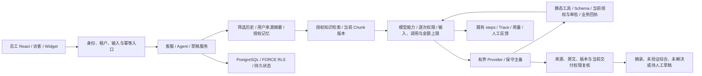

# 全项目深度审查、开源研究与选择性优化

续修：2026-11-13。第 1–18 节保留此前范围与证据；幂等复核见[第 16 节](#16-幂等并发事务与重试链路复核)，知识派发与来源补修见[第 17 节](#17-p0p1-遗留项续修知识派发与敏感来源)、[第 18 节](#18-派发与敏感来源链路复核补修)，本轮租约截止修复与提交范围见[第 19 节](#19-索引租约截止与发布前静态复核)。当前仍要求 0020，迁移未应用，本轮没有新增或修改迁移。

原开源研究轮次日期：2026-11-13。**该轮修复 6 项确认缺陷；静态检查通过不代表真实业务、AI 质量或部署已验收。** 未确认新增 P0，完整物理擦除继续 BLOCKED。没有复制第三方源码、Prompt 或 UI，没有引入上游 Runtime、依赖、迁移或基础设施。

状态口径：FIXED 为源码修改完成；PASS 为列明的静态检查通过；VERIFIED 需要对应实际行为证据，本轮没有业务运行 VERIFIED；NOT_RUN 为未执行；BLOCKED 为缺少安全完整性或外部条件；DEFERRED 为明确延期。历史报告的运行证据不作为当前版本验收证明。

## 1. 基线、范围与职责

- 实际仓库为 `support-agent-platform`，分支 `main`，HEAD `49fc85fbb5ba827507e4a6334a3a4daf995beb73`，起始暂存区为空。进入本轮时已有大量未提交修改、删除和未跟踪成果；先保存 268 个现存发布文件的内容与 SHA-256，再按该脏基线审查本轮增量，没有重置文件。
- 已核对根 AGENTS.md、README、P15、两阶段 Finalization、Prompt Quality、Deep Audit、Final Product Acceptance 和上一轮集中修复记录。旧报告保留当时证据，不改写为本轮成果。
- 全量清单与静态扫描覆盖 106 个应用 Python 模块，以及 scripts/migrations 合计 129 个 Python 文件；36 个 TSX、15 个 TS、15 个旧网页/Widget JS、0001–0019 迁移、ORM/API/Schema、依赖锁、Docker/Compose/Nginx/Actions/Pages 和文档。人工深读聚焦下表调用链及本轮差异，不宣称逐分支形式化证明或全项目无缺陷。
- 主代理负责整合、草稿/网关修复、Langfuse/Phoenix 研究和交付；Terra A 负责 Agent/Prompt/RAG/记忆及三个上游；Terra B 负责后端/权限/数据关系与 Dify/LangGraph；Terra C 负责 React/Demo、Chatwoot 及独立复核。最多 4 个同时活动代理，按文件所有权写入；跨模块修改先交接。

| 模块 | 当前实现与审查重点 |
| --- | --- |
| 身份、租户、发布 | dependencies、identity、tenants、public_delivery、widget_identity；成员/访客分离、会话令牌、企业切换、发布/网站版本、当前权限 |
| 客服业务 | conversations、operations、handoff、desk、attachments；人工接管、连续消息、负责人/优先级/标签/SLA、游标/已读、内部备注、工单和通知 |
| AI 与上下文 | autonomy、prompting、agent_turns、chat、memory、user_memory；任务启发式、完整输入预算、摘要来源、个人记忆、证据与最终交付 |
| 知识与文件 | ingestion、retrieval、search、chunk_versions、vector_index、knowledge、storage/s3_storage；有界召回、版本、不可变文件、处理租约及撤权 |
| 模型与工具 | providers、model_runtime、limits/budgets/costs、tool_protocol/runtime、tool_execution/connectors、approvals；静态绑定、授权/审批、幂等、未知结果和结算 |
| 质量与后台 | drafts、traces、answer_feedback、analytics、background、customer_exports、retention/erasure；人工确认、无正文观察、租约、保留与完整擦除阻断 |
| 产品与交付 | React → Adapter、独立 Demo、旧网页/Widget、Worker、CLI、部署与 wheel 声明；请求代次、账号隔离、真实状态和交付边界 |

## 2. 固定版本的上游源码与许可证

只读访问公开仓库的固定提交、目录树、源码/接口/类型和许可；未运行上游项目。表中是实际选读模块与片段，不是上游全仓安全审计。主代理补读关键实现；源码下载/只读稀疏检出均在本项目外，没有 vendoring。所读源文件未发现覆盖下列结论的额外许可头；这不覆盖未读目录或其依赖。

| 项目与固定 Commit SHA | 实际研究的源码、数据结构或 API | 对应许可边界 |
| --- | --- | --- |
| Chatwoot `1c9991de76419455ce8727de09b33e54c5593645` | [Macro 模型](https://github.com/chatwoot/chatwoot/blob/1c9991de76419455ce8727de09b33e54c5593645/app/models/macro.rb)、`app/controllers/api/v1/accounts/macros_controller.rb`、`app/models/canned_response.rb`、`app/services/conversations/filter_service.rb`、`app/models/message.rb`；账户范围、personal/global、白名单动作、分页与权限基础集合；另只读 enterprise 的 SLA 模型 | [根 LICENSE](https://github.com/chatwoot/chatwoot/blob/1c9991de76419455ce8727de09b33e54c5593645/LICENSE) 的普通目录为 MIT；[enterprise/LICENSE](https://github.com/chatwoot/chatwoot/blob/1c9991de76419455ce8727de09b33e54c5593645/enterprise/LICENSE) 是受限企业许可，未复制或采用该目录代码 |
| Dify `32ee51ca542c10a2c0cec3fb836ef549fc117a22` | [Agent 工具服务](https://github.com/langgenius/dify/blob/32ee51ca542c10a2c0cec3fb836ef549fc117a22/api/services/agent_tool_inner_service.py)、`api/services/app_model_config_service.py`；caller/app tenant 核对、服务端工具运行上下文和按应用类型配置校验 | [LICENSE](https://github.com/langgenius/dify/blob/32ee51ca542c10a2c0cec3fb836ef549fc117a22/LICENSE) 为附加多租户与品牌条件的修改版 Apache-2.0，不能当普通 Apache-2.0 源码移植 |
| RAGFlow `d5cef8388145996a33343190786029733bb98926` | [标题切片实现](https://github.com/infiniflow/ragflow/blob/d5cef8388145996a33343190786029733bb98926/internal/ingestion/component/chunker/title.go) 的标题/列表层级与配置；`internal/service/dataset/search.go` 的 dataset 权限、候选约束和检索入参 | [LICENSE](https://github.com/infiniflow/ragflow/blob/d5cef8388145996a33343190786029733bb98926/LICENSE) Apache-2.0，标题源文件亦有对应许可头。未采用其宽候选参数、问题正文日志或新检索基础设施 |
| FastGPT `d10876f9c047474e62c739e193dc47661fdbadd2` | [多路召回](https://github.com/labring/FastGPT/blob/d10876f9c047474e62c739e193dc47661fdbadd2/packages/service/core/dataset/search/defaultRecall/multiQueryRecall.ts)、`packages/global/core/dataset/search/type.ts`；共同权限/元数据过滤、空交集短路和筛选 Schema | [LICENSE](https://github.com/labring/FastGPT/blob/d10876f9c047474e62c739e193dc47661fdbadd2/LICENSE) 是 Apache-2.0 加商业/标识条件及界面设计声明；所读 packages 文件无单独许可头，未据目录名推断宽松许可 |
| Langfuse `6decf5af5f374c01b56cfc41b60794c8735028bb` | [观察数据结构](https://github.com/langfuse/langfuse/blob/6decf5af5f374c01b56cfc41b60794c8735028bb/packages/shared/src/domain/observations.ts)、`packages/shared/src/domain/scores.ts`、`web/src/features/prompts/server/actions/{createPrompt,getPromptByName}.ts`、`fern/apis/server/definition/prompt-version.yml`；类型/父子关联、Prompt 版本、提交与后续副作用分开、人工评分来源 | [根 LICENSE](https://github.com/langfuse/langfuse/blob/6decf5af5f374c01b56cfc41b60794c8735028bb/LICENSE) 普通目录 MIT；`ee/`、`web/src/ee/`、`worker/src/ee/`、`packages/shared/src/server/ee/` 按 [ee/LICENSE](https://github.com/langfuse/langfuse/blob/6decf5af5f374c01b56cfc41b60794c8735028bb/ee/LICENSE) 受限；本轮所读业务实现位于普通目录 |
| Arize Phoenix `d0b990958abc11a5cbb79fe84fa6153d01a78c3f` | [Span 结构](https://github.com/Arize-ai/phoenix/blob/d0b990958abc11a5cbb79fe84fa6153d01a78c3f/src/phoenix/trace/schemas.py)、`src/phoenix/trace/attributes.py`、`src/phoenix/server/api/types/{Span,SpanAnnotation}.py`、`packages/phoenix-otel/src/phoenix/otel/otel.py`；阶段种类、明确未知状态、注释来源、OTel 适配接口 | [根 LICENSE](https://github.com/Arize-ai/phoenix/blob/d0b990958abc11a5cbb79fe84fa6153d01a78c3f/LICENSE) 为 ELv2；[phoenix-otel/LICENSE](https://github.com/Arize-ai/phoenix/blob/d0b990958abc11a5cbb79fe84fa6153d01a78c3f/packages/phoenix-otel/LICENSE) 为 Apache-2.0。不能用子包许可覆盖根 src；仅参考，不复制 |
| Pydantic AI `db141af6d7c4f215259cb16d6cbf48de73018b76` | [`pydantic_ai_slim/pydantic_ai/_output.py`](https://github.com/pydantic/pydantic-ai/blob/db141af6d7c4f215259cb16d6cbf48de73018b76/pydantic_ai_slim/pydantic_ai/_output.py) 的 OutputSchema、ObjectOutputProcessor、类型到 Schema 和最终验证 | [根 LICENSE](https://github.com/pydantic/pydantic-ai/blob/db141af6d7c4f215259cb16d6cbf48de73018b76/LICENSE) 和 [slim LICENSE](https://github.com/pydantic/pydantic-ai/blob/db141af6d7c4f215259cb16d6cbf48de73018b76/pydantic_ai_slim/LICENSE) 均 MIT；没有引入它的包或输出重试运行时 |
| LangGraph `3183e90eca59850a607d8a4c1b24fa8c5c8a2b69` | [checkpoint 数据结构](https://github.com/langchain-ai/langgraph/blob/3183e90eca59850a607d8a4c1b24fa8c5c8a2b69/libs/checkpoint/langgraph/checkpoint/base/__init__.py)、`libs/langgraph/langgraph/pregel/_loop.py` 的 pending writes、版本与恢复已完成节点的片段 | [checkpoint LICENSE](https://github.com/langchain-ai/langgraph/blob/3183e90eca59850a607d8a4c1b24fa8c5c8a2b69/libs/checkpoint/LICENSE)、[langgraph LICENSE](https://github.com/langchain-ai/langgraph/blob/3183e90eca59850a607d8a4c1b24fa8c5c8a2b69/libs/langgraph/LICENSE) 均 MIT；没有引入编排/checkpoint Runtime |

这些许可核对只用于限定本次研究与零移植决策，不是全部上游依赖的法律合规保证。没有第三方移植文件、提示词或素材，因此没有新增第三方分发清单；本项目及既有依赖授权不变。

## 3. 能力对照与采用决策

| 候选能力 | 分类与本轮决定 | 对照现有实现及落点 |
| --- | --- | --- |
| Chatwoot 收件箱、个人/共享宏 | 仅参考；共享批处理宏 DEFERRED | 已有个人快捷回复/保存视图、负责人、标签、优先级、SLA 和工单；修复现有列表请求竞争与创建防重。共享多动作宏需要服务端权限、逐项状态、幂等、失败回执和审计，未增加半成品入口 |
| Dify Agent 配置/工具边界 | 仅参考 | 已有 Agent 配置版本、发布快照、静态工具、当前租户/授权、Trace；保留本项目更窄的固定服务命令及独立审批，不引入插件 Runtime 或数据库可执行处理器 |
| RAGFlow 文档结构、来源定位 | 仅参考结构设计；来源歧义由本项目重新实现修复 | 已有自然段/标题/页码/表格分隔、generation/修订；本轮补充引用唯一段落与摘要多片段歧义拒绝，不移植 Go 解析器或全量文档平台 |
| FastGPT 多路召回一致过滤、调试 | 仅参考 | 已有 FTS/CJK、pgvector、RRF、有界重排、单点调试/Chunk 历史及来源复核；不新增重复检索入口或无界查询分解 |
| Langfuse Prompt/观察/反馈治理 | 直接借鉴通用的显式版本与状态区分原则，复用现有实现 | `staff.draft` 升至 2，保留静态模板 hash、配置版本、调用和人工反馈；没有增加 Prompt 编辑发布系统或外部观测服务 |
| Phoenix 阶段/未知用量语义 | 适配实现于本项目网关 | 区分已知零次派发和尝试/用量未知，修复 steps→Trace/费用的一致性；没有复制其 Span 代码、OTel exporter 或采集正文 |
| Pydantic AI 类型/输出 Schema | 仅参考 | 当前 Pydantic/JSON Schema 和静态工具绑定已具备；保留最终验证与失败降级，不引入 Schema 修复重试循环 |
| LangGraph 执行恢复 | 仅参考；通用图/自动重试不采用 | ModelCall/ToolExecution、租约、执行回执、一次性审批和业务幂等已持久化；未知结果先协调，不重新执行完成的业务步骤，不声称外部副作用 exactly-once |

没有可证明收益的自动子问题模型、多路扩召回、额外 Reranker 或新业务工具。意图分类仍是显式的本地词法启发式，不能当作已验证语义理解。本轮以修复输入、引用和执行状态为成果，不以新增功能计数。

## 4. 确认缺陷与优先级

| ID / 优先级 / 状态 | 根因及影响 | 修复位置与行为 |
| --- | --- | --- |
| U1 / P1 / FIXED | `contextual_quote` 用首次 substring 定位；同一句出现在不同条件/否定段落时，可能把选中的摘录扩展到错误段落。摘要同一 message 的多个旧片段也会 first-match | `prompting.py`、`services/memory.py`：包含重叠的所有后续匹配都必须完全位于首个段落上下文；否则拒绝。摘要逐一检查同源片段并要求唯一扩展，失败沿 invalid_summary 保留旧水位 |
| U2 / P2 / FIXED | 草稿用最后用户问题，但历史固定 `transcript[:-1]`；末条是人工回复时，当前问题重复进入历史而最新人工回复消失 | `services/drafts.py`、`services/chat.py`：按最后 user 的真实索引拆分；之前的片段作为历史，之后人工原文放独立 `staff_replies_after_question` 字段，避免 role 配对和时间倒置，完整计入输入预算 |
| U3 / P2 / FIXED | 敏感消息直接从草稿 transcript 删除，最新客户问题可能被更早问题替代；新敏感消息也不改变 digest，旧草稿可能继续可用 | `services/drafts.py`：纳入草稿上下文的客户/人工消息若敏感或遮蔽，仅留 ID、role、排除原因，不含正文，参与 digest。最新 user 不可用则明确拒绝生成；较早被排除消息成为历史切分边界，防止后续人工答复错配。React 显示明确中文原因 |
| U4 / P2 / FIXED | 网关持久化 running step 后，Provider 忙/禁用或派发前超时能明确返回 attempts=0，却转抄空 Token；金额/Token 已释放，但费用/Trace 仍显示未知 | `services/model_runtime.py`：仅精确 `attempts == 0` 规范为 0/0、usage_complete=true。None 或实际派发缺 usage 仍未知；失败状态和错误分类不改变，不把“失败”推断为零费用 |
| U5 / P2 / FIXED | 会话列表主动加载/reload 与后台 poll 不共用代次，较旧轮询后返回能覆盖较新队列、状态和排序 | `ChatPage.tsx`：列表加载期间不发新轮询，共享 listEpoch 屏蔽旧响应；保留 AbortController、隐藏页退避和原权限边界 |
| U6 / P2 / FIXED | 新建会话 POST 无服务端幂等键，按钮无创建状态/同步锁，React 更新前快速重复触发可创建多条会话 | `ChatPage.tsx`：同步 ref 锁和创建中禁用，finally 释放。只防同一挂载实例的并发提交；未知结果后的跨刷新/人工重试仍无持久幂等保证，见第 14 节 |

所有修改均由当前源码定位，不来自上游功能数量比较。U1 限制的是引用定位完整性，不证明资料真实或语义正确；U2/U3 的建议仍必须人工审核后才能发送。

## 5. 修复链路、独立复核与兼容性

- U1 同时影响知识引用、摘要读取与更新：含歧义的旧摘要在读取时不再复用；新摘要无效时不推进旧水位；原文、Chunk 和已保存消息不改写。无效回答仍走现有未解决/摘录降级路径，没有再请求模型修复。
- 独立复核发现初稿只从首个段落右边界查重复会漏掉跨边界的重叠匹配，已改为从首个起点 +1 逐次检查。该结论来自逐字符源码推导，没有执行样例或测试。
- U2 初步方案若把后续 assistant 拼到较早历史，会被 `history_rounds` 配对给错误 user；最终用独立原文数组保留时间关系，不改变真实用户问题，不把人工文字提升为知识证据。
- U3 由独立复核继续追踪发现。排除标记只在服务器当前上下文与 digest 中使用，不保存敏感正文副本，也不输入模型；最新问题被排除时在模型调用创建之前拒绝。原消息仍按既有数据保留策略管理。
- 现有 API 允许人工消息元数据带 `redacted`；统一以无正文标记处理，不把被标记的最新 user 静默删除。自动历史遮蔽目前主要发生于非 user 的 AI/草稿来源，二者不混同为已经验证的用户隐私治理。
- U2/U3 仍保留最近 50 条、敏感/来源过滤、会话 digest、当前身份/配置/知识交付复查、人工版本确认与发送幂等。历史片段仍由原完整轮次选择逻辑裁剪，不声称保留全会话；新的必需人工上下文无法容纳时明确拒绝，不截断条件。
- U4 经两位代理核对 Provider 的零尝试与未知尝试路径，并复核 costs/budgets/limits：新行为与原预检拒绝的已知零次语义一致，没有释放未知调用、改价或扩大预算。
- Terra B 只读复核 U1 与 U5/U6；Terra A/C 复核草稿时序和敏感过滤；主代理复核全部本轮差异。最终保留此前 `knowledge_sources` 派发事务绑定、每次主备工具授权检查、文件不可变及消息历史竞争修复。
- 无公共 API、数据库 Schema 或工具契约变化；新增字段只存在于内部 staff Prompt。`staff.draft` 版本 1→2，静态 system hash随模板变化；其余 6 个 Prompt 版本保持，不回填历史记录。
- 旧草稿若此前忽略了敏感/遮蔽消息，重新读取时 digest 将变化并按原机制过期/遮蔽，这是有意保守失效；没有批量修改数据库。干净 transcript 不因该占位策略改变 digest。

## 6. Prompt、Agent 与工具能力

复核全部 8 个模型网关调用位置和 7 个注册 Prompt ID：agent.conversation、agent.knowledge、rag.selection、memory.summary、retrieval.rerank、staff.draft、provider.connection；Embedding 不伪造文本模板。当前注册版本除 agent.knowledge=2、staff.draft=2 外均为 1。

草稿新增指令只解释时间关系、非可信人工数据与不构成执行证明。当前问题和企业职责、证据契约仍分别负责不同层次；不把长历史/工具结果拼入 system，不展示隐藏推理。缺参澄清、简单问题快速结束和复杂问题有界执行沿用现有实现，效果仍 NOT_RUN。

Agent 保留整轮 120 秒、最多 5 次总模型派发（包括摘要/Embedding/重排/主备）及 4 个工具，静态注册/运行时绑定、输入输出 Schema、逐次当前授权、R2/R3 固定命令与必要独立审批、同轮参数重复阻断和持久回执。模型不能注册工具、授予权限、猜测可信资源 ID 或开放 Python/Shell/SQL。

已完成/未知执行不作为新操作自动重试；恢复依靠原记录、状态协调和具体业务幂等。本轮没有新增外部 CRM/订单 Mock，没有把租约协调描述为通用自动恢复。预检提交与真正网络发送之间仍有异步撤权窗口，交付复核继续保留，不能声称已发请求可被事后撤回。

## 7. RAG、知识与记忆

保持现有 PostgreSQL FTS/CJK、单字/多个孤立汉字的有界路径、多知识库授权交集、pgvector 1536 维空间、RRF 和可选完整候选重排；上游的多查询/大候选默认值没有移植。复杂问题不无条件触发额外模型或扩召回。

引用继续使用真实 Chunk UUID、generation/修订、原文与当前授权；U1 新增的是唯一段落门槛，可能使重复措辞资料更多地返回未解决，这是安全取舍，不是召回率提升证明。重复文字在同一完整段落内仍可接受；跨段但语义相同也可能被保守拒绝。没有来源偏移协议，不能猜测模型想引用哪处。

现有切片保留自然边界、标题、页码、列表/表格分隔和有界重叠；未重处理任何现存文档。长表头跨块、多列 PDF、跨段例外及复杂知识冲突仍有限。综合回答继续 `semantic_verified=false`，事实/推断/不确定标签和引用关联不构成语义蕴含证明；无充分证据保持拒答/人工核实和安全摘录降级。

摘要只取用户来源、旧条目重验、合法空选择按既有约定推进；U1 的歧义选择无效时保留水位。个人记忆仍显式同意/保存、本人/企业 RLS、来源版本/有效期、词法相关筛选、预算和逐次撤回检查；工具、助手、内部备注和后续人工回复不会自动变成长期用户事实。不自动写知识库或个人记忆。

## 8. 客服产品与前端

当前闭环入口继续存在：Agent/Provider 配置→知识处理与授权→发布/Widget→访客 AI 问答与引用→追问/工具→转人工→人工期访客连续消息/客服回复→恢复 AI→历史/游标/未读→内部协作/满意度/回答反馈→Trace/运营→个人记忆与保留管理。身份、来源与工具撤权复核在服务端；整体擦除例外仍 BLOCKED。

本轮只改现有工作台与草稿：队列避免旧响应回退，创建请求加在途防重，草稿保留最新人工回复、明确不可生成原因，并用现有 `explain` 显示后台失败分类。没有重复开发快捷回复、保存视图、Chunk 历史、反馈或记忆页面，没有空壳宏、SLA 新引擎或视觉重构。

React 19 / HeroUI v3 / Tailwind v4、既有克制视觉和 reduced-motion 保持。个人草稿/账号/企业通过既有存储键、重挂载和请求代次隔离；浏览器实际操作、滚动/焦点/复制和双端消息并发均 NOT_RUN。

Demo Adapter、虚构数据、重置及 Widget demo 保持不变；正式/Demo 编译别名及产物混入拒绝、Demo CSP `connect-src 'none'` 继续保留。没有执行 Adapter 或用模拟数据冒充真实业务。GitHub Pages 公开入口与手动发布流程保留，未访问或发布当前线上产物，不能确认站点当前内容/可用性。

## 9. Trace、反馈、费用与效率

复用 ModelCall.steps、无正文 Trace、配置与 Prompt 版本、AnswerFeedback；没有新增采集平台。请求受理、上下文/记忆/检索、模型/工具、服务端完成与客户端是否收到继续分别表达；未采集/未知状态不补成功。

U4 使明确零次派发的步骤显示已知 0/0、费用行 `no_external_usage`，与原金额/Token 释放一致；调用仍可失败或超时。未知 attempts/usage/价格不补零；一个调用包含未知步骤时总用量仍未知，已知费用小计独立保留。全零步骤没有计价币种时总额仍可为空，不制造供应商账单。

价格快照、精确模型/端点、金额原子预留、跨日未知占用、主备允许类别及截止时间均未改变。新草稿上下文是完整原文而非缩写，可能占更多预算；不以减少字符或追加 Prompt 宣称省 Token/提速。

性能层面只陈述源码机制：没有新模型调用、Embedding、检索分支或每条消息数据库查询；U5 在列表加载期间跳过后台重复请求，U6 防止并发创建；U1 扫描受现有 Chunk/消息大小及摘要条数上限约束。此前请求内向量复用、批量关联、草稿列表 digest 复用、SSE 有界队列/心跳和文件解析资源限制保留。未测量延迟、资源或准确率，没有百分比结论。

反馈仍是问题→回答/调用→来源→人工分类/状态/修订建议；必须人工确认知识修改，不自动训练或写记忆。没有把结构化评分、模板版本或完整 Trace 当作回答正确证明。

## 10. 数据库、安全与部署影响

本轮没有 ORM/db、迁移、运行角色、权限策略、依赖和部署配置变更。0001–0019 线性链、44 个表、48 个显式索引、37 个 tenant FORCE RLS 声明继续保留；PublicRoute 的公开定位用途与同租户复合关联按既有设计，不机械加策略破坏匿名定位。元数据/离线 SQL 不证明实际库一致或并发安全。

数据关系仍为用户/成员→会话/消息/游标/记忆/协作→调用/工具/草稿/反馈/工单；发布/路由/Widget→访客→会话；知识→文档→代次/Chunk 修订/向量→引用/派生 JSON；文件/附件/导出→本地或 S3→版本/副本/备份。完整图与 0019 升级闸门见 [第一阶段](FINALIZATION_PHASE_1.md) 和 [部署说明](DEPLOYMENT.md)。

个人数据、企业共享会话/知识、审计记录不能按同一所有权删除。RLS 不可见行仍 UNKNOWN；缺少完整主体归属、批准的保留/脱敏政策、跨 JSON/文件版本冻结清单、幂等阶段账本及备份恢复删除抑制，不能证明完整擦除。本轮未解锁任何整体删除，也没有扩大确认集合。

部署静态审查保留 Python 3.11–3.14/PostgreSQL 15+ 声明、Docker 非 root、私有文件、无数据库宿主公开端口、独立迁移凭证、Nginx Host/HTTPS/覆盖代理头/体积限制/SSE 无缓冲，以及 wheel 资源声明。基础 `postgres:17` 不含 vector；现有显式新隔离卷 overlay 使用 `pgvector/pgvector:0.8.7-pg17-bookworm`，不自动替换旧库或启用扩展。镜像存在性/内容、真实权限和升级能力均 NOT_RUN。

Actions 仍只执行静态检查，Pages 仍须手动发布；未触发任何 workflow。Dependabot 配置保持，无依赖安装/升级。第三方授权文件存在不等于全部分发产物合规，当前 CVE/OSV、镜像层和未安装平台包扫描 NOT_RUN。

## 11. 本轮文件、依赖与迁移清单

相对本轮 268 文件脏基线，仅以下文件有增量；不能把整个 Git diff 算作本轮开发：

| 文件 | 本轮增量 |
| --- | --- |
| `src/support_agent/prompting.py` | 引用位置唯一性；staff.draft 版本 2 |
| `src/support_agent/services/memory.py` | 同源多个片段的唯一段落校验 |
| `src/support_agent/services/drafts.py` | 当前问题索引、人工后续上下文、无正文排除标记/digest、删除已被守卫覆盖的死分支 |
| `src/support_agent/services/chat.py` | 可选 staff 原文上下文字段及完整输入预算 |
| `src/support_agent/services/model_runtime.py` | 明确零尝试的用量一致性 |
| `frontend/src/features/chat/ChatPage.tsx` | 列表代次与创建在途防重 |
| `frontend/src/features/chat/ReplySuggestions.tsx` | 后台草稿错误通过现有映射显示 |
| `frontend/src/adapters/errors.ts` | 最新客户问题不可用于草稿的中文解释 |
| `docs/COMPREHENSIVE_AUDIT_AND_UPGRADE.md` | 本报告（新增） |
| `docs/OPEN_SOURCE_REUSE.md` | 固定版本研究记录入口 |
| `README.md` | 本轮交付入口 |

依赖新增/升级 0，锁文件变更 0，迁移新增/修改 0，数据/备份操作 0，测试体系变更 0。P15、Finalization、Deep Audit、Prompt Quality、Final Product Acceptance 和上一轮集中修复报告均保持。

## 12. 实际静态检查与证据

| 检查 | 结果与限制 |
| --- | --- |
| `.venv/bin/python scripts/check.py` | PASS：Ruff lint/format，169 个格式目标；129 个 Python AST，19 项线性迁移、离线 SQL/外键唯一目标/索引名/RLS 声明；脚本不连数据库 |
| `npm run check --prefix frontend` | PASS：tsc --noEmit，无 React 构建或运行 |
| Python 3.11 AST | PASS：129 文件 feature_version=3.11；不是多个 Python 解释器运行矩阵 |
| API / JSON Schema 元数据 | PASS：169 个本模块声明的 Pydantic 类、8 个静态工具字典声明经 JSON Schema 检查；仅导入元数据，未构造业务样例/调用处理器。OpenAPI 为 16 routers、127 paths、174 operations、159 schemas，无应用实例/HTTP |
| PostgreSQL 方言 | PASS：44 表、48 显式索引编译；无 SQL 执行，不能证明实际数据满足约束 |
| Prompt 调用点 | PASS：8 处 complete 均声明 messages/prompt_id，注册 7 ID；staff.draft=2 与本轮模板一致；Embedding 无文本版本 |
| 顶层本地依赖图 | PASS：106 个模块的 AST 直接导入图无环；函数内延迟依赖另作调用链审查，不声称全运行图无环 |
| 依赖锁/许可元数据 | PASS：42 外部 uv 锁包；40 本机精确版本及声明授权文件存在，greenlet/tzdata 未安装。npm 214 锁条目、根直接依赖一致、非根许可字段存在；没有安装依赖或查实时漏洞库 |
| YAML / Shell | PASS：6 个 Compose/Actions/Dependabot YAML 解析；sh -n 检查 local-postgres.sh，未执行脚本或 Compose |
| Actions 固定引用 | PASS：8 处引用/6 个不同 action 为 40 位 SHA；只读核对指定上游仓库提交存在性，不证明 action 内容安全或签名可信，未触发任务 |
| JavaScript / HTML / 发布文件 | PASS：scripts/check_delivery.py 退出 0；269 个发布文件，node --check、静态模块链接（无 evaluate）、HTML 资源、本地 Markdown 链接和已知秘密模式；React 产物/wheel NOT_RUN |
| 安全与权限调用链 | 定点审查模型/工具/历史/草稿/文件交付、固定子进程及动态执行/HTML 注入模式；宽模式命中函数名 retrieval 属误报，没有新增任意执行入口；不等同完整安全证明 |
| 基线保护 / Diff | PASS：10 个基线文件修改、1 个新增报告，无基线文件删除；62 个受保护文件散列不变，HEAD 不变、暂存区为空；git diff --check 及本轮文本行尾检查通过 |

检查只生成元数据或离线声明，没有运行测试、业务样例、Provider/Adapter 探针、API、Worker、服务、数据库或真实模型。静态检查命令用本地已有 `.venv` 与 Node，不因没有 uv CLI 安装工具。

## 13. BLOCKED、NOT_RUN 与后续人工验收

| 状态 | 项目与必要条件 |
| --- | --- |
| BLOCKED | 整体会话/用户/客户/知识完整物理擦除、S3 全版本/副本/对象锁/备份：需批准的主体/共享归属和留存规则，RLS 下完整枚举证明，跨介质冻结清单、幂等恢复账本及备份恢复抑制；不绕过 RLS 或使用超级用户 |
| BLOCKED | 外部 CRM/订单/通知副作用的通用恢复：缺少获准数据源、服务契约、审批/幂等/回执及结果核对，不能用 Mock 代替 |
| NOT_RUN | 模型意图/规划/工具选择、复杂中文/指代/冲突/多文档综合、真实 Token/费用/时延；须先明确 Provider、模型、Endpoint、隐私和费用上限授权 |
| NOT_RUN | 数据库迁移应用、RLS 行为、约束升级、锁/并发、租约/进程中断、文件/S3/导出恢复；须另授权全新隔离库/路径/卷、合成数据和具体人工操作 |
| NOT_RUN | React/Widget/访客/人工双端、草稿新输入和错误提示、Demo 重置/隔离/CSP、线上 Pages；须单独浏览器人工验收，不创建自动化套件 |
| NOT_RUN | 测试、构建、服务、容器、真实连接诊断、VPS、wheel/镜像实际产物、推送/发布/部署；本轮均禁止且未执行 |
| NOT_RUN | 当前漏洞公告全覆盖、镜像层扫描、二进制分发授权、Action 签名和供应链安全；提交存在性不替代这些证据 |

未来人工验收可以围绕重复引用定位、末条人工回复、最新敏感客户消息、零尝试/未知尝试、列表乱序响应和双击创建逐项保留实际证据；只有获得对应明确授权后开展，不把人工项目包装为测试套件。本轮没有为这些场景保存夹具、测试代码或执行样例。

## 14. 遗留技术债与成熟度

- **原轮 DEFERRED → 续修 FIXED（源码）**：创建会话持久幂等已按第 15 节补齐；新增迁移未应用，并发及中断恢复未作运行验收，不能将其标记 VERIFIED。
- **DEFERRED**：共享多操作客服宏、通用 Agent checkpoint/自动恢复、多查询语义规划；当前需求已有窄能力，新增须证明收益并完整治理权限、回执和失败。
- **DEFERRED/NOT_RUN**：通用语义验证、复杂条件与跨段上下文、长表和多列 PDF、词法记忆漏选、超长摘要源的可恢复分片、供应商账单对账；不能用本轮定位/预算改进代替真实评估。
- 引用歧义现在保守拒绝；敏感识别仍是有限模式，不能当完整 DLP。较早被排除消息之前的草稿历史会被舍弃，当前客户问题和可用后续人工消息优先，仍须人工核实上下文。
- 运行步骤提交后的知识依赖是保守的派发准备记录，不证明 Provider 已收到；attempts=0 可能保留来源依赖。没有为减少误失效而删除安全依赖，预检与网络之间的异步撤权窗口仍保留明确边界。

当前判断为：**有界运行、权限与来源治理的源码路径继续完善，本轮确认缺陷已完成修复并进入静态交付；真实可用性、AI 效果和生产成熟度尚未验收。** 不宣称所有已知风险消失。完成后停止，等待用户审阅；没有提交、推送或部署。

## 15. 续修：会话创建服务端幂等与客户端恢复

2026-11-13，在当前 `main` / `49fc85fbb5ba827507e4a6334a3a4daf995beb73` 及 269 文件脏基线继续。执行前保存本轮文件快照，未重置或覆盖其他修改；本轮不启用子代理。优先处理 U6 的服务端缺口及其客户端契约，没有扩展模型、检索或删除范围。

### 修复与契约

| 状态 | 缺陷与改动 |
| --- | --- |
| FIXED / U6 | 原员工创建服务直接插入随机 ID，会话缺少持久请求身份。现在 `ConversationCreate.idempotency_key` 为必填 UUID；按企业 + 创建人 + 键持久去重，输入摘要基于版本 1 及规范化 subject/channel；同键不同输入 409，同输入返回同一会话当前状态，不恢复创建时字段 |
| FIXED / U6 | 先沿用 locked_staff_context 的授权门及 Session/成员/企业复核，再拿请求范围事务锁；创建、请求身份与首次审计原子提交，唯一约束兜底。重放记 conversation.create_replay，不伪造第二次创建审计；无输入正文/请求键/摘要复制到审计 |
| FIXED / U6 | React 与旧网页复用现有 requestIdentity/sessionState，未确认键按 mode/企业/用户/输入摘要分别保存；修改标题再改回仍可复用。同步在途锁在异步摘要之前设置；React 创建期间禁用标题输入，创建按钮和 submit 处理器条件一致；旧界面也有同步锁 |
| FIXED / U6 | 仅收到成功创建响应后清键，不因超时/未知结果换键或自动重试。正常标签页存储下刷新后重新提交相同输入仍用原键；存储不可写时沿用内存回退并在请求失败时明确提醒不要刷新、先核对列表 |
| FIXED / U7 | 旧网页 storage.set 失败时新键只在内存，get 恢复可读后可能返回旧盘值；remove 失败时已确认旧键也会重现。同步 React 已有 volatile 集合与删除标记，避免这两条路径；不移动或删除其他存储内容 |
| FIXED / 契约 | Demo 独立模拟必填键、输入冲突、当前状态重放及虚构请求收据；记录只在本地 Demo state，不返回内部收据、不访问 API/数据库/模型。删除通用 POST 中已不可达的会话默认分支；管理信息声明同步 0020 |

服务端不从当前可变标题倒推原始输入，不以请求键代替授权；不同创建人使用同一键是独立范围，不能由此读出他人的会话。每次重放均走现有 FORCE RLS 和当前员工授权。ConversationOut 字段不变，不公开内部键/摘要；首次与重放均沿用 201。API 缺键返回 422，这是有意的输入契约变更，外部调用方必须升级，不提供不受保护的隐式随机键降级。

### 数据和升级影响

仅新增 [0020_conversation_idempotency.py](../migrations/versions/0020_conversation_idempotency.py)：两个可空列、一个复合唯一约束和一个成对非空/摘要格式 CHECK；44 张表、48 个显式索引及 37 张租户 RLS 表数量不变（唯一约束的数据库支撑索引另计）。0001–0019 内容不变，无历史回填，不推测旧请求身份。访客创建依然走独立认证入口，新增列保持双 NULL；没有给访客开放员工创建或重放。

当前预期 revision 改为 0020。新旧代码与数据库必须协调升级，不能混跑或跳过 head 检查。迁移索引创建会有扫描及锁开销，不能声称无停机；操作员须另行审查、备份、排空并取得授权。运行角色不增加 DDL/BYPASSRLS 等权限。0020 的 downgrade 明确阻断，防止无审查丢弃已接受请求身份。详细契约与保留边界见[部署说明](DEPLOYMENT.md#会话创建幂等升级0020未执行)。

幂等身份随会话保留，独立于可到期删除的审计，不新增 TTL 或后台清理。将来物理删除必须先明确幂等墓碑及删除后重放规则。全部完整擦除、S3 版本/副本/备份清理继续 BLOCKED，RLS 不可见数据继续 UNKNOWN；擦除、保留服务本轮未改。

### 本轮增量与静态证据

相对 269 文件基线，本轮仅修改 13 文件、新增 1 文件，无基线文件删除：

- 服务端：schemas.py、models.py、db.py、services/conversations.py，新增 migrations/versions/0020_conversation_idempotency.py。
- React/Demo：frontend/src/features/chat/ChatPage.tsx、frontend/src/adapters/demo.ts、frontend/src/adapters/errors.ts。
- 旧界面：src/support_agent/web/chat.js、api.js、storage.js。
- 文档：README.md、docs/DEPLOYMENT.md、本报告；其他历史报告保持原证据。

没有新增依赖、锁文件或测试体系；0019 及以前迁移、其他服务、RLS、运行角色和配置未改。未提交、推送或部署。

| 检查 | 结果 |
| --- | --- |
| .venv/bin/python scripts/check.py | PASS：Ruff lint/format，171 个格式目标；130 Python AST、20 个线性迁移、完整离线 SQL/RLS/FK/唯一目标/索引名声明。运行行为明确 NEEDS_RUNTIME_VERIFICATION |
| npm run check --prefix frontend | PASS：tsc --noEmit，无构建 |
| API/JSON Schema 元数据 | PASS：ConversationCreate 必填 UUID、POST 请求体必填、ConversationOut 无内部键/摘要；仅元数据导入和 OpenAPI 生成，无处理器调用 |
| PostgreSQL DDL / 0020 离线 SQL | PASS：44 表及显式索引方言编译；0019→0020 SQL 仅加两列、约束和 Alembic revision 更新，无 RLS/授权变更；无 SQL 执行 |
| Python 3.11 AST | PASS：130 文件，feature_version=3.11；无业务样例或运行时探针 |
| JS/资源/文档与已知秘密模式 | PASS：scripts/check_delivery.py 退出 0；270 个发布文件，node --check、静态模块链接（无 evaluate）、HTML 资源、本地 Markdown 链接与已知秘密模式；React 产物/wheel NOT_RUN |
| Git / 基线保护 | PASS：13 个基线文件修改、1 个新增迁移，256 个基线文件散列不变，无文件删除；历史迁移/锁文件/其他报告不变，HEAD 不变、暂存区为空；git diff --check 与本轮文本空白检查通过 |

### 未验收与保留限制

- NOT_RUN：实际数据库迁移、运行角色、并发排队/唯一冲突、事务中断/提交结果未知、撤权和锁顺序运行行为；需另行授权新隔离库及具体人工操作。
- NOT_RUN：React/旧网页刷新、存储受限恢复、账号切换、Demo 请求重放及重置、真实浏览器交互；没有执行 Adapter 或业务样例。
- NOT_RUN：测试、构建、服务、数据库、模型、VPS、推送/发布/部署。本轮只给出源码和静态声明证据，没有 VERIFIED 运行结论。
- 客户端必须复用同一个操作键。清理浏览器存储、显式退出登录（既有 pending 清理）、关闭标签页或跨设备新建操作无法恢复原键；不按相同标题永久合并独立意图。错误不会被自动补发，不能把服务端持久约束宣传成客户端任意换键也绝不重复。
- 上一轮其余模型效果/语义验证、长表/跨段条件、摘要分片、外部业务恢复和供应商对账仍缺少明确可证明的通用修复或必要授权，保持既定 DEFERRED/NOT_RUN/BLOCKED，不用增加 Prompt、无界召回或临时框架掩盖限制。

## 16. 幂等并发、事务与重试链路复核

2026-11-13，在 `main` / `49fc85fbb5ba827507e4a6334a3a4daf995beb73`、270 文件脏基线上继续；修改前保存内容与散列，无子代理、无重置。复核创建路由→Schema→授权门→请求锁→查重/插入→审计→get_db 提交，以及 React/旧网页→存储→API Client→JSON/SSE→清键链路；其余历史源码成果保留。

### 确认缺陷与修复

| 编号 / 状态 | 根因与源码修复 |
| --- | --- |
| I1 / P1 / FIXED | 应用未声明事务隔离级别，依赖数据库默认。若默认 RR，认证查询已经建立旧快照，请求锁释放不刷新快照，后续查重可能唯一冲突、权限复核也可能读旧状态。db.py 显式 READ COMMITTED，维持锁后重新读取的设计前提；导出已有的独立 RR 事务未改 |
| I2 / P1 / FIXED | locked_staff_context 在请求锁等待前完成校验；授权门阻止并发撤销，却无法停止 Session 自然到期。取得请求锁后再次 resume_context，再查重/写入；过期即拒绝，保持授权门→请求锁顺序和原事务 |
| I3 / P2 / FIXED | React 离开页面后创建响应仍可返回，原先先清键、再看 alive，导致未展示结果的操作丢失稳定重试身份。当前页面/旧 ctx 校验移到清键之前；迟到结果不清键、不清标题、不更新 UI |
| I4 / P2 / FIXED | 泛型 API 返回值没有运行时结构验证，成功但空/不完整 JSON 会先清键、再在打开详情时失败。两个创建入口现在确认合法会话 UUID、企业和创建人匹配后才清键；不符保持未知及原键，不渲染该会话。该检查不替代服务端授权 |
| I5 / P2 / FIXED | 旧界面把 POST、列表刷新和详情加载放在同一失败分支；GET 失败看起来像未创建，且列表失败阻止打开。明确通知已确认创建；列表失败仍尝试详情，后续失败不再当作创建失败，ctx 失效后不再启动详情读请求 |
| I6 / P1 / FIXED | SSE 终态后 readEvents 的 finally 仍 await reader.cancel；期间切换账号/取消后，原 React Client 可正常返回旧终态；两个 Client 也未统一检查调用方取消。API Client 在 JSON/Blob/事件与最终返回处复核取消/代次，React SSE 释放流后补复核，避免过期成功结果清除人工/AI 消息请求键或更新旧状态 |

I1 的快照推导依据 [PostgreSQL 事务隔离](https://www.postgresql.org/docs/current/transaction-iso.html)和 [SQLAlchemy 隔离参数](https://docs.sqlalchemy.org/en/20/dialects/postgresql.html#transaction-isolation-level)，不是运行验证或“数据库曾配置错误”的断言。额外锁后身份校验会增加有界数据库读取，没有测量或宣称性能提升。

### 并发与权限结论（源码审查）

| 路径 | 当前约束与边界 |
| --- | --- |
| 同企业/创建人/键并发 | 同一事务请求锁串行化；RC 下第二个查询看先提交记录；同摘要返回原会话当前状态，不改状态/负责人；不同摘要 409。唯一约束独立兜底，哈希锁冲突只会额外串行，不扩大查重范围 |
| 不同企业/创建人 | 请求锁键和查重条件都含二者，created_by 取服务端上下文，tenant_id 继续 FORCE RLS；UUID 键不授予读权限。访客上下文在授权门入口拒绝，公开创建仍走原独立路径 |
| 撤权/到期 | 用户/企业授权门先于请求锁；排在撤销提交之后的请求重验身份；已经持门的命令与撤销串行。锁后补自然到期复核，不声称到期或取消可撤回已提交命令 |
| 插入/审计/序列化失败 | create 不自行 commit，get_db 的 function scope 先提交再发送响应，异常回滚；审计和请求身份同事务。本机已安装 FastAPI routing.request_response 与 dependencies.utils 的退出栈源码确认该顺序，未运行路由 |
| 提交成功但响应丢失 | 客户端保留原键并显式重试；记录独立于可到期的审计保留。连接故障可能令提交结果未知，服务端不自动重试，也不凭异常释放客户端身份 |
| 页面离开/取消/终态释放 | 未被当前页面确认的创建响应保留键；SSE 最终返回前复核代次/取消。停止接收不代表服务端停止或回滚，终态需用原记录核对 |
| 已确认 POST 后 GET 失败 | 已创建与后续加载分别提示；不生成新的 POST、键或自动补发。正常存储下同输入的未决键继续支持刷新重试；关闭标签页、退出清理、跨设备仍不保证找回键 |

数据库实际隔离、锁等待/死锁、断连提交、RLS、撤权与双端行为均仍 NOT_RUN。Schema、ORM、0001–0020、FORCE RLS、角色与依赖本轮不变，未新增迁移，也未应用 0020。不能把本表标记为并发 VERIFIED。

### 本轮文件与检查

仅改动 8 个基线文件，无新增/删除：src/support_agent/db.py、services/conversations.py、web/api.js、web/chat.js，frontend/src/adapters/api.ts、features/chat/ChatPage.tsx，docs/DEPLOYMENT.md 和本报告。其余 262 个基线文件保持；无依赖/锁文件/测试体系变化，HEAD 不变、暂存区为空。

| 检查 | 实际结果 |
| --- | --- |
| Ruff / AST / 离线迁移 | PASS：scripts/check.py，171 格式目标、130 Python 文件、20 线性迁移及离线 SQL/RLS/FK/唯一目标/索引声明；未连数据库 |
| TypeScript | PASS：最终源码 npm run check --prefix frontend 退出 0，仅 tsc --noEmit |
| 元数据、源码与发布检查 | PASS：目标 OpenAPI/JSON Schema 必填 UUID 与私有字段排除；44 表/48 显式索引 PostgreSQL 编译、37 RLS 声明、130 文件 Python 3.11 AST；AST 确认锁后 resume、无 create 内 commit 及显式 RC。check_delivery.py 退出 0，270 发布文件的 JS 语法/静态链接（无 evaluate）、HTML/本地文档链接及已知秘密模式通过；React 产物/wheel NOT_RUN |
| Git / 基线保护 | PASS：8 个基线文件修改、262 个文件散列不变，无新增/删除；所有迁移、ORM、Schema、RLS/preflight、锁文件及其他报告不变；HEAD 不变、暂存区为空，git diff --check 与修改文本空白检查通过 |

本轮同时处理了报告中消息取消/过期响应的源码缺口 I6。语义验证、长表/跨段条件、词法记忆效果、超长摘要分片、外部业务恢复及账单对账仍缺少可证明的通用修复或必要证据，保持 DEFERRED/NOT_RUN/BLOCKED；未靠扩大召回、额外模型或新框架替代。完整物理擦除、S3 版本/副本和备份清理继续 BLOCKED，RLS 不可见数据 UNKNOWN。

所有运行验收、测试、构建、服务、数据库、模型、VPS、提交/推送/部署均未执行；本轮仅交付源码修复与静态证据，完成后停止等待审阅。

## 17. P0/P1 遗留项续修：知识派发与敏感来源

2026-11-13，以 main / `49fc85fbb5ba827507e4a6334a3a4daf995beb73` 及当前 270 文件脏基线继续；修改前保存内容及散列。未重复实现第 15–16 节会话幂等。针对报告中的间接数据交付、未知执行结果和知识撤权边界，复核模型网关、金额/Token 预留结算、工具授权与审批、后台索引、检索/引用、摘要和个人记忆、历史与导出调用链；没有重新宣称全项目无缺陷，也没有执行这些业务函数。

### 确认缺陷

| 编号 / 优先级 / 状态 | 根因、修复和边界 |
| --- | --- |
| K1 / P1 / FIXED | `vector_index.process_one` 读取已发布 Chunk 后提交，再把其原文交给 Embedding；没有将 Chunk ID 传给网关。后台调用的知识依赖为空，故文档在两事务之间撤回、重处理或修订时，派发前无法校验该来源，结果发布复核无法收回已外发内容。现传入 `knowledge_sources=(cid,)`，复用派发事务内的来源绑定、当前授权/发布/generation/当前修订校验。失败走原预检拒绝与 FAILED 记录，不发 Provider、不预留费用；原文、索引版本、租约和显式重试规则不变 |
| K2 / P1 / FIXED | `reference_is_safe` 仅检查注入模式；已有凭证模式检查用于摘要/记忆/索引，却未覆盖词法/CJK 及向量结果、知识工具和历史引用。已发布的含已知凭证 Chunk 因而仍可能进入模型输入或摘录回复。复用 `memory.sensitive` 加入统一来源筛查；`current_chunks` 同样过滤不安全原文，使既有回答/缓存工具结果的当前来源复核也拒绝该来源。只阻断交付，不删除或修改文档、Chunk、消息及向量 |

没有确认新增 P0；此结论不证明不存在 P0。K1 不消除短事务提交至外部网络派发之间的异步撤权窗口，不能声称已派发内容可撤回。K2 是保守的已知模式筛查，可能排除示例文本；不能保证识别任意隐私数据、变形凭证或提示词注入。具有原文编辑权限的人员仍可通过知识管理修订来源；本轮没有扩大编辑、访客或运行角色权限。

### 调用链与兼容性

- K1：后台 `background.model_call` 初始化来源版本 → 网关同事务 bind → `delivery_error` → `current_citations` → `current_chunks(current_only=True, lock=True)` → 既有金额/Token 预留 → 提交 → Provider。来源失效在预检处拒绝，后续失败记录不包含原文。付费结果未知仍保留既有预留，不自动重试。
- K2：FTS/CJK、向量召回、重排候选、知识工具和新引用复用统一筛查；历史消息、重放、草稿及客户导出的当前来源复核经 `current_chunks` 失效。受影响的旧回答/工具结果可能被现有交付逻辑遮蔽或拒绝，这是有意的安全失效，不回写历史内容。直接的原文管理权限与知识对话交付权限继续区分。
- 没有新增调用、扩大候选范围或加入 DLP/模型服务；复用已编译的模式。没有性能测量，不声明提升比例。
- API、ORM、0001–0020、FORCE RLS、锁顺序、Provider/工具契约、Prompt 版本与依赖保持；无升级操作，0020 仍未执行。会话幂等与客户端取消/迟到结果成果保留。

### 文件与静态证据

本轮仅修改 `src/support_agent/services/vector_index.py`、`src/support_agent/retrieval.py` 和本报告；其余 267 个基线文件保持。没有新增/删除文件，HEAD 不变、暂存区为空。

| 检查 | 实际结果 |
| --- | --- |
| Ruff / AST / 离线迁移 | PASS：`scripts/check.py` 退出 0，171 格式目标、130 Python 文件、20 线性迁移及离线 SQL/RLS/FK/唯一目标/索引声明；未连接数据库 |
| TypeScript | PASS：`npm run check --prefix frontend` 退出 0，仅 `tsc --noEmit`；前端未修改 |
| 来源与元数据 | PASS：AST 核对索引调用传递具体 cid、网关 bind/来源复核在预留和 Provider 前、统一筛查用于当前来源返回；106 应用模块 Python 3.11 AST，44 表/48 显式索引 PostgreSQL DDL 编译、37 RLS 声明。没有执行检索、Worker、Provider 或业务样例 |
| 交付与工作区 | PASS：`scripts/check_delivery.py` 退出 0，270 发布文件的 JS 语法/静态模块链接（无 evaluate）、HTML/本地文档链接及已知秘密模式；`git diff --check`、本轮文本空白及基线散列核对通过 |

### 未验收与遗留

- NOT_RUN：撤回/修订与派发的实际并发、拒绝后的索引状态、历史遮蔽、RLS/约束/迁移、数据库隔离和运行角色、检索效果及性能；需另行授权隔离人工验收。
- NOT_RUN：测试、构建、服务、数据库连接/操作、真实模型、浏览器、VPS、CI/Pages、推送及部署；没有业务运行 VERIFIED 结论。
- BLOCKED：完整会话/用户/知识物理擦除、S3 全版本/副本/备份清理；RLS 不可见数据仍 UNKNOWN。主体归属/留存、冻结清单、完整枚举与恢复账本缺口未因本轮筛查而解除。
- DEFERRED/NOT_RUN：通用语义验证、复杂条件与长表、超长摘要可恢复分片、词法记忆效果、共享多操作宏/通用 checkpoint、外部副作用恢复及供应商账单核对。当前没有足以支持安全通用实现或效果验收的证据，不以新增框架、扩大召回或放宽权限代替。

本轮交付后停止，等待审阅；不自动进行运行验收或发布。

## 18. 派发与敏感来源链路复核补修

2026-11-13，继续以 main / `49fc85fbb5ba827507e4a6334a3a4daf995beb73`、270 个现存文件为基线，修改前保存内容与散列；保护全部既有未提交修改，无子代理。聚焦第 17 节 K1/K2，未重复实现会话幂等。复核后台索引 → 模型网关 → 当前来源/索引授权 → 预留/Provider → 结果发布，以及 FTS/CJK/向量 → 重排/引用 → 历史/草稿/交接/客户导出链路；补读费用预留、个人记忆和无正文 Trace，未执行业务函数。

### 本轮确认缺陷

| 编号 / 优先级 / 状态 | 根因与源码修复 |
| --- | --- |
| K3 / P1 / FIXED | K1 校验了 Chunk 当前修订/generation、发布与知识授权，但索引启用、版本、租约和管理员身份只在前一事务读取、结果发布时复核。两事务间索引被禁用/重配、租约被替换或提交人降为成员时，旧任务仍可能派发付费 Embedding。创建后台 ModelCall 时持久绑定索引 ID/version/lease_token；每次后台 Embedding 派发在来源锁后取得同租户索引锁，再复核管理员与 Session、索引状态/版本/租约及到期、Agent、请求人/原 Session、模型和精确 Endpoint。不符走既有 preflight denied，尚未进入单次费用/Token 预留及 Provider |
| K4 / P1 / FIXED | K2 只检查 Chunk 正文，检索结果及引用另带文件名和 section；上传允许这些字段包含已知凭证模式，章节标题还会延续至正文已不含标题的切片，故历史引用、交接来源等仍可能泄漏这些字段。reference_is_safe 增加可选文件名/章节字段，FTS、CJK、向量候选及 current_chunks 均传入完整来源字段，统一保守筛查；既有正文调用契约仍可用。不安全来源从新召回及历史交付复核中失效，不修改保存的原文、引用、消息或向量 |

没有确认新增 P0，此结论不证明全项目不存在 P0。K3 和 K4 均为源码修复，不是实际并发或泄漏拦截 VERIFIED。

### 事务、交付及兼容性复核

- 后台索引派发顺序为既有身份授权门 → ModelCall → Agent → 来源 KB/Document → KnowledgeIndex → 单次金额/Token 预留 → 提交 → Provider。ensure_dispatch 放在原来源复核之后，不先锁索引再反向锁来源；管理员/Session 校验在索引锁等待后重新读取。索引锁与配置/排队/租约更新串行，授权门继续与账号/成员撤销串行。事务提交至网络派发后的异步撤权窗口仍存在，不能追回已外发内容。
- 绑定仅增加后台 ModelCall.result 的服务端索引快照，不含文档正文或凭证；没有 API/ORM/迁移/权限变更。缺少或格式无效的旧索引快照拒绝派发，不猜测当前索引、不自动恢复未知付费调用。前台 query_embedding 仍沿原搜索调用路径，不要求后台租约或管理员；本轮没有把后台身份条件施加给访客查询。
- K1 的具体 Chunk 绑定及当前修订复核保留；派发期间撤回/修订后的结果发布仍走原二次校验。失败保留原索引/调用错误与审计，租约不符时不覆盖后来任务，未知费用预留不改为零。
- current_chunks 同时服务历史 current_citations、缓存 knowledge_search 工具结果、草稿来源与反馈来源；会话历史再供访客交付及客户导出/缓存下载复核，人工交接包也调用 current_citations。新模型输入/草稿使用当前修订；历史交付仍允许原有有效谱系内的不可变旧修订，K4 增加来源字段筛查，没有将历史追溯机械改成最新文本。
- 原文管理/修订权限保持，筛查只用于知识参与召回及相关交付。模式可能排除凭证示例或标题；不提供通用 DLP、语义注入检测、任意个人信息分类保证。没有扩大召回候选、增加模型调用或依赖，没有性能比例声明。
- 对报告其他 P0/P1 遗留，核对了无正文 Trace、历史导出复核、个人记忆来源和未知费用跨窗口保留；未发现足以直接修复的新增高置信缺陷，保持既有实现，不引入推测性改造。外部账单对账、语义质量与完整擦除所缺证据仍不能由源码补齐。

### 本轮文件与静态检查

仅修改 5 个基线文件：src/support_agent/services/vector_index.py、services/model_runtime.py、services/search.py、src/support_agent/retrieval.py 和本报告；其余 265 个基线文件不变，无新增/删除。所有迁移、ORM、RLS、Schema、前端、依赖与锁文件及此前其他报告保持；HEAD 不变、暂存区为空。

| 检查 | 实际结果 |
| --- | --- |
| Ruff / Python AST / 离线迁移 | PASS：scripts/check.py 退出 0，171 格式目标、130 Python 文件、20 个线性迁移及离线 SQL/RLS/FK/唯一目标/索引声明；没有数据库连接 |
| TypeScript | PASS：npm run check --prefix frontend 退出 0，仅 tsc --noEmit；前端未修改 |
| 调用顺序与元数据 | PASS：AST 列出派发来源绑定/复核、ensure_dispatch、预留及 Provider 的位置，四处完整来源字段调用；106 应用模块 Python 3.11 AST，44 表/48 显式索引 PostgreSQL DDL 编译、37 RLS 声明。仅解析源码、导入声明元数据和编译，不运行 Worker、检索或 Provider |
| 发布与基线 | PASS：scripts/check_delivery.py 退出 0，270 发布文件的 JS 语法/静态链接（无 evaluate）、HTML/文档本地链接及已知秘密模式检查；git diff --check、本轮文本空白及散列比对通过 |

NOT_RUN：索引禁用/重配、管理员降权、Session 到期与派发的真实竞态，索引/调用失败状态、历史与缓存遮蔽、RLS/数据库行为、迁移应用和模型效果；测试、构建、服务、数据库连接/操作、浏览器、Provider/Adapter 执行、真实模型、VPS、CI/Pages、提交、推送及部署均未执行。静态检查不能确认实际可用性。

BLOCKED：完整会话/用户/知识物理擦除、S3 全版本/副本/备份清理；RLS 不可见数据 UNKNOWN，不绕过 RLS、不扩大角色权限。外部副作用恢复/供应商账单对账、通用语义验证、长表和复杂上下文等原有 DEFERRED/NOT_RUN 边界保持。

本轮交付后停止，等待审阅；不自动进行运行验收或发布。

## 19. 索引租约截止与发布前静态复核

2026-11-13，在 main / `49fc85fbb5ba827507e4a6334a3a4daf995beb73` 的 270 个现存文件基线上继续；修改前保存内容及散列。核对第 18 节索引快照/租约/身份、来源字段筛查与历史交付，补读 Provider 超时、金额/Token 预留、工具缓存与报告遗留项。没有子代理或业务函数运行。

| 编号 / 优先级 / 状态 | 根因与源码修复 |
| --- | --- |
| K5 / P1 / FIXED | K3 在锁内确认索引租约尚未到期，但 Provider 的执行期限只取请求期限及 ModelCall 租约；预检等待后，后台 Embedding 仍可能获准执行到索引租约之外。ensure_dispatch 返回已锁定的 lease_until，网关将其剩余时间转换为 monotonic 截止时间，与原请求期限取较早值。既有预留前检查和提交后、Provider 前检查共享该期限：等待会消耗租约，剩余不足 1 秒不派发，否则 Provider 超时不超过剩余整秒 |

K5 没有延长索引/ModelCall 租约、增加重试或放宽审批。派发前耗尽沿现有 attempts=0 / 已知零用量结算；已派发后超时/断连仍保留未知用量及费用，不因租约到期推断为零。时钟跳变、进程终止延迟、供应商是否继续执行及实际竞态未验收；不能保证到期撤销上游处理或外部 exactly-once。

### 复核结果与遗留边界

- PASS（源码审查）：索引快照缺失/无效拒绝，tenant/Agent/请求人/原 Session/管理员、启用/版本/租约 token 与时效、模型和 Endpoint 检查保留；来源检查仍先于索引锁，未改变锁顺序、来源绑定和结果发布复核。
- PASS（源码审查）：FTS、CJK、向量和 current_chunks 均传入正文、文件名及 section。历史 current_citations、缓存知识工具、草稿、交接与会话历史/访客/客户导出复核继续经过该入口；本轮未确认新的字段绕过，不重复修改第 18 节。原文编辑权限与原始历史保持，已知模式筛查仍不是完整 DLP。
- 复核费用预留/Token 结算及 Provider 固定单次请求路径，未确认其他可直接修复的 P0/P1；这不是全项目无缺陷证明。语义验证、长表/复杂上下文、通用外部副作用恢复和供应商账单对账仍维持原 DEFERRED/NOT_RUN/BLOCKED，未用扩大召回、额外模型或新框架替代。
- BLOCKED：完整会话/用户/知识物理擦除、S3 全版本/副本/备份清理；RLS 不可见数据 UNKNOWN，没有绕过 RLS 或扩大角色权限。
- NOT_RUN：测试、构建、服务、数据库连接/查询/迁移应用、真实模型、浏览器、VPS、Pages 部署及真实业务/并发行为。没有业务运行 VERIFIED 项。

### 本轮增量、静态证据与 Git 交付

本轮业务改动仅涉及 services/vector_index.py、services/model_runtime.py 和本报告；暂存检查另发现 docs/DEEP_AUDIT_REPORT.md 原有末尾空行，移除该空行后，另外 266 个基线文件保持，无新增/删除。API/ORM/迁移/RLS/前端/依赖不变。此前未提交的阶段成果仍为当前代码依赖，不能只将本轮网关片段提交到缺少相关服务的旧 HEAD。

| 静态检查 | 结果 |
| --- | --- |
| Ruff / AST / 离线迁移 | PASS：scripts/check.py 退出 0，171 格式目标、130 Python 文件、20 迁移及 SQL/RLS/FK/索引声明；没有连接数据库 |
| TypeScript | PASS：npm run check --prefix frontend 退出 0，仅 tsc --noEmit |
| 元数据与调用链 | PASS：106 应用模块 Python 3.11 AST、44 表/48 显式索引 PostgreSQL DDL 编译、37 RLS 声明；AST 核对索引检查和四处完整来源字段调用，源码核对截止时间沿用至 Provider 前 |
| 发布与差异 | PASS：scripts/check_delivery.py 的 270 文件已知秘密模式/本地链接、JS 语法与静态链接（无 evaluate）、HTML 资源检查；git diff --check、本轮散列与空白核对 |

用户本次明确授权提交和推送：交付范围为此前相关阶段成果与本轮租约修复，保留原文件内容并核对暂存树，不重置或丢弃已有成果；使用普通提交及非强制 main 推送，不执行部署。已核对 main 远端起点为同一旧 HEAD；当前 push 工作流仅做静态检查，Pages 仅手动 workflow_dispatch，本轮不触发它。提交号与最终远端一致性在交付回复记录；CI 运行结果不冒充本地静态结果或部署成功。
