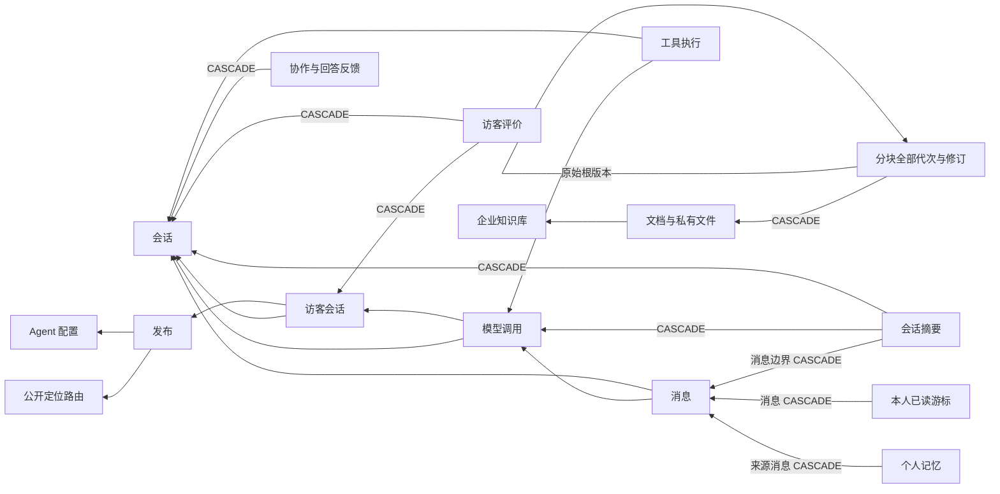

# 全项目深度审查与选择性能力融合

当前结论以文末「专项 B：核心产品能力」及其明确保留的专项 A 边界为准；前文章节保留历史证据，其中未实现状态不代表当前源码。

前文至“静态检查”为上一轮深审记录；数据治理、知识版本与执行观测的当前结论见文末专项及 2026-11-09 补充安全复核。前文“无新增迁移”和 DEFERRED 项仅描述当时状态，不覆盖本次增量。

日期：2026-11-07。起点：本地 `main` / `49fc85fbb5ba827507e4a6334a3a4daf995beb73`，工作区原有 P15、React、消息闭环、0012 与测试清理改动全部保留。本文记录本轮源码变更；不把历史运行记录当成本轮验收。不提交、不推送、不部署。

`FIXED` 表示已修改；`PASS` 仅表示相应静态检查通过；`NOT_RUN` 表示未执行；`BLOCKED` 表示缺少必要外部条件或权限；`DEFERRED` 表示有明确理由暂不实施。没有运行时 VERIFIED 结论。

## 范围与已有能力

范围清单通过文件枚举、AST 和实际调用链审查建立：`src/support_agent` 下 99 个源码/网页文件（其中 `api` 12 个、`services` 26 个），React `frontend/src` 38 个文件，全部 12 个迁移、27 张 ORM 表，以及依赖/锁文件、安装与静态检查脚本、Docker/Compose/Nginx 和 GitHub 配置。静态数得 111 个参与 Schema 的 HTTP 操作声明，不等于已运行服务并生成验收过的 OpenAPI。

| 模块 | 实际审查重点 | 保留的已有能力与边界 |
| --- | --- | --- |
| 身份、企业、API/Schema | 全部 API 模块及输入/输出 Schema；identity/tenants/dependencies/resources | Cookie 写请求 Origin、opaque session、成员状态和服务端租户；平台身份不自动取得企业权限 |
| 数据库 | 0001–0012 全文、models/db/preflight；FK/唯一键/索引/级联/RLS | FORCE RLS、用户级记忆/游标策略、复合关联；声明检查不能证明实际数据库策略 |
| 消息与协作 | conversations/operations/public_delivery/streaming | 人工期访客消息、会话锁、幂等、独立认证、分页/游标、未读、撤权后交付与内部备注隔离 |
| AI 核心 | providers/model_configs/model_runtime/chat/agent_turns/memory/user_memory/tool_execution/tool_connectors | 有界循环、未知结果不盲重试、来源/授权复查、预算、摘要降级、记忆来源与本人授权 |
| 知识与文件 | ingestion/storage/knowledge/retrieval/search_text | 四格式、有界隔离解析、墓碑删除、处理 token/lease、generation、FTS/二字组/RRF/受限单字搜索、逐字与当前来源检查 |
| 前端 | 管理页/工作台/知识/访客、hooks、正式/Demo Adapter、旧网页与 Widget | React/HeroUI 风格保留；请求取消、过期隔离、5 秒轮询与 60 秒退避、游标去重、iframe 生命周期和身份隔离 |
| 交付与运维 | bootstrap/CLI/maintenance/retention、配置、CI/容器/代理/许可证 | 静态检查优先；生产超时与资源限制保留；没有新增长期服务或部署操作 |

这是全项目范围的静态审查及关键链路深读，不是无缺陷证明、形式化验证或动态安全审计。

## 缺陷、根因与修复

本轮未确认 P0。以下严重度按可见影响分类，尚无运行时复现声明。

| 等级 | 确认问题 | FIXED 与源码落点 |
| --- | --- | --- |
| P1 | 草稿键缺少用户维度，同标签页切换同企业账号可能读到上一账号未发送内容 | `ChatPage.tsx` 草稿及待确认请求加入 user ID；不把旧无用户键自动迁移给当前账号。服务端调用/消息不删除，旧未知请求须查历史确认 |
| P1 | 会话删除会级联个人记忆/游标，租户级保留预览却未披露；用户级 RLS 隐藏的数据不能记成零 | `retention.py` 如选中会话，明确返回不可执行及未计数依赖；拒绝执行，不增加绕过 RLS 的角色/函数。独立审计、调用摘要仍可按原授权流程预览；待删文档物理清理在后续复核中另行阻断 |
| P1 | 保留执行在确认后再次选取数据，并发变化可能纳入未确认的新对象 | 执行只选择一次，计划与执行复用同一已锁定批次，消除二次选择；不是放宽确认摘要 |
| P2 | 公开入口配置能选中访客运行时恒拒绝的历史工具，重新发布也缺少一致性校验 | `public_delivery.validate_public_tools` 在创建及启用/重新发布验证静态绑定、授权和公开禁用键；React 过滤未绑定/历史工具，Demo 对应拒绝 |
| P2 | preflight 漏查 0012 已读游标表 CRUD，可能预检通过而会话接口失败 | `preflight.py` 同时检查记忆、同意和已读游标三表权限，不授予所有权或 BYPASSRLS |
| P2 | 相同字节以 TXT/Markdown 不同格式上传，SHA 去重静默沿用旧解析类型 | `knowledge.upload` 明确返回 409 `document_format_conflict`，保留原文档和引用。不同格式并存需另行设计唯一键，未擅改 Schema |
| P2 | 客服停留历史位置也可能把新消息标已读；并发已读请求可能漏掉最新位置 | `ChatPage` 在消息提交到 DOM 后、最新页/可见/近底部才更新，前请求结束后处理最新已提交位置；错误独立展示，失败不无限重试、不遮住主历史 |
| P2 | 知识页允许选择不支持的 `.markdown`；文档变更后仍显示旧预览 | 移除错误扩展名，重处理/删除后清除旧分块预览，补加载及空状态 |
| P2 | 新时间线初版依赖正文交付权限，撤权失败反而不可诊断；阶段失败又可能随事务回滚消失 | 改为本人/企业管理员的无正文元数据视图；AppError 失败收尾在既有 rollback 后恢复固定阶段/耗时，同收尾事务提交，不新增独立提交 |

最后两轮独立复核另确认并修正了“读取反馈首屏无法识别更早的本人反馈”：增加 `mine=true` 本人查询、`before` 分页、取消生命周期及原回答跳转。反馈写入仍由服务端固定身份与会话锁防重。

## 选择性产品升级

| 能力 | FIXED | 明确边界 |
| --- | --- | --- |
| 会话收件箱 | 完整标签筛选、最近客户发言排序；保存当前已应用筛选为个人视图，支持查看/删除；沿用负责人、优先级、队列与 SLA 排序 | 原 activity 排序语义不变；本机、按模式/企业/用户隔离，每类最多 100；不是企业共享查询引擎或服务端暂存任务 |
| 快捷回复 | 个人模板保存/删除，两个白名单文本变量（会话标题、客服姓名），插入编辑框再由用户发送 | 不自动发送，不执行代码/工具，不扩张发送权限；正式保存在本机，Demo 仅标签页并随重置清除 |
| 服务评价与问题定位 | 概览可按满意/不满意筛选、有界游标分页并跳转原会话；未解决列表也可跳转 | 返回真实现有评价/原因，不伪造客户档案、在线状态或答案正确率 |
| 知识调试 | 问题、1–10 个真实最终命中、排名、实际分数/策略、文件/分块 ID、generation、页/章节和内容预览 | 不虚构完整候选、过滤原因、置信度或精确相关率；Demo 明示固定虚构结果 |
| Agent 配置记录 | 配置/知识授权审计记录版本与修改字段；管理员可分页查看；Trace 关联实际执行的配置版本 | 不存历史 Prompt/密钥正文，不提供未经快照支持的历史恢复；旧审计未记录版本时为未知，工具授权仍独立审计 |
| 执行时间线 | 复用 ModelCall.steps、ToolExecution、AuditEvent，增加上下文/检索/记忆筛选计时；关联 request/conversation/call/execution/config version，显示模型目的、状态、错误、Token 和费用估算 | 最多 100 展示事件；超过步骤/执行上限拒绝，审计展示可截断并标记。未知费用/用量/时间不置零，不是供应商账单 |
| 回答级人工反馈 | 六类反馈（帮助/无帮助/引用/完整性/知识缺失/其他）、备注、待复核/已复核/已处理；关联最终消息、调用及引用 chunk ID | 复用内部 Collaboration note，tenant RLS 不变；每用户每最终消息固定 UUID 幂等。创建复查原回答交付，处理状态仅管理员或当前负责人；不会写入知识/个人记忆 |
| Demo | 上述筛选、模板、反馈、评价定位、配置记录与时间线均有独立静态数据路径 | 不连接正式 API、数据库或模型；模拟 Trace 不伪造真实 Token、延迟和模型质量 |

### Trace 的安全和完整性边界

- 正式接口仅当前有效企业成员可进入，且须是调用发起人或企业管理员；访客没有 Trace 入口。共享会话可读不等于共享个人记忆。
- 返回白名单元数据，不含用户正文、Prompt、工具参数/结果、凭证标记、内部备注或个人记忆内容/标识。撤权后仍可诊断状态，不代表能重新交付原结果；原正文/引用/工具交付检查保留。
- 上下文/检索/记忆计时仅覆盖本轮以后实际采集的阶段；旧记录、进程异常终止、数据库故障、未提交 reservation 前失败等可能缺少阶段。AppError 的失败阶段接入现有收尾事务；不能据此声称完整分布式追踪或所有故障 Span 均可恢复。
- 模型和摘要步骤、主备原因与现有部署价格估算复用原记录。未知价格、重试不完整用量仍显示未知；新增计时不改变模型预算/调用次数，也不记录检索正文。

## 五个上游：实际源码、许可证和落点

仅阅读上游源码并借鉴设计；没有复制源码/Prompt，没有引入其 SDK、UI 体系、数据库或运行依赖。以下路径均为本轮实际读取，不能推广成上游完整安全或依赖许可证通过。

| 项目/固定版本 | 实际源码与许可检查 | 吸收与未采用 |
| --- | --- | --- |
| [Chatwoot](https://github.com/chatwoot/chatwoot/tree/625d5964e3cb3f1d917b43c3b8332219e525a4b8) | `app/controllers/api/v1/accounts/custom_filters_controller.rb`、`canned_responses_controller.rb`、`app/javascript/dashboard/components/widgets/conversation/CannedResponse.vue`、根 LICENSE | 用户/账号范围视图、回复变量启发本机个人视图与模板。非 enterprise 区域 MIT，enterprise 有独立许可；不移植源码，不仿造其在线分配/团队负载 |
| [Dify](https://github.com/langgenius/dify/tree/00a129f11e08ca0e8c25aa2050f5e00c728d732d) | `api/services/app_model_config_service.py` 全文、`api/services/app_service.py` 租户/配置读取部分、`api/models/model.py` AppModelConfig 定义与关联部分、根 LICENSE | 借鉴配置与运行记录关联及服务端租户验证，落实既有版本的变更字段日志和 Trace。许可为附额外多租户/前端条件的 Apache 修改版，本项目不移植其代码或架构 |
| [RAGFlow](https://github.com/infiniflow/ragflow/tree/3c6d2255af06164f0818d0959af10de0afd8b8fa) | `web/src/hooks/use-knowledge-request.ts` 的真实检索请求、`web/src/pages/next-search/retrieval-documents/index.tsx`、根 LICENSE | Apache-2.0；吸收可观察检索结果的交互，落点知识页。没有采用其解析任务/向量服务，也未声称已完成同等切片/重排能力 |
| [FastGPT](https://github.com/labring/FastGPT/tree/0cda1a974c4b3bdbd0eb19fe91a832e0f0df9e1e) | `projects/app/src/pages/api/core/dataset/searchTest.ts`、`projects/app/src/pageComponents/dataset/detail/Test/hooks/useDatasetSearchTest.ts`、根 LICENSE | 借鉴受权限控制的真实检索预览；回答反馈自行实现并复用本地协作。Apache 衍生许可附多租户 SaaS/标识限制，不复制源码。这里的上游文件名不表示运行其测试或向本库恢复测试体系 |
| [Langfuse](https://github.com/langfuse/langfuse/tree/f257bef7c17b489ebd79a230e906abcc2d5ef5d7) | `packages/shared/src/server/repositories/observations.ts`、`web/src/server/api/routers/traces.ts`、根 LICENSE | 借鉴类型化观察记录、服务端项目范围及有界返回，落实本地时间线。非指定商业目录 MIT，EE 等目录另有许可；不部署 Langfuse、不移植其服务或追踪正文采集 |

HeroUI v3 Skill 和官方 MCP Button 文档实际读取；新增交互沿用现有 v3 `onPress`、语义 variant 和组件，不引入第二套 UI 或动画依赖。

## API、数据库及文件变化

新增内部 API（均位于 `/api/v1`）：

- `GET /conversations/{conversation_id}/runs/{call_id}/trace`：本人/企业管理员，无正文诊断。
- `GET/POST /conversations/{conversation_id}/answer-feedback`、`PATCH /conversations/{conversation_id}/answer-feedback/{feedback_id}`：内部人工反馈；GET 支持调用、类别、状态、本人及 before 游标。
- `GET /workspace/feedback`：真实访客评价，按企业及 rating/before 有界分页。
- `GET /agent-configs/{config_id}/changes`：企业管理员配置变更记录。
- 既有 `GET /conversations` 增加精确 `tag` 条件和 `sort=customer_activity`（仅用户消息时间）；原 activity 排序保留。参数化 JSONB contains，不拼接用户 SQL。

**无新增/修改迁移，无本轮 ORM 表变更，无数据库执行。** 现有未提交 `0012_support_experience` 保留原状；反馈关联在服务器验证后写现有 Collaboration JSON，不增加跨表外键。其生命周期随会话协作记录；不允许原始 JSON 写接口绕过验证。现有 27 表/RLS 声明和运行角色保护保留。新查询复用协作/审计/访客反馈索引，未以无执行计划证据为由盲加索引。

主要文件：

- API/Schema：`api/{agents,conversations,workspace}.py`、`schemas.py`、`operations_schemas.py`、新增 `feedback_schemas.py` / `trace_schemas.py`。
- 服务：新增 `services/{answer_feedback,traces}.py`；修改 `services/{agents,workspace,operations,public_delivery,knowledge,chat,agent_turns}.py`、`observability.py`、`preflight.py`、`retention.py`。
- React：新增 `chat/{PersonalTools,RunInspector,TracePanel}.tsx`、`admin/FeedbackInbox.tsx`；修改 ChatPage、Agents、Overview、Publications、知识页、Demo Adapter 和错误提示。
- 文档：本文、README、FRONTEND、OPERATIONS、OPEN_SOURCE_REUSE。未改依赖或锁文件，未复制第三方实现。

Sol 负责后端、收尾修复、契约/Demo 整合和最终检查；Terra 分别实施工作台/知识预览/Trace 初版，独立审查身份、迁移、AI、运维和前端。所有文件写入按职责划分，主 Agent 逐项复核并修正上述竞态；独立复核结果仍只是静态证据。

## 未完成与选择边界

| 状态 | 项目与理由 |
| --- | --- |
| BLOCKED | 外部 CRM/订单/工单无真实接口/权限资料；不新增空壳连接器或冒充集成。客户侧栏只用现有会话状态/标签/协作，不按 IP 猜测客户身份或串联访客历史 |
| DEFERRED | 会话/访客自动保留删除被安全阻断；需完整用户级级联影响计划与并发验证后再恢复，不放宽 RLS |
| DEFERRED | 自动分配/容量负载、业务时间 SLA、持久化稍后处理：缺少可靠在线/班次数据或持久调度契约；继续人工负责人、固定 SLA 与队列排序，不伪造在线能力 |
| DEFERRED | 企业共享快捷回复、多端同步：当前明确交付个人本机模板；共享资源需单独权限/持久化设计 |
| DEFERRED | Chunk 人工修改/删除、历史配置恢复：必须先明确原文和人工改写的来源、generation 及完整版本快照/权限，不能只覆盖 content 或将审计字段日志当作可回滚快照 |
| DEFERRED | 完整候选/过滤调试、自动多问题拆分、向量/Reranker：当前覆盖率门槛可能漏掉分散的互补证据，没有本轮真实检索错例/指标证明更优策略；保留多知识库检索及有界授权 knowledge_search 工具，不宣称提升召回率或 AI 质量 |
| DEFERRED | `public_routes` 与 `publications` 缺 tenant 复合外键的声明级完整性增强：当前创建/读取服务显式按租户约束，未确认可利用越权路径；未无证据扩大本轮 Schema |
| NOT_RUN | 真实 DB/RLS、并发、撤权、API/OpenAPI 运行、浏览器、Widget、Demo 操作、构建/wheel、模型效果和生产部署；均依用户禁令不执行 |

没有新增 Agent 工具：已有文本统计、会话状态、会话用户输入历史、SLA、授权知识搜索五项能力保留静态 Schema/进程隔离/逐次授权/有界输出。工具不能访问 DB、任意地址/代码或执行审批外写操作；本轮修复的是公开白名单一致性。完整 CRM 或工作流并非新增工具数量的理由。

## 静态检查

| 状态 | 实际检查与结果 |
| --- | --- |
| PASS | `.venv/bin/python scripts/check.py`：Ruff/格式（123 文件）、89 个 Python AST、12 条迁移链与离线 SQL/RLS 声明；约 1.10 秒。未连接数据库 |
| PASS | `npm run check --prefix frontend`：`tsc --noEmit`；最终约 2.31 秒。新增客户活动排序后，对受影响 Python 文件补做 Ruff/格式检查；不把类型检查当作页面运行 |
| PASS | `.venv/bin/python scripts/check_delivery.py`：205 个发布文件、JS 语法/模块链接（不求值）、HTML 资源、本地文档链接和已知敏感模式；最终约 0.73 秒 |
| PASS | Python 3.11 grammar 静态解析 89 文件；Shell `sh -n`；CI、Pages、Dependabot、Compose YAML 解析；两个工作流各 4 个第三方引用均完整 40 位 SHA |
| PASS | Diff 空白检查、空暂存区、依赖与锁文件未改；没有新增测试框架/依赖/运行任务。Demo 源码无 fetch/WebSocket/XMLHttpRequest，Vite Adapter 隔离和 CSP 声明保留 |
| NOT_RUN | 未刷新本轮依赖安全公告；依赖版本/许可证未变，前一专项的审查证据仍仅适用于当时查询。Docker 镜像安全、所有支持 Python/PostgreSQL 版本的运行兼容性、Nginx 实际加载都未验收 |
| NOT_RUN | 测试、构建、应用、数据库/迁移、浏览器、模型、压力与生产验收；未 commit/push/部署。没有因检查而新增依赖、自动评分器或单项硬超时 |

结论：上述代码改动和静态检查已完成；真实功能、权限并发、资源/性能与 AI 质量仍为 `NEEDS_RUNTIME_VERIFICATION`，需单独授权，不能从本轮 PASS 推导。

## 数据治理、知识版本与执行观测专项

2026-11-07，仍基于上述未提交工作区。没有重置、清理、提交或远端操作；无测试、构建、服务、数据库、模型调用。原有 0012/P15/React 修改保留。

### 删除依赖与数据影响矩阵

下表来自当前全部 27 张 ORM 表和 0001–0013 声明。箭头为“子记录引用父记录”；未特别标注的 FK 为 NO ACTION，ORM 未声明额外 relationship 删除级联。

| 记录 | 直接关联/存储依赖 | 范围、删除与可见性 |
| --- | --- | --- |
| tenants / users | 所有 tenant/actor/created_by；用户还被 auth_sessions 引用 | 不提供无差别级联清除。企业/用户创建资源、审计与他人会话须保留，当前整体用户/企业物理擦除 BLOCKED |
| tenant_memberships | tenant/user；被 assignee、Chunk 编辑人、个人同意/记忆/游标引用 | 同意/记忆/游标对 membership CASCADE；负责人和编辑人关联限制删除。停用不等于物理删除 |
| auth_sessions | user | 登录会话与企业共享资源分离，不能用删除企业会话代替账号注销 |
| conversations / messages | tenant/created_by、负责人 membership；message → conversation / model_call | 会话专属消息不包含共享 Agent/知识/用户。消息被记忆、游标、摘要引用，完整影响不可见时阻断 |
| model_calls / tool_executions | tenant/user/conversation/agent；call → visitor；execution → call/tool | 有循环式删除排序要求，不能只先删 call；独立 call 仅脱敏 result/steps，保留状态/用量/幂等身份 |
| publications / public_routes / visitor_sessions | publication → 同 tenant route + Agent；visitor → publication/conversation | 撤销/下线不物理删除历史；已有访客和调用限制删除发布，route 不级联清掉企业资源 |
| conversation_summaries | conversation、source_start/end 消息、model_call 均 CASCADE | 内容 JSON 另存来源 ID/逐字摘录，需当前来源检查；不把摘要当独立可信事实 |
| conversation_collaboration（含 AnswerFeedback） | conversation CASCADE、actor user；details 中保存消息/call/chunk/source ID | 随会话协作生命周期；JSON 不产生数据库级联，不恢复已撤权正文。反馈意见不写入知识或记忆 |
| visitor_feedback | visitor、conversation 均 CASCADE | 评价不是模型正确率；备注与访客身份分离 |
| user_memory_consents / user_memories | tenant+user membership CASCADE；memory 来源消息 CASCADE | FORCE RLS 同时限制 tenant/user。会话删除不删独立 consent；本人删除只影响本人。模型/消息 JSON 依赖保留 ID 并在交付时失效检查 |
| conversation_read_cursors | membership、同会话 message 均 CASCADE | tenant+user FORCE RLS；不可将运维看不见的其他成员游标当零 |
| knowledge_bases / documents / document_chunks | doc → KB；chunk → doc CASCADE；chunk → 同 tenant/doc/generation/position 根版本与编辑 membership | 知识属于企业共享资源，不随会话删除。文档显式删除清全部代次；私有文件按 tenant/doc UUID 寻址，不使用用户路径 |
| agent_configs / agent_knowledge_bases / agent_tools / tool_definitions | user/tenant；绑定到同 tenant Agent/KB/tool，KB 删除 CASCADE 知识授权 | 不随个人记忆或会话删除；配置版本、授权撤销及工具静态契约保留 |
| model_credentials | tenant/created_by，ref 在配置 JSON/字段中由服务端解析 | 不随会话/文档删除；AAD/主密钥与备份生命周期独立，明文不进入预览或 Trace |
| audit_events | tenant/actor FK；resource_id/details 为独立元数据关联 | 不随业务资源 FK 级联；按显式审计期限处理，retention receipt 并非永久账本 |
| http_buckets | 无业务 FK；HMAC key/过期连接租约 | 不级联删除企业共享数据，沿用原限流清理机制 |

另外，ModelCall.result/steps、Message.metadata、ToolExecution.result、Publication.public_tool_ids 和反馈 details 的 JSON 引用不是 FK，物理删除不会自动清除它们。交付仍需现有来源、工具、记忆及发布复核。本机草稿/模板、远端 Provider、备份与日志也不由 retention 一并擦除；没有改变隐私/保留政策。

### 安全删除：FIXED 与 BLOCKED

- **FIXED**：预览返回每组具体对象 ID 与内容/版本 digest，确认摘要 v2 绑定依赖集合，不仅绑定数量/updated_at；检测同数量替换和内容变化。总计 10000 行有界，超限计数 `null`、不可执行。预览明确删除、脱敏、保留、阻断、私有文件及 UNKNOWN。
- **FIXED**：执行锁定一次选出的父记录、必要文档 Chunk，再重算确认；仅执行这一批，不重新扩大集合。Document 锁与 Chunk 修订协议一致。独立 call 保留原幂等和真实用量，不把预留当费用。
- **BLOCKED**：会话/访客整批删除，用户级记忆/游标的完整级联范围在 tenant 维护上下文下不可见，显式 `null`；不提供 SECURITY DEFINER/BYPASSRLS 旁路，不改应用权限，也不添加一个假安全的用户删除入口。本人记忆删除/撤回沿用已审核 owner + consent 锁路径。
- **BLOCKED（2026-11-09 补充）**：知识物理清理还会影响未枚举的历史 JSON 引用，原 deleting 墓碑不足以证明影响已获确认。文档/知识库 DELETE 和 retention 文档清理均停止物理操作；返回已知范围与 UNKNOWN，无确认值可执行。历史墓碑保留，但不据此证明当前文件完整或跨介质原子性。

### PublicRoute 租户完整性：FIXED

`PublicRoute(tenant_id,id)` 唯一键与 `Publication(tenant_id,id)` 复合 FK 替换旧 id 单 FK；Agent 的既有复合 FK 保留。原主键/API/创建 route→publication 顺序和软撤销逻辑不变。`public_routes` 仍是仅含 locator 的公开定位表，不机械加 tenant RLS 破坏定位；发布及访客数据原 ENABLE/FORCE RLS 保留。历史租户不匹配将使迁移失败，不自动改绑数据。

### Chunk 版本与引用：FIXED

- 不新增版本表：复用 DocumentChunk，增加 root_chunk_id/revision/is_current/is_deleted/revised_by/revision_reason；原 created_at、正文和位置保留。旧行回填为自身根 v1，**不能恢复此前已被删除的旧代**。
- 每次编辑/逻辑删除/恢复创建新 ID，旧正文不覆盖；删除也作为可追踪修订。文档重处理仅在成功时推进 generation，不再提前删旧 Chunk；处理失败/进行中不参与检索。整文档物理删除当前 BLOCKED，逻辑删除不等于隐私擦除。
- 当前部分唯一索引、版本唯一键、同租户/文档/代次/位置根 FK、编辑人 membership FK 保留边界；服务通过 KB→Document 锁和 expected_current_id 串行切换 current。约束保证最多一个 current，完整根链与版本连续性还依赖该服务协议，不宣称直接任意 SQL 也安全。
- FTS/二字组/单字通道均仅召回当前代的当前非删除 Chunk。模型首次选择证据须当前版本，运行中工具/引用也验证当前；已持久化历史保留原版本 ID/正文，同代 lineage 仍有效且当前授权才可展示。逻辑删除、文档不可用/换代或知识撤权后遮蔽历史内容，记录存在与可交付分开。
- 来源检查先按 KB→Document 排序取共享锁，再用新 SQL 快照检查 lineage，避免等待修改锁后使用旧快照；原 Agent/发布/凭证授权锁与次数/预算不放宽。
- 管理员 UI：代次选择、位置、版本/时间/修改人/原因、分页、完整文本前后对照、确认后编辑/删除/同代恢复；历史代只读，不自动跨代合并人工改写。请求取消不代表事务回滚，结果未知须刷新。

新增 API：`GET /documents/{id}/chunks/{chunk}/versions`、`PATCH/DELETE /documents/{id}/chunks/{chunk}`、`POST .../{chunk}/restore`，均 TenantAdmin；旧 chunks GET 增加管理员 generation/include_deleted。修改必须原因和 expected_current_id；正文限 1200 字、原因 500 字。普通成员不获取修订历史或 tombstone 正文。

### Agent Trace 与人工治理：FIXED

- 持久化来源仍是 ModelCall.steps、ToolExecution、白名单 AuditEvent；请求受理、上下文、记忆、检索、模型、工具、服务端结果分开。缺记录为 UNKNOWN，客户端是否收到结果始终 UNKNOWN，不用服务端完成冒充网络确认。
- 统一阶段状态；过期却仍标 running 的租约显示 UNKNOWN，不在诊断查询偷偷重试/结算。实际已记录超时、中断才分类；数据库故障或突然退出不捏造普通失败。Python 取消/终止展开不记为成功，但无法保证该路径最终提交。
- 补实际 finished_at 采集，旧记录结束时间未知，不用 start+elapsed 伪造精确时刻。审计 outcome 仍仅 success/failure/rejected；详细阶段状态和固定错误分类另存白名单 metadata，符合原 CHECK。
- Trace 仅调用本人/企业管理员，关联 request/conversation/call/execution/agent/version/tool；不含正文、Prompt、内部备注、个人记忆、凭证和工具参数/结果。Token 与费用沿用原价格快照，未知不计零，非账单。仍最多 100 展示事件，可能截断并显式标记。
- 人工反馈：分类/状态筛选，待处理→处理中→已处理（兼容已复核）、人工意见、知识/检索/引用/回答问题分类；消息按真实 model_call_id 精确定位原问题，历史缺关联为未知，不按最近消息猜测。
- 反馈带 revision，PATCH 要 expected_revision + expected_status，避免同状态意见并发覆盖。只允许管理员/当前负责人处理；关联 KB/doc/Chunk 在 Agent 锁后重查授权及来源。原引用可关联仍有效的原修订，其他关联须当前版本；普通成员还受当前 Agent 知识授权约束。意见不自动修改知识或写入记忆。
- Demo 同步版本操作、反馈和原问题关联；仅虚构标签页状态，不连接正式 API。演示检索不实施真实查询排名，不把效果描述为真实模型/检索验收。

### 迁移、文件、协作和验收

新增 `0013_knowledge_governance.py`，从 0012 线性升级，**未执行**。回填逐企业 GUC、保持 FORCE RLS；迁移角色访问不全/既有数据不一致将失败，不关闭策略。无新表/依赖、没有历史迁移改动；运行版本检查改为 0013。执行前需独立授权、备份、停写排空并检查权限；禁止旧写入代码与新版本混跑。downgrade 阻断，未提供数据破坏式回退。

主要新增：`chunk_schemas.py`、`services/chunk_versions.py`、React `knowledge/ChunkVersions.tsx`、0013。修改：models/db、api/knowledge、rag_schemas、knowledge/retrieval、chat/agent_turns/tool_connectors 的引用检查、model_runtime/observability/traces/trace_schemas、feedback_schemas/answer_feedback、知识页/TracePanel/RunInspector/Demo Adapter，以及 README/DEPLOYMENT/OPERATIONS/FRONTEND/本文。没有修改 ingestion 解析隔离或个人记忆保存政策。

Sol 负责数据治理/模型/迁移/引用与 Demo 契约整合/反馈并发/最终审查；Terra A 实施版本服务与检索，另一个 Terra 按文件边界实现知识 UI；Terra B 只读审查删除/FK/锁与历史引用；Terra C 实施 Trace/反馈初版并独立复核。主 Agent 核实并修正审计状态约束、反馈同状态覆盖、源授权并发及历史/当前版本区分。前章已检查的 RAGFlow/FastGPT 固定源码和许可设计依据继续复用；本轮没有复制第三方源码或引入其服务，也未重新查询远端活动。

| 状态 | 本专项实际检查 |
| --- | --- |
| PASS | `scripts/check.py`：Ruff、126 文件格式、92 Python AST、13 迁移线性链及离线 SQL/RLS 声明；约 1.43 秒，无数据库连接 |
| PASS | `npm run check --prefix frontend`：最终 `tsc --noEmit`，约 2.73 秒；不执行页面或 Demo Adapter |
| PASS | `scripts/check_delivery.py`：209 发布文件、JS 语法/模块静态链接、HTML/本地文档链接、已知敏感模式；约 1.07 秒。构建资源/Wheel NOT_RUN |
| PASS | 当前三张受影响表的 PostgreSQL DDL/索引方言编译，全部 27 表 FK/ON DELETE 元数据枚举；7 类 API JSON Schema 生成。没有 API 调用或真实 Schema 对比 |
| PASS | `git diff --check`、24 个未跟踪源码/文档的空白和末尾换行检查；依赖/锁文件未改、暂存区为空，HEAD 仍为 `49fc85fbb5ba827507e4a6334a3a4daf995beb73` |
| NOT_RUN | 数据库迁移/RLS/权限/并发/恢复、API 运行、浏览器和 Demo 交互、构建、模型及生产。未运行任何测试，未 commit/push/部署 |

**剩余边界**：会话/用户整体擦除、知识物理清理 BLOCKED；真实数据库迁移、RLS/锁/并发、文件故障恢复、浏览器、正式/Demo 交互、真实模型、备份恢复与生产环境均 NOT_RUN。跨代自动恢复/合并和版本自动压缩/清理 DEFERRED，需要来源语义及保留策略，不擅自清历史。此专项不宣称生产就绪。

## 补充安全复核（2026-11-09）

本轮起点仍为 main / `49fc85fbb5ba827507e4a6334a3a4daf995beb73`。开始时已存在大量未提交与未跟踪成果，包括上节 Chunk/Trace/反馈实现、0012/0013 和本报告；本轮在原文件上补漏，没有重新开发这些能力。Sol 负责删除安全与契约整合；Terra A 复核知识/引用，Terra B 只读核对全模型、迁移、RLS 与删除依赖，Terra C 修正 Trace 并独立复核整合。未新增依赖或迁移，0013 保留待审阅，0001–0012 未在本轮修改。

| 状态 | 本轮发现与处理 |
| --- | --- |
| FIXED | `api/knowledge.py` 分块读取原先未复查知识库墓碑；现在复查 active 库，查询同时约束库状态及普通读取的 ready 文档/当前代次，关闭 deleting 库继续暴露分块正文的路径。静态声明不能证明并发撤权实际效果。 |
| FIXED | `model_runtime.aggregate` 原先在部分步骤用量不完整时仍可能累计为完整 Token；现在总量要求每步 usage_complete，Trace 同步将不完整 Token 保持未知。预算与费用仍沿用逐步用量/预留，不以未知当零。 |
| FIXED | Trace 补充缺失模型/工具阶段为 UNKNOWN；有零次调用的明确预检拒绝记录才标 NOT_STARTED。请求/客户端交付和其他缺记录场景不补造成功。白名单内容及本人/管理员权限保留。 |
| FIXED / BLOCKED | retention 文档预览增加 ModelCall.result/steps、Message.metadata、ToolExecution.result、Collaboration.details 未枚举 JSON 依赖，数量为 null；有这类对象即拒绝执行，阻断预览不发放确认值，v3 摘要仅供依赖范围已知的可执行批次。独立审计清理与调用脱敏保留单一锁定批次、变更拒绝、审计回执；会话/访客仍因用户级 RLS 阻断。 |
| FIXED / BLOCKED | 普通知识库/文档 DELETE 原先不绑定预览确认，还会提前删全部代次 Chunk；现仅允许 `preview=true` 返回已知对象、generation、时间、该页全部版本数量和 UNKNOWN，不发放执行确认；执行返回 409 `knowledge_reference_review_required`，不更改状态、不删行、不 unlink。已不存在对象维持幂等 204。React「删除影响」与 Demo 对齐阻断状态，不显示删除成功或发起未确认执行。 |
| PASS（源码审查） | PublicRoute `(tenant_id,id)` 唯一键、Publication 同租户 route 复合 FK 与既有 AgentConfig 复合 FK，及 0013 增量声明一致；原主键/API/服务层授权/公开定位不变，未增加应用角色权限。Chunk 内容/版本/原文位置、历史只读与同代恢复、当前检索及反馈人工闭环已存在，保留原实现。 |

删除影响矩阵沿用上节，补充明确：Conversation 的 Message/ModelCall/ToolExecution/VisitorSession FK 是 NO ACTION，并非全自动级联；Collaboration/Summary/VisitorFeedback 存在 CASCADE。Message 删除会影响用户级 RLS 的记忆和游标，MemoryConsent 不随会话删。Document→Chunk CASCADE 涵盖所有代次/修订，而四类 JSON 引用不是 FK，会保留且改变历史来源交付可用性；当前没有完整枚举和锁协议，所以不声称预览完整或删除安全。个人记忆仍限本人 owner + consent 锁，不删共享知识、来源会话或其他成员记忆；用户整体擦除无安全实现，继续 BLOCKED。

本轮涉及文件：`retention.py`、`services/knowledge.py`、`api/knowledge.py`、`rag_schemas.py`、`services/model_runtime.py`、`services/traces.py`；React `features/knowledge/index.tsx`、`adapters/demo.ts`、`adapters/errors.ts`；README、OPERATIONS、P7_RUNTIME、DEPLOYMENT、FRONTEND 和本报告。其余已有改动保留，不将其计作本轮新实现。没有执行数据、文件、备份或配置清理。

本轮实际静态检查如下，前节 PASS 为已有记录，不代替本轮验证。所有数据库/RLS/迁移/并发/故障恢复、浏览器、正式与 Demo 交互、测试、构建、服务、真实模型及 VPS/部署均 NOT_RUN；未提交或推送。现存 0013 尚未应用，不能以静态 SQL 编译证明现网结构与权限行为。

| 状态 | 本轮实际静态证据 |
| --- | --- |
| PASS | `.venv/bin/python scripts/check.py`：Ruff、126 文件格式、92 Python AST、13 个线性迁移与离线 SQL/RLS 声明；无数据库连接。 |
| PASS | `npm run check --prefix frontend`：tsc --noEmit；未构建或执行 React/Demo。 |
| PASS | `.venv/bin/python scripts/check_delivery.py`：209 发布文件，JavaScript 语法/静态模块链接、HTML 资源、本地 Markdown 链接和已知敏感模式；构建产物和 wheel NOT_RUN。 |
| PASS | 92 文件 Python 3.11 grammar；27 表 PostgreSQL DDL/索引编译；7 类 JSON Schema 与知识/会话路由 27 个路径的 OpenAPI 元数据生成，未调用应用 factory 或任何 endpoint。 |
| PASS | Git Diff/未跟踪交付文件的空白检查；已跟踪历史迁移无 diff，依赖与锁文件无 diff，暂存区为空；HEAD 未变。 |
| NOT_RUN / BLOCKED | 运行时路径与物理删除安全未验收；会话/用户整体擦除和知识物理删除继续 BLOCKED，不因静态 PASS 宣称完成隐私擦除。 |

## 私有客服产品化增量（2026-11-09，静态交付，整体未验收）

范围与当前缺口以[产品化矩阵](PRODUCTIZATION.md)为准。沿用 main `49fc85fbb5ba827507e4a6334a3a4daf995beb73` 和既有未提交工作，主代理实施；4个独立审查代理只读复查知识/存储、数据/权限、Agent/Trace和前端契约，无并行修改同一模块。未新增依赖、测试或框架，未提交/推送/部署；历史已跟踪迁移未改，新增0014–0016仅生成并静态审查，未执行。前文历史PASS不代表本轮或生产环境通过。

| 范围 | 本轮实际改变与静态结论 |
| --- | --- |
| 单企业/权限 | 运行、维护与公开上下文复查单企业不变量；多企业库拒绝使用而不自动改数据。新CRM/R2/记忆命令持授权共享门，用户停用/注销、成员撤权及企业停用持对应独占门；成员变更先按UUID排序actor/target再锁tenant并重查会话/角色，避免双管理员反序。只审所列路径，不声称所有遗留管理路径已完成统一门锁。 |
| CRM/工单 | 真实客户档案、明确会话关联、不覆盖冲突身份、稳定幂等创建、PATCH字段保留、版本检查、状态/分配/期限/操作历史、活动审计元数据。更改其他字段不再截断工单原期限秒数。客户资料导出明确仅profile，整体删除409。 |
| 工具/交接 | 六项静态客服能力：客户/工单查询、创建/更新工单、转人工和站内提醒。R2由服务代码固定分支执行，权限/当前资源/风险逐次复查；效果、终态执行记录、审计同事务。转人工在同事务结束Agent循环。交接包复核完整工具来源后展示，不用截断前缀作授权；待办先过滤未完成再分页并标截断。 |
| 计划/Trace | 词法意图和复杂度候选明确标UNKNOWN语义确定性，计划/风险决策存白名单metadata；风险与工具UUID可关联。预留execution_pending显示NOT_STARTED，缺失阶段/客户端接收未知，不捏造成功和费用。 |
| 知识发布 | 新文档默认不发布，现存兼容回填true；重处理成功/Chunk修订撤回待发布。修改Chunk补授权门+admin重查。管理员用generation+updated_at发布/撤回，检索与历史引用检查published；不会通过重复演示导入恢复已撤回文档。HTML仅解析文本，剔除脚本/常见隐藏内容，不拉取外部资源或实现浏览器CSS渲染。 |
| 客户记忆 | 默认关闭、管理员明确启用/确认，来源必须是已关联会话user消息中的逐字片段；1–365天/最多100有效项，不自动送模型。撤回/关闭清除此副本正文，保留来源/摘要墓碑并阻止同源同文恢复；到期先过滤、Worker异步清正文。不等于源消息、备份和全链路隐私擦除。0016来源复合FK已修为现有三列消息唯一键，静态检查增加FK目标唯一声明核对。 |
| 附件/存储 | 会话私有附件、访客隔离、明确共享、服务生成稳定UUID、登记后不可变写入、下载前后验权/摘要。文件5MiB、会话20份；请求体入口另有上限与30秒读取预算。强制octet-stream下载/CSP/nosniff，不内联执行，无恶意软件扫描保证。S3 path-style SigV4+条件写入，无新依赖，版本感知删除阻断；配置预检与本地目录分开，网络未验证。 |
| Worker/模型 | PostgreSQL SKIP LOCKED有界提醒与到期记忆清理，可选Compose profile；按ticket/version/user/kind缺失提醒选择，后加入管理员可补发；停用企业不新发提醒。模型私网仅精确DNS显式白名单，HTTPS443与证书校验保留，逐次DNS检查并连接该IP，元数据/链路本地拒绝。 |
| 前端 | HeroUI3实际组件含Table；BoardUI Skill/MCP与Taste实际用于IA/共享框架。新增客户/工单/通知/记忆/活动/附件、模型路由及治理运营入口；loading/error/empty区分，深链错误可见、正式Widget人工回复source字段补齐。Demo发布停用Agent检查、活动target字段、消息来源、知识撤回与记忆契约对齐；不以Demo冒充后端或存储验收。 |
| 部署/文档 | 当前head0016；新增七表运行权限/RLS、单企业、可选Worker、本地/S3/私网模型、停写排空、DB/文件/对象版本/密钥一致批次、隔离恢复与无破坏downgrade说明。备份/恢复管理页显示真实未验证状态，无假恢复按钮。 |

删除依赖扩充：会话预览将 conversation_customers、tickets、ticket_events、staff_notifications、conversation_attachments、attachment_storage_versions、customer_memories 纳入UNKNOWN，不能再用旧矩阵声称依赖完整。既有用户级memory/cursor FORCE RLS与历史JSON/派生文本仍未可完全枚举。用户/会话/客户整体擦除、知识与S3对象版本物理删除继续 **BLOCKED**，无确认值可执行。解除必须另行审查完整引用/存储版本图、确认绑定、锁/故障协调与备份撤回策略；不增加旁路或以局部删除伪称完成。

| 状态 | 本轮最终静态证据 |
| --- | --- |
| PASS | `scripts/check.py`：Ruff、144文件格式、109 Python AST、16迁移线性链/离线SQL、27表RLS声明、复合FK目标唯一键元数据核对；不连接数据库。 |
| PASS | `npm run check --prefix frontend`：tsc --noEmit，未执行React或Demo；修复整合期间发现的缺失Loading导入与Demo Row类型错误后通过。 |
| PASS | `scripts/check_delivery.py`：234发布文件、JS语法/静态模块链接、HTML资源/本地Markdown链接、已知敏感模式；构建资源与Wheel NOT_RUN。 |
| PASS | 34 ORM表及索引PostgreSQL方言编译；14路由模块、104 OpenAPI路径、128 schema元数据生成；109文件Python3.11 grammar。没有调用app factory、endpoint、数据库或外部接口。 |
| PASS | Git diff空白、未跟踪交付文件空白、暂存区/HEAD/历史迁移/依赖锁文件核对；没有提交或生产操作。 |
| NOT_RUN | 测试、构建、服务/Worker/容器、数据库/迁移/RLS/锁/并发、真实Provider/S3/DNS/TLS、浏览器/Widget/Demo交互、备份恢复与部署。 |

**专项 A 前的历史结果：尚未完成完整产品化，不能标记Production-Ready。** 向量/Embedding/Reranker、R3审批执行、金额原子硬预算、可信网站客户身份、AI草稿建议、完整客户导出仍未实现；已在管理能力接口与实施矩阵明确展示缺失。R3/R4、无真实订单/外部通知接口继续拒绝，不用Mock或静态页掩盖。其余源码已实现路径仍需目标环境验收，特别是幂等未知结果/撤权并发、迁移历史数据和新增表授权、存储中断与隔离恢复。上述未实现项与NOT_RUN必须保持到后续实际实施/验收后再更新。

## 专项 A：安全与执行控制（2026-11-10）

基于现有脏工作区继续实施；main 仍为 `49fc85fbb5ba827507e4a6334a3a4daf995beb73`。只处理完整擦除、R3 审批、金额预算和可信 Widget；未扩展专项 B。独立代理只读审查，代码修改由主代理完成。下列 FIXED 指源码已修复，不代表运行验收。

| 专项 | 状态 | 实际交付与边界 |
| --- | --- | --- |
| 用户/客户/会话完整擦除 | BLOCKED | 真实依赖预览、未知范围、幂等请求登记、重复评估和脱敏审计已实现；不接受清除执行，不阻断源数据访问，不提供假进度或 PURGED。完整生命周期尚未实现。 |
| R3 高风险审批 | FIXED / NEEDS_RUNTIME_VERIFICATION | 数据库、API、独立管理员决定、操作详情、原申请人执行及一次性消费已接通；仅支持固定 desk 事务命令。外部副作用无幂等协议继续 BLOCKED，R4 不放行。 |
| 金额预算 | FIXED / NEEDS_RUNTIME_VERIFICATION | 统一模型执行层在每个付费 HTTP 前持久原子预留，覆盖 Run、UTC 日/月、企业系统累计及可选 Agent 累计，实际用量结算、未派发释放、未知占用、超界冻结及真实账本界面。 |
| Widget 可信网站 | FIXED / NEEDS_RUNTIME_VERIFICATION | HTTPS 文件归属验证、启停/到期/轮换、网站后端断言、部署/发布/网站版本绑定、签名 Bootstrap/Visitor、nonce 防重放、精确 frame-ancestors 及会话逐次验权。真实网站后端须按接入协议部署。 |

### 擦除依赖审计与保留边界

以下是从当前 40 张 ORM 表离线枚举的全部 FK 出边；`N` 为 NO ACTION，`C` 为 CASCADE，复合键中 tenant 字段省略以便阅读，准确列名由管理 API `foreign_keys` 返回。所有 tenant 表保留原 FORCE RLS；个人记忆/已读游标仍有 owner RLS。单纯的 FK 图不代表完整个人数据血缘。

| 表 | 引用目标及删除行为 |
| --- | --- |
| http_buckets | 无 FK |
| tenants | 无 FK |
| users | 无 FK |
| agent_configs | created_by → users (N)；tenant_id → tenants (N) |
| audit_events | actor_id → users (N)；tenant_id → tenants (N) |
| auth_sessions | user_id → users (N) |
| budget_policies | tenant_id → tenants (N) |
| customers | created_by → users (N)；tenant_id → tenants (N) |
| erasure_requests | requested_by → users (N)；tenant_id → tenants (N) |
| knowledge_bases | created_by → users (N)；tenant_id → tenants (N) |
| model_credentials | created_by → users (N)；tenant_id → tenants (N) |
| public_routes | tenant_id → tenants (N) |
| tenant_memberships | tenant_id → tenants (N)；user_id → users (N) |
| tool_definitions | created_by → users (N)；tenant_id → tenants (N) |
| agent_knowledge_bases | created_by → users (N)；agent_config_id → agent_configs (N)；knowledge_base_id → knowledge_bases (C)；tenant_id → tenants (N) |
| agent_tools | created_by → users (N)；agent_config_id → agent_configs (N)；tenant_id → tenants (N)；tool_id → tool_definitions (N) |
| conversations | assignee_id → tenant_memberships (N)；created_by → users (N)；tenant_id → tenants (N) |
| documents | created_by → users (N)；knowledge_base_id → knowledge_bases (N)；tenant_id → tenants (N) |
| publications | created_by → users (N)；agent_config_id → agent_configs (N)；tenant_id → tenants (N)；id → public_routes (N) |
| user_memory_consents | user_id → tenant_memberships (C) |
| conversation_collaboration | actor_id → users (N)；conversation_id → conversations (C)；tenant_id → tenants (N) |
| conversation_customers | created_by → users (N)；conversation_id → conversations (N)；customer_id → customers (N)；tenant_id → tenants (N) |
| document_chunks | revised_by → tenant_memberships (N)；document_id,generation,position,root_chunk_id → document_chunks (N)；document_id → documents (C)；tenant_id → tenants (N) |
| tickets | created_by → users (N)；conversation_id → conversations (N)；customer_id → customers (N)；assignee_id → tenant_memberships (N)；tenant_id → tenants (N) |
| widget_sites | publication_id → publications (N)；tenant_id → tenants (N) |
| staff_notifications | user_id → tenant_memberships (N)；tenant_id → tenants (N)；ticket_id → tickets (N) |
| ticket_events | actor_id → users (N)；tenant_id → tenants (N)；ticket_id → tickets (N) |
| visitor_sessions | conversation_id → conversations (N)；publication_id → publications (N)；tenant_id → tenants (N)；site_id → widget_sites (N) |
| widget_bootstraps | tenant_id → tenants (N)；site_id → widget_sites (N) |
| conversation_attachments | created_by → users (N)；conversation_id → conversations (N)；tenant_id → tenants (N)；visitor_session_id → visitor_sessions (N) |
| model_calls | created_by → users (N)；agent_config_id → agent_configs (N)；conversation_id → conversations (N)；tenant_id → tenants (N)；visitor_session_id → visitor_sessions (N) |
| visitor_feedback | conversation_id → conversations (C)；tenant_id → tenants (N)；visitor_session_id → visitor_sessions (C) |
| cost_reservations | agent_config_id → agent_configs (N)；model_call_id → model_calls (N)；tenant_id → tenants (N) |
| messages | created_by → users (N)；conversation_id → conversations (N)；model_call_id → model_calls (N)；tenant_id → tenants (N) |
| tool_executions | created_by → users (N)；agent_config_id → agent_configs (N)；conversation_id → conversations (N)；model_call_id → model_calls (N)；tenant_id → tenants (N)；tool_id → tool_definitions (N) |
| conversation_read_cursors | conversation_id,message_id → messages (C)；user_id → tenant_memberships (C) |
| conversation_summaries | conversation_id → conversations (C)；model_call_id → model_calls (C)；tenant_id → tenants (N)；conversation_id,source_end_id → messages (C)；conversation_id,source_start_id → messages (C) |
| customer_memories | confirmed_by → users (N)；customer_id → customers (N)；source_conversation_id,source_message_id → messages (N)；tenant_id → tenants (N) |
| tool_approvals | decided_by → users (N)；requested_by → users (N)；agent_config_id → agent_configs (N)；conversation_id → conversations (N)；tenant_id → tenants (N)；tool_id → tool_definitions (N)；execution_id → tool_executions (N) |
| user_memories | source_conversation_id,source_message_id → messages (C)；user_id → tenant_memberships (C) |

主体关系：User 通过 Membership/created_by/actor_id 关联共享配置、会话、工单、审计、审批及个人数据，不能无差别删其创建的他人记录；Customer 经 ConversationCustomer、Ticket、CustomerMemory 间接关联会话、消息及通知；Conversation 经 Message/ModelCall/ToolExecution/VisitorSession/Attachment 关联个人记忆、摘要、反馈、审批、成本账本和文件。CustomerIdentity 无独立模型，客户人工关联不构成已验证登录身份；AgentRun 由 ModelCall 表示，AgentTrace 为 steps/审计投影。向量/Embedding/Reranker 存储当前 NOT_AVAILABLE，不能声称已清理不存在的独立系统。

弱引用及非数据库依赖：ModelCall.result/steps、Message.metadata、ToolExecution.result、Feedback.details、审批加密参数、审计 details、摘要、记忆、工单正文及附件描述可能携带摘录或主体 ID；知识文档/全部 Chunk 代次也可能含客户资料，不能凭客户外键推断正文归属。文件路径、上传中对象、S3 历史版本/复制、浏览器草稿/会话存储、HTTP 聚合桶、日志、Provider 留存和备份不在 FK 级联范围。预览返回自由文本/JSON 列名和 UNKNOWN，不返回 RLS 隐藏记录的虚假零计数。

当前仅记录 REQUESTED → BLOCKED，`accepted_for_purge/access_blocked/complete` 均为 false；状态表预留其他枚举不表示已实现该阶段。请求按 tenant+主体幂等，重试仅重新评估。没有授权通过的清除任务，不能声称立即撤权、附件删除重试、跨介质清除或最终 PURGED 已完成。阻断条件：owner 级 RLS 枚举协作授权、共享/多参与人及合法保留分类、弱副本索引、可冻结的跨介质清单、版本感知删除及失败协调、备份恢复删除重放机制均未具备；本轮不绕过 RLS 或局部删除。

新审计仅保存主体/操作 ID、摘要、状态和原因码；审批理由是受权限保护的人工输入，不复制操作参数到审计。参数加密并不能代替删除。既有审计/成本凭证可能有合法保留要求，尚无经批准的逐类期限，默认保留，不能把标识符称为匿名数据。备份策略须由部署责任人批准明确期限、隔离访问、到期版本/副本清理及恢复后再开放前的删除抑制；当前无强制到期实现、不改已有备份，因此不能证明备份已清除。

### 执行控制与调用链

- **R3**：`security_controls → approvals → agent_turns.execute_direct → tool_execution`。申请绑定 tenant/请求人/工具/版本/权限契约/授权版本/配置/会话和目标工单版本、精确参数摘要；参数 Keyring 加密。独立活动管理员决定，明确理由、过期和撤销；执行前取得请求人/审批人撤权门，复核身份、资源、风险和摘要。预检在占用固定执行幂等键前完成，派发时再次复核；锁定审批行防重复消费。仅固定数据库命令允许业务效果、ToolExecution、审批 EXECUTED 和审计同事务提交。等待审批终止原 Agent 回合，批准后执行不调用模型。变更参数需新申请，复用旧批准会拒绝。
- **金额**：`model_runtime.complete → budgets.reserve → provider → budgets.settle`；聊天、Agent、摘要和连接诊断均经过此网关。tenant 事务 advisory 锁串行预算修改、查询和预留；冻结费率/策略版本，每次付费尝试在提交预留后才可发网。底层隐式重试已移除，主备各自预留。价格未知/过期/币种不同/目录变更/未经核验硬成本边界均默认拒绝。没有外部收费工具实现，Embedding/Reranker NOT_AVAILABLE，不能声称测试了这些调用。
- **成本边界**：最大预留按核验模型完整上下文 Token 上界与输出上限计算，Decimal 向上取整；部署者必须核实费率涵盖全部计费项和供应商强制 Token 边界。完整 usage 结算；明确零尝试释放；未知/进程中断保持全部占用且跨日/月继续计入。超出核验上界保留较大金额并停用策略。没有自动释放未知费用或供应商对账实现。系统预算为当前单企业实例累计，不是跨独立部署共享额度。内部预算不同于供应商账单，没有供应商硬配额不能保证其最终账单绝不超额。
- **Widget**：管理员配置精确 HTTPS origin，24h challenge 经固定路径/无重定向/公有 DNS/TLS/隔离进程10s总界验证；归属有效30天。网站后端密钥加密且只展示一次，网站后端按9字段规范签短期断言。平台验证 origin 与 MAC 后持久 nonce，签发一次性 Bootstrap，原子消费并创建1h签名 Visitor；逐请求复核网站/发布版本、有效期及资源归属。网站/发布变更撤销旧凭证，无信任 tenant_id/customer_id 的入口；无通配 CORS。签名证明网站后端签发，不能证明真人或客户登录，签发接口须自行授权/CSRF/限流，详见[精确接入协议](WEBSITE_INTEGRATION.md)。
- **UI**：SecurityControls 复用 HeroUI/现有共享控件与 BoardUI/Taste 布局指导，连接真实 API，展示预览/拒绝原因、审批详情与结果、预算余量/账本、网站验证/轮换/真实集成配置；Demo 明确 NOT_AVAILABLE。原不安全发布嵌入代码已撤换，Demo loader 独立资产。浏览器交互和截图 NOT_RUN。

### 迁移、权限与升级

新增 `0017_security_controls`：erasure_requests、tool_approvals、budget_policies、cost_reservations、widget_sites、widget_bootstraps 六张表及 tenant FORCE RLS；VisitorSession 增网站绑定，ToolExecution 增 tenant+id 唯一约束。审批、账本、网站依赖使用复合 tenant FK；不删除既有 FK，不放宽 RLS。应用要求 head 0017，40 ORM 表/33 RLS 表。

审查0001–0017全链发现上一轮**未提交草稿**0014/0016 的默认唯一约束名重复；仅改为明确不同名称以避免 PostgreSQL 同名支撑索引冲突。已提交0001–0011未修改，0012/0013/0015未改。现有库未连接，实际结构及历史是否执行 UNKNOWN，升级前须由操作员单独核对，禁止擅自 stamp/修库。0017 不提供破坏式 downgrade。

凭证轮换清单加入审批参数、网站密钥，所有加密写入复用轮换锁。旧进程仍须停写排空；备份依赖的旧解密密钥不能擅删。升级将拒绝旧无网站绑定 Visitor、旧无签名发布直链；未配置启用金额策略时所有付费模型请求被拒绝，详见[部署交接](DEPLOYMENT.md#专项-a-升级闸门0017未执行)。

### 本轮静态检查与剩余验收

| 状态 | 本轮实际检查 |
| --- | --- |
| PASS | `scripts/check.py`：Ruff、152文件格式、117 Python AST、0001–0017线性迁移链、离线 SQL/RLS/唯一键/FK目标声明。 |
| PASS | `npm run check --prefix frontend`：TypeScript `tsc --noEmit`。 |
| PASS | `scripts/check_delivery.py`：246交付文件，JS语法/模块链接、HTML资源、本地Markdown链接、已知敏感模式。正式构建资产/wheel未验证。 |
| PASS | 只导入15路由元数据生成118条OpenAPI路径/147个Schema；40张ORM表/索引编译为PostgreSQL DDL；117文件Python3.11 AST。未实例化应用或调用端点。 |
| PASS | Git Diff空白检查；staging为空，HEAD不变；依赖manifest/lock及已跟踪0001–0011历史迁移无差异。 |
| NEEDS_RUNTIME_VERIFICATION | 实际数据库结构、RLS、并发锁/原子性、真实API、Provider费用边界与网站/浏览器行为。 |
| NOT_AVAILABLE | 当前没有独立CustomerIdentity、向量/Embedding/Reranker运行实现。 |
| BLOCKED | 完整擦除；外部R3副作用无安全执行协议；未知费用自动对账释放未实现。 |

禁止将离线 SQL、类型或 OpenAPI 元数据检查称为实际迁移/API/并发验证。

运行时待验证：目标 PostgreSQL 迁移/既有数据约束、FORCE RLS/撤权门/锁序/并发幂等；两人审批/过期/版本失效/中断原子性；同时付费预留、跨期未知占用、崩溃与供应商 usage/费用边界；真实 HTTPS/DNS/TLS、网站签发授权、重放/CSP/跨站存储/SSE/文件撤权、浏览器管理流程、Keyring轮换与隔离备份恢复。本轮测试、构建、服务、数据库、迁移、真实模型和网络验证全部 NOT_RUN，无提交/推送/部署。整体不标记 Production-Ready。

## 专项 B：核心产品能力（2026-11-10）

本轮接续 main `49fc85f` 的既有脏工作区，不覆盖用户成果，不使用子 Agent/Computer Use，不重新实施 A。读取 AGENTS、产品矩阵、深审及检索/模型/Worker/存储/完整迁移链；只运行静态检查。当前源码要求0018，未查询真实DB，未执行任何迁移。

### 实现与安全复核

| 范围 | 结论 | 源码证据 / 边界 |
| --- | --- | --- |
| 向量与索引 | FIXED | `vector_type.py` 有限/非零1536维绑定；`providers.py` 复用有界子进程、批准HTTPS、SSRF/TLS/不重试，增加单输入Embedding严格响应解析；`vector_index.py` 模型/端点/版本、来源摘要、幂等upsert、增量/重建/租约/失败。旧代次及撤回立即不参与检索，旧向量未宣称擦除。 |
| 混合召回 | FIXED | `search.py` 在全文FTS/CJK之外增加余弦召回和RRF排名，非简单拼接；可选LLM重排只接受完整无重复ID排列，失败回到融合结果并标记。文档/章节过滤在SQL中执行；逐次恢复RLS身份、再查KB授权、锁定当前来源与索引模型空间，五个结果列表都过滤失效来源。 |
| 执行整合 | FIXED | chat和agent_turns复用混合结果；将原来只读的Agent准备阶段移入已持久化运行的异常收尾/时间预算范围，避免Embedding已计费后失败遗留假活动运行。准备失败不覆盖已有付费步骤为零次；输入按UTF8/框架开销保守限额，付费Embedding/重排/草稿均走A金额网关。 |
| 导出关联与策略 | FIXED | Customer资料/标签、人工身份关联、全部客户可见会话消息、允许附件、Ticket/Event、CustomerMemory、评价及活动白名单。另一客户的会话/工单冲突拒绝；内部备注、员工标识、原始模型/工具协议、任意JSON、个人记忆、认证密钥/Token、共享知识、备份/供应商副本排除。manifest列明边界和协议排除数量，不以profile_only冒充完整导出。 |
| 异步快照/文件 | FIXED | `customer_exports.py` 绑定审核范围摘要与稳定键，RR快照、100行批量/逐行JSONL、附件哈希、完整ZIP后才发布；先持久化分片所有权再执行存储写入。申请、生成、下载前后重新验证原管理员/数据范围/历史消息交付，知识撤回或记忆到期使旧包不可再下载。匿名临时文件由OS回收，下载完成关闭；不是永久公开存储链接。 |
| 到期及物理清理 | FIXED / BLOCKED | 到期独立拒绝下载，本地分片由Worker幂等删除；S3仍沿用版本删除拒绝接口，不降低A安全标准，失败保留CLEANUP_BLOCKED/分片并重试。未实现S3版本/复制/保留规则清理前不能称该后端完整物理清理。 |
| 草稿隔离/发送 | FIXED | `drafts.py` 独立七态，只有发起人且有权操作人工会话可读写；上下文摘要/有效期/模型配置/来源授权失效时API脱敏，不通过旧引用回读知识。生成无工具、无Message写入；编辑/拒绝/反馈可审计，采用现有完整段落引用验证，缺少依据仅显示需核实提示。明确人工确认与版本内容匹配后复用人工消息权限门，ACCEPTED与Message同事务，重复只回原发送记录。 |
| 草稿预算/Trace | FIXED | Worker ModelCall.kind=draft，查询Embedding+重排+生成共用Run预算；开始/模型步骤/检索阶段/结束元数据与现有Trace对接，不在审计复制Prompt或草稿正文。业务已完成声明筛查仅已知模式，语义/事实仍须人工审核；草稿不能作为R3批准或执行业务的证明。 |
| 权限/UI/Demo | FIXED | 三类真实API和类型、正式JSON/Blob Adapter、Worker一致；管理员索引/诊断及导出、人工工作台草稿/引用/Trace均真实接入。Demo明确NOT_AVAILABLE，不伪造付费/授权/文件。HeroUI/BoardUI/Taste已读取、MCP文档能力实际可用；无依赖安装和视觉运行验收。 |

### 数据库与擦除依赖增量

0018新增四张tenant ENABLE/FORCE RLS表及HNSW索引；ModelCall.kind增加embedding/search/draft，保留原值。全部新增业务关系以tenant复合FK绑定：KB/Agent→KnowledgeIndex→ChunkEmbedding→DocumentChunk/ModelCall；Customer→CustomerExport→私有parts弱引用；Conversation/Agent/ModelCall/Message→ReplyDraft。申请人和AuthSession使用原身份FK。没有级联删除、历史迁移重写、已有数据改写或RLS权限扩张；完整44表FK目标均有声明唯一键。

新增派生载荷：Chunk向量/摘要、索引任务、导出JSONL/ZIP分片/manifest、草稿原文/编辑内容/引用/反馈。`erasure.py` 自动FK图和显式UNKNOWN清单、`retention.py` 会话/知识依赖已覆盖这些新增项；**完整擦除和知识物理删除继续 BLOCKED**。软失效/禁读/向量版本隔离不代表物理删除。备份仍由既有一致备份、到期和恢复重放抑制策略管理，不能从导出流程推断备份已清理。

### 实际静态证据

- PASS：`.venv/bin/python scripts/check.py`，Ruff/格式、126 Python AST、18迁移单链、离线Alembic SQL、RLS和FK唯一目标声明。未连接数据库。
- PASS：`npm run check --prefix frontend`，TypeScript noEmit；未运行构建。
- PASS：纯元数据OpenAPI生成127路径/174操作；44表PostgreSQL DDL编译、37张RLS声明；0018四表及索引冻结SQL与ORM逐项归一匹配。未启动app或调用API。
- PASS：专项A approvals/budgets/widget_identity/0017 相对本轮保存基线SHA-256不变；新网关调用仍逐次使用金额账本和原授权，不修改A策略。
- PASS：`.venv/bin/python scripts/check_delivery.py`，259个交付文件/本地文档链接/已知秘密模式、JavaScript语法与模块链接；已有React构建产物及wheel检查NOT_RUN。`git diff --check`通过；HEAD未变，暂存区为空，没有把既有脏工作区修改当成本轮新增。

### 未完成、BLOCKED与解除条件

| 项目 | 状态 | 解除条件 |
| --- | --- | --- |
| 完整用户/客户/会话及知识物理擦除 | BLOCKED | 保持A的主体/合法保留/RLS可枚举/历史JSON/跨介质清单、版本感知删除及备份恢复抑制要求；必须包含B新增副本。 |
| S3导出文件物理过期清理 | BLOCKED | 经过授权实施并验证所有版本、复制、对象锁和保留策略的删除协调；当前CLEANUP_BLOCKED不能标成DELETED。 |
| pgvector部署前提 | NEEDS_RUNTIME_VERIFICATION | 操作员准备兼容扩展/数据库镜像、评审完整链及权限并单独授权升级；本轮不安装或执行0017/0018。 |
| 检索质量/配置范围 | NEEDS_RUNTIME_VERIFICATION | 真实1536维/供应商用量、价格上界、重排与RRF质量、中文语义、多KB HNSW过滤/性能和错误降级。当前仅相同批准端点，不支持任意Embedding维度或跨端点共享密钥。 |
| 大规模导出 | NEEDS_RUNTIME_VERIFICATION | 10万导出记录/1万关联/512MiB限制内的快照、来源撤回、并发修改、租约中断、完整性/有效期/下载、实际本地清理；超限明确失败，尚无更大范围的人工分区导出工具。 |
| 第三方隐私与事实判断 | NEEDS_RUNTIME_VERIFICATION | 明确机构导出审查与人工客服审核责任，真实策略评审。已知凭证模式阻断不是完整DLP；引用校验/业务声明正则不是事实正确性证明。 |
| Worker/草稿并发与UI | NEEDS_RUNTIME_VERIFICATION | 原会话到期/撤权、未知付费失败不重放、任务重排、双重采纳仅一条Message、人工/公开Widget发送权限、浏览器状态与交互。 |
| 所有动态动作 | NOT_RUN | 本轮禁止测试/构建/服务/DB/迁移/真实模型/浏览器，未提交/推送/部署；需未来明确授权。 |
