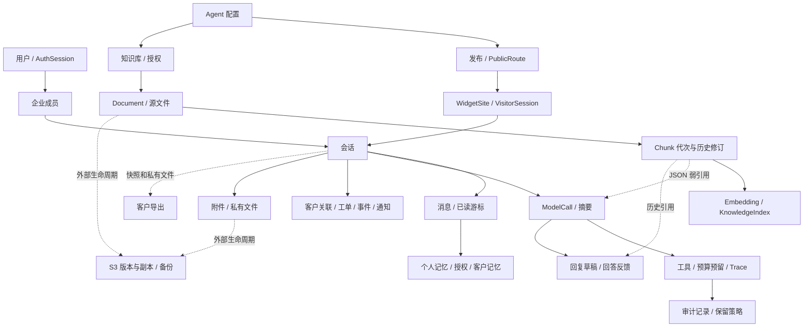

# 第一阶段：核心系统完整性、安全性与可靠性收口

交付日期：2026-11-13。状态：源码修复与静态交付完成；运行验收 **NOT_RUN**，完整擦除仍 **BLOCKED**。本报告描述本阶段增量，不将工作区原有 P15、专项 A/B 和未提交成果计为本阶段开发。

## 1. 基线与审查范围

- 分支 `main`，起始 HEAD `49fc85fbb5ba827507e4a6334a3a4daf995beb73`。工作区原已存在大量修改、未跟踪模块及 0012–0018；修改前保存 236 个文件的文本/散列基线，并对本阶段差异逐项复核。
- 已读 AGENTS.md、README、DEEP_AUDIT_REPORT、PRODUCT_QUALITY_ACCEPTANCE、P15_B_AI_UPGRADE 及相关实现。保留 FastAPI → services → SQLAlchemy / PostgreSQL、React → Adapter 和独立 Demo 架构。
- 全模块清单：身份/租户/成员/认证会话，Agent 配置/发布/Widget，知识库/授权/文档/Chunk 修订/向量索引，客服会话/消息/已读游标/内部备注/接管，客户/工单/通知/附件/客户记忆，个人记忆/授权，检索/Provider/模型网关/预算/工具/审批/后台任务，草稿/反馈/Trace/导出/擦除/保留策略，React 管理台/工作台/访客/知识页，旧版网页/Widget，CLI/Worker/部署/静态检查。
- 44 个 ORM 表、全部迁移、API 与前端文件纳入清单和静态检查；重点逐链追踪授权、知识交付、模型调用、人工消息、后台索引、文件发布、删除/保留。静态检查不等于人工证明所有分支、并发和真实环境均正确。

## 2. 确认缺陷、根因与修复

| 状态 | 原因与影响 | 本阶段修复 |
| --- | --- | --- |
| FIXED | 只校验最终引用，未覆盖历史 AI 内容、重排候选等已输入模型但未被引用的知识；撤权后可能间接传播 | 新增版本化有界知识依赖集合（最多 512），记录所有相关输入；网关派发、历史复用和结果交付复核来源与当前授权；来源不明的旧 AI 内容隐藏并拒绝复用，不擦除原记录 |
| FIXED | 人工采纳草稿失去生成来源身份，后续可能当普通人工消息复用 | 服务端写入 reply_draft_id，结合实际 sent_message_id 回查；生成草稿排除已有 AI/草稿内容，客户端不能伪造该元数据 |
| FIXED | 固定 Token 预留不能覆盖多步/备用/Embedding/重排；跨日未知用量可能退出预算统计 | 每次付费派发在跨进程准入锁内预留上界；逐步结算，未知保留预留，跨日未结算继续占用；跨 UTC 日不追加旧请求步骤 |
| FIXED | 检索耗时未完整纳入请求时限，过期后仍可能派发 | 检索沿用整轮截止时间，派发前重新计算剩余时间并检查租约，预算拒绝/超时未派发记 attempts=0 |
| FIXED | 后台向量最终 READY 与文档变更可交错，旧 Worker 可覆盖新状态 | 配置→知识库→索引锁顺序串行最终发布；回收/重配/完成使租约令牌失效，发布要求 RUNNING、匹配令牌/版本和未过期租约 |
| FIXED | 最终文件路径直接写入，进程中断可能留下被误认为完成的残缺文件 | 同 UUID pending 写完、fsync 后无覆盖发布；目录锁协调写入/恢复/删除；相同内容幂等，已有不同内容报错留待人工 |
| FIXED | 部分写路径只在请求入口校验，撤权可在后续提交前生效 | 在知识、配置、凭证、工具、授权、会话、个人记忆、反馈和附件交付等路径使用当前身份授权闸门；resume_context 绑定认证会话真实 user_id |
| FIXED | 同租户 FK 未约束引用的是同一个会话、Agent、访客站点或认证会话申请人 | 新增 0019 的 5 个唯一约束、14 个复合 FK、1 个 CHECK；历史不一致阻止升级，不自动清理 |
| FIXED | 人工发送网络响应丢失后重试会产生重复消息 | MessageCreate 必填 UUID idempotency_key；会话锁内确定性消息 ID 和精确输入冲突检查；React、旧版客服页及 Demo 同步契约，失败保留键，成功清理 |
| FIXED | Widget 关闭重开时旧初始化响应可复活旧状态；关闭会话无法感知恢复 | Widget 初始化代次与取消信号；客服/访客关闭状态继续低频刷新，收到开放状态可恢复交互 |

知识依赖不代表语义事实验证。旧 AI 输出可能因缺少来源标记不可交付，这是明确的安全兼容边界。直接工具执行仍沿用逐次工具交付校验；不赋予模型任何授权能力。

## 3. 数据生命周期与完整依赖关系

下表从当前 ORM 元数据生成，列出全部表的直接外键；`NO ACTION` 不等于可以安全物理删除。JSON、密文、文件、历史导出和备份等弱引用须结合上图及擦除预览，不能靠 FK 自动证明完整。

| 表 | 直接外键（本表列 → 目标表列；删除行为） |
| --- | --- |
| `http_buckets` | 无直接 FK |
| `tenants` | 无直接 FK |
| `users` | 无直接 FK |
| `agent_configs` | `created_by` → `users(id)` [NO ACTION] `tenant_id` → `tenants(id)` [NO ACTION] |
| `audit_events` | `actor_id` → `users(id)` [NO ACTION] `tenant_id` → `tenants(id)` [NO ACTION] |
| `auth_sessions` | `user_id` → `users(id)` [NO ACTION] |
| `budget_policies` | `tenant_id` → `tenants(id)` [NO ACTION] |
| `customers` | `created_by` → `users(id)` [NO ACTION] `tenant_id` → `tenants(id)` [NO ACTION] |
| `erasure_requests` | `requested_by` → `users(id)` [NO ACTION] `tenant_id` → `tenants(id)` [NO ACTION] |
| `knowledge_bases` | `created_by` → `users(id)` [NO ACTION] `tenant_id` → `tenants(id)` [NO ACTION] |
| `model_credentials` | `created_by` → `users(id)` [NO ACTION] `tenant_id` → `tenants(id)` [NO ACTION] |
| `public_routes` | `tenant_id` → `tenants(id)` [NO ACTION] |
| `tenant_memberships` | `tenant_id` → `tenants(id)` [NO ACTION] `user_id` → `users(id)` [NO ACTION] |
| `tool_definitions` | `created_by` → `users(id)` [NO ACTION] `tenant_id` → `tenants(id)` [NO ACTION] |
| `agent_knowledge_bases` | `created_by` → `users(id)` [NO ACTION] `tenant_id,agent_config_id` → `agent_configs(tenant_id,id)` [NO ACTION] `tenant_id,knowledge_base_id` → `knowledge_bases(tenant_id,id)` [CASCADE] `tenant_id` → `tenants(id)` [NO ACTION] |
| `agent_tools` | `created_by` → `users(id)` [NO ACTION] `tenant_id,agent_config_id` → `agent_configs(tenant_id,id)` [NO ACTION] `tenant_id` → `tenants(id)` [NO ACTION] `tenant_id,tool_id` → `tool_definitions(tenant_id,id)` [NO ACTION] |
| `conversations` | `tenant_id,assignee_id` → `tenant_memberships(tenant_id,user_id)` [NO ACTION] `created_by` → `users(id)` [NO ACTION] `tenant_id` → `tenants(id)` [NO ACTION] |
| `customer_exports` | `auth_session_id` → `auth_sessions(id)` [NO ACTION] `requested_by,auth_session_id` → `auth_sessions(user_id,id)` [NO ACTION] `requested_by` → `users(id)` [NO ACTION] `tenant_id,customer_id` → `customers(tenant_id,id)` [NO ACTION] `tenant_id` → `tenants(id)` [NO ACTION] |
| `documents` | `created_by` → `users(id)` [NO ACTION] `tenant_id,knowledge_base_id` → `knowledge_bases(tenant_id,id)` [NO ACTION] `tenant_id` → `tenants(id)` [NO ACTION] |
| `knowledge_indexes` | `auth_session_id` → `auth_sessions(id)` [NO ACTION] `requested_by,auth_session_id` → `auth_sessions(user_id,id)` [NO ACTION] `requested_by` → `users(id)` [NO ACTION] `tenant_id,agent_config_id` → `agent_configs(tenant_id,id)` [NO ACTION] `tenant_id,knowledge_base_id` → `knowledge_bases(tenant_id,id)` [NO ACTION] `tenant_id` → `tenants(id)` [NO ACTION] |
| `publications` | `created_by` → `users(id)` [NO ACTION] `tenant_id,agent_config_id` → `agent_configs(tenant_id,id)` [NO ACTION] `tenant_id` → `tenants(id)` [NO ACTION] `tenant_id,id` → `public_routes(tenant_id,id)` [NO ACTION] |
| `user_memory_consents` | `tenant_id,user_id` → `tenant_memberships(tenant_id,user_id)` [CASCADE] |
| `conversation_collaboration` | `actor_id` → `users(id)` [NO ACTION] `tenant_id,conversation_id` → `conversations(tenant_id,id)` [CASCADE] `tenant_id` → `tenants(id)` [NO ACTION] |
| `conversation_customers` | `created_by` → `users(id)` [NO ACTION] `tenant_id,conversation_id` → `conversations(tenant_id,id)` [NO ACTION] `tenant_id,customer_id` → `customers(tenant_id,id)` [NO ACTION] `tenant_id` → `tenants(id)` [NO ACTION] |
| `document_chunks` | `tenant_id,revised_by` → `tenant_memberships(tenant_id,user_id)` [NO ACTION] `tenant_id,document_id,generation,position,root_chunk_id` → `document_chunks(tenant_id,document_id,generation,position,id)` [NO ACTION] `tenant_id,document_id` → `documents(tenant_id,id)` [CASCADE] `tenant_id` → `tenants(id)` [NO ACTION] |
| `tickets` | `created_by` → `users(id)` [NO ACTION] `tenant_id,conversation_id` → `conversations(tenant_id,id)` [NO ACTION] `tenant_id,customer_id` → `customers(tenant_id,id)` [NO ACTION] `tenant_id,assignee_id` → `tenant_memberships(tenant_id,user_id)` [NO ACTION] `tenant_id` → `tenants(id)` [NO ACTION] |
| `widget_sites` | `tenant_id,publication_id` → `publications(tenant_id,id)` [NO ACTION] `tenant_id` → `tenants(id)` [NO ACTION] |
| `staff_notifications` | `tenant_id,user_id` → `tenant_memberships(tenant_id,user_id)` [NO ACTION] `tenant_id` → `tenants(id)` [NO ACTION] `tenant_id,ticket_id` → `tickets(tenant_id,id)` [NO ACTION] |
| `ticket_events` | `actor_id` → `users(id)` [NO ACTION] `tenant_id` → `tenants(id)` [NO ACTION] `tenant_id,ticket_id` → `tickets(tenant_id,id)` [NO ACTION] |
| `visitor_sessions` | `tenant_id,publication_id,site_id` → `widget_sites(tenant_id,publication_id,id)` [NO ACTION] `tenant_id,conversation_id` → `conversations(tenant_id,id)` [NO ACTION] `tenant_id,publication_id` → `publications(tenant_id,id)` [NO ACTION] `tenant_id` → `tenants(id)` [NO ACTION] `tenant_id,site_id` → `widget_sites(tenant_id,id)` [NO ACTION] |
| `widget_bootstraps` | `tenant_id` → `tenants(id)` [NO ACTION] `tenant_id,site_id` → `widget_sites(tenant_id,id)` [NO ACTION] |
| `conversation_attachments` | `created_by` → `users(id)` [NO ACTION] `tenant_id,conversation_id` → `conversations(tenant_id,id)` [NO ACTION] `tenant_id` → `tenants(id)` [NO ACTION] `tenant_id,visitor_session_id` → `visitor_sessions(tenant_id,id)` [NO ACTION] `tenant_id,conversation_id,visitor_session_id` → `visitor_sessions(tenant_id,conversation_id,id)` [NO ACTION] |
| `model_calls` | `created_by` → `users(id)` [NO ACTION] `tenant_id,agent_config_id` → `agent_configs(tenant_id,id)` [NO ACTION] `tenant_id,conversation_id` → `conversations(tenant_id,id)` [NO ACTION] `tenant_id` → `tenants(id)` [NO ACTION] `tenant_id,conversation_id,visitor_session_id` → `visitor_sessions(tenant_id,conversation_id,id)` [NO ACTION] `tenant_id,visitor_session_id` → `visitor_sessions(tenant_id,id)` [NO ACTION] |
| `visitor_feedback` | `tenant_id,conversation_id,visitor_session_id` → `visitor_sessions(tenant_id,conversation_id,id)` [CASCADE] `tenant_id,conversation_id` → `conversations(tenant_id,id)` [CASCADE] `tenant_id` → `tenants(id)` [NO ACTION] `tenant_id,visitor_session_id` → `visitor_sessions(tenant_id,id)` [CASCADE] |
| `chunk_embeddings` | `tenant_id,chunk_id` → `document_chunks(tenant_id,id)` [NO ACTION] `tenant_id,index_id` → `knowledge_indexes(tenant_id,id)` [NO ACTION] `tenant_id,model_call_id` → `model_calls(tenant_id,id)` [NO ACTION] `tenant_id` → `tenants(id)` [NO ACTION] |
| `cost_reservations` | `tenant_id,agent_config_id,model_call_id` → `model_calls(tenant_id,agent_config_id,id)` [NO ACTION] `tenant_id,agent_config_id` → `agent_configs(tenant_id,id)` [NO ACTION] `tenant_id,model_call_id` → `model_calls(tenant_id,id)` [NO ACTION] `tenant_id` → `tenants(id)` [NO ACTION] |
| `messages` | `tenant_id,conversation_id,model_call_id` → `model_calls(tenant_id,conversation_id,id)` [NO ACTION] `created_by` → `users(id)` [NO ACTION] `tenant_id,conversation_id` → `conversations(tenant_id,id)` [NO ACTION] `tenant_id,model_call_id` → `model_calls(tenant_id,id)` [NO ACTION] `tenant_id` → `tenants(id)` [NO ACTION] |
| `tool_executions` | `tenant_id,agent_config_id,model_call_id` → `model_calls(tenant_id,agent_config_id,id)` [NO ACTION] `tenant_id,conversation_id,model_call_id` → `model_calls(tenant_id,conversation_id,id)` [NO ACTION] `created_by` → `users(id)` [NO ACTION] `tenant_id,agent_config_id` → `agent_configs(tenant_id,id)` [NO ACTION] `tenant_id,conversation_id` → `conversations(tenant_id,id)` [NO ACTION] `tenant_id,model_call_id` → `model_calls(tenant_id,id)` [NO ACTION] `tenant_id` → `tenants(id)` [NO ACTION] `tenant_id,tool_id` → `tool_definitions(tenant_id,id)` [NO ACTION] |
| `conversation_read_cursors` | `tenant_id,conversation_id,message_id` → `messages(tenant_id,conversation_id,id)` [CASCADE] `tenant_id,user_id` → `tenant_memberships(tenant_id,user_id)` [CASCADE] |
| `conversation_summaries` | `tenant_id,conversation_id,model_call_id` → `model_calls(tenant_id,conversation_id,id)` [CASCADE] `tenant_id,conversation_id` → `conversations(tenant_id,id)` [CASCADE] `tenant_id,model_call_id` → `model_calls(tenant_id,id)` [CASCADE] `tenant_id` → `tenants(id)` [NO ACTION] `tenant_id,conversation_id,source_end_id` → `messages(tenant_id,conversation_id,id)` [CASCADE] `tenant_id,conversation_id,source_start_id` → `messages(tenant_id,conversation_id,id)` [CASCADE] |
| `customer_memories` | `confirmed_by` → `users(id)` [NO ACTION] `tenant_id,customer_id` → `customers(tenant_id,id)` [NO ACTION] `tenant_id,source_conversation_id,source_message_id` → `messages(tenant_id,conversation_id,id)` [NO ACTION] `tenant_id` → `tenants(id)` [NO ACTION] |
| `reply_drafts` | `auth_session_id` → `auth_sessions(id)` [NO ACTION] `tenant_id,agent_config_id,model_call_id` → `model_calls(tenant_id,agent_config_id,id)` [NO ACTION] `tenant_id,conversation_id,model_call_id` → `model_calls(tenant_id,conversation_id,id)` [NO ACTION] `requested_by,auth_session_id` → `auth_sessions(user_id,id)` [NO ACTION] `requested_by` → `users(id)` [NO ACTION] `tenant_id,agent_config_id` → `agent_configs(tenant_id,id)` [NO ACTION] `tenant_id,conversation_id` → `conversations(tenant_id,id)` [NO ACTION] `tenant_id,conversation_id,sent_message_id` → `messages(tenant_id,conversation_id,id)` [NO ACTION] `tenant_id,model_call_id` → `model_calls(tenant_id,id)` [NO ACTION] `tenant_id` → `tenants(id)` [NO ACTION] |
| `tool_approvals` | `decided_by` → `users(id)` [NO ACTION] `requested_by` → `users(id)` [NO ACTION] `tenant_id,agent_config_id` → `agent_configs(tenant_id,id)` [NO ACTION] `tenant_id,conversation_id` → `conversations(tenant_id,id)` [NO ACTION] `tenant_id` → `tenants(id)` [NO ACTION] `tenant_id,tool_id` → `tool_definitions(tenant_id,id)` [NO ACTION] `tenant_id,execution_id` → `tool_executions(tenant_id,id)` [NO ACTION] |
| `user_memories` | `tenant_id,source_conversation_id,source_message_id` → `messages(tenant_id,conversation_id,id)` [CASCADE] `tenant_id,user_id` → `tenant_memberships(tenant_id,user_id)` [CASCADE] |

### 所有权、保留与删除决策

| 数据类别 | 处理边界 | 状态 |
| --- | --- | --- |
| 用户个人记忆、授权、已读游标 | user+tenant RLS，管理员无法枚举其他用户；本人的既有单条操作需当前授权 | 个人功能保留；全用户擦除 BLOCKED |
| 企业共享知识、历史 Chunk、会话、工单与多方客户记录 | 必须区分企业资产、参与人数据、来源修订及留存义务；不可直接级联擦除 | 整体会话/共享文档物理删除 BLOCKED |
| ModelCall、工具结果、草稿、导出、摘要与 JSON 引用 | 包含内容副本、弱引用和执行未知状态；需主体感知清单、冻结范围和恢复协议 | BLOCKED |
| 审计 | 原有最短保留与确认摘要保持；只记录擦除标识、原因与阻断状态，不复制正文 | 现有有界策略保留；个体脱敏政策 DEFERRED |
| 本地文件 | 数据库已提交 UUID 关联，pending→发布；失配不覆盖；无法跨存储/DB 做原子事务 | 写入与重试修复；崩溃恢复运行确认 NOT_RUN |
| S3 版本/副本、临时导出、备份和恢复回放 | 在线角色无法证明全版本删除及恢复抑制 | BLOCKED，需部署方留存与回放规则 |

`erasure.preview` 返回完整 FK 元数据、弱引用列、可见计数和 UNKNOWN 名称；不提供可执行确认、不改变源数据或宣称已撤销访问。`retention_plan` 保留身份+内容摘要确认，有界数量超限及 RLS 隐藏项标 UNKNOWN；发现会话/文档范围即阻断。已确认允许的其他保留任务仍按锁内重新选择并比较快照，不把新增数据自动纳入删除。没有为了完成擦除而使用超级用户、旁路 RLS 或扩大运行角色。

解除阻断的具体缺口：主体/共享记录归属及批准的留存规则；用户级 RLS 下可证明完整的逐主体枚举；JSON/密文副本索引；跨 DB/对象版本的冻结清单与幂等阶段账本；确认后变化的处理；失败恢复和审计脱敏；备份到期及恢复回放抑制。上述均不能仅由 FK 迁移解决。

## 4. 权限与数据库审查

- 当前声明：44 表，37 个 tenant FORCE RLS 表，其中 user_memories、user_memory_consents、conversation_read_cursors 叠加 user 范围；其他 7 个身份/定位/管理表沿用专门服务端访问边界，PublicRoute 不机械加破坏公开定位的 RLS。
- PublicRoute→Publication 已有同租户 FK 保留；已读游标绑定用户+会话+最后消息；记忆证据、文档/Chunk 的租户、代次和历史根关系；answer_feedback 的调用/用户及状态边界；发布快照与当前 Agent 工具/知识权限均纳入审查。
- Cookie/Session、Visitor Token、企业切换、撤权和公开发布交付继续使用当前身份、发布与站点检查。历史、工具结果和 Trace 沿用授权过滤；本轮补全未引用知识输入的间接泄漏路径。
- 禁止任意代码/Shell/SQL 的工具目录保持静态；模型参数通过 Schema 和服务端资源归属验证，读写风险由服务器决定，写操作保留确认/审批和幂等。
- 0019 仅增量约束与唯一键；没有修改或执行 0001–0018、没有连接数据库。新 head 需另行授权升级；生产启动前校验 head，不兼容旧数据库直接启动。索引/约束扫描开销、已有坏数据及 RLS 真实效果 NOT_RUN。
- 0019 的 CHECK 使用 Alembic op.f 保持 ORM 命名一致；PostgreSQL 方言与 0018→0019 离线 SQL 逐约束比较，避免命名约定重复前缀。

## 5. 消息、Agent 与文件安全

人工消息幂等契约已同步 API/React/旧网页/Demo；同一键修改正文或内部备注属性返回冲突，访客连续发送仍保留原有队列、同会话忙互斥与幂等；内部备注不进入访客消息、模型可信用户事实。会话关闭/恢复、状态轮询、账号维度草稿/请求键、请求取消及 Widget 生命周期作定点修复，无整体 UI 重构。

工具静态注册、逐次授权、输入/输出限制、步数/调用/时限预算、幂等与 unknown 不重试继续保留。模型网关补充每步 Token 准入、总截止时间和派发前知识校验；unknown 用量不会记为零。配置中的 Token 上界必须正确且足够保守，旧未知请求的历史预留是否充分仍需操作员核对，付费上线前不能用本报告代替核对。

文档处理、历史修订和引用追溯保留；本地写入原子发布不等于 DB 与对象存储的分布式事务。S3 全版本擦除、旧版残缺最终文件与不可证明归属的对象继续人工处理，不自动覆盖或清库。

## 6. 修改文件（相对进入本阶段的脏基线）

- `README.md`
- `docs/DEPLOYMENT.md`
- `docs/FINALIZATION_PHASE_1.md`
- `frontend/src/adapters/demo.ts`
- `frontend/src/adapters/errors.ts`
- `frontend/src/features/chat/ChatPage.tsx`
- `frontend/src/features/visitor/VisitorPage.tsx`
- `migrations/versions/0019_core_integrity.py`
- `src/support_agent/api/conversations.py`
- `src/support_agent/db.py`
- `src/support_agent/dependencies.py`
- `src/support_agent/models.py`
- `src/support_agent/retention.py`
- `src/support_agent/schemas.py`
- `src/support_agent/services/agent_turns.py`
- `src/support_agent/services/agents.py`
- `src/support_agent/services/answer_feedback.py`
- `src/support_agent/services/attachments.py`
- `src/support_agent/services/background.py`
- `src/support_agent/services/chat.py`
- `src/support_agent/services/conversations.py`
- `src/support_agent/services/drafts.py`
- `src/support_agent/services/knowledge.py`
- `src/support_agent/services/knowledge_provenance.py`
- `src/support_agent/services/limits.py`
- `src/support_agent/services/memory.py`
- `src/support_agent/services/model_configs.py`
- `src/support_agent/services/model_runtime.py`
- `src/support_agent/services/operations.py`
- `src/support_agent/services/public_delivery.py`
- `src/support_agent/services/search.py`
- `src/support_agent/services/tools.py`
- `src/support_agent/services/user_memory.py`
- `src/support_agent/services/vector_index.py`
- `src/support_agent/services/workspace.py`
- `src/support_agent/storage.py`
- `src/support_agent/streaming.py`
- `src/support_agent/web/chat.js`
- `src/support_agent/web/widget.js`

依赖与历史迁移保持不变；没有新增测试、框架或运行基础设施。该清单不等于整个 git diff：原有工作区变更仍保留。

## 7. 静态检查与证据边界

| 检查 | 结果与范围 |
| --- | --- |
| Ruff / 格式 / AST | PASS：check.py 最终退出 0；164 个格式目标、128 个 Python 源文件 |
| 迁移链 / 离线 SQL / RLS 声明 | PASS：19 个线性迁移及 37 个 RLS 表声明；只生成 SQL |
| PostgreSQL 方言 | PASS：44 表及索引编译；0018→0019 离线 SQL 与 ORM 的 20 个新增约束精确匹配 |
| 历史文件保护 | PASS：基线内 21 个历史迁移及锁文件散列一致，0001–0018 未改 |
| OpenAPI 元数据 | PASS：仅导入路由/Schema，无应用实例或请求；127 路径、174 操作、159 Schema，MessageCreate 幂等键必填 |
| TypeScript | PASS：npm run check --prefix frontend，tsc --noEmit |
| JavaScript / 发布资源 / 文档链接 / 已知敏感文件模式 | PASS：check_delivery.py，262 文件；已有源码资源检查，无构建产物或 wheel 检验 |
| git diff --check | PASS：已跟踪差异无空白错误；新增文本另行空白检查 |
| 依赖/许可证 | 静态核对 uv/npm 锁及已有许可证；无依赖改动；实时漏洞库、镜像层扫描 NOT_RUN |

最终检查中发现一处新增函数签名格式不符，已用 Ruff 仅格式化对应文件并重跑通过。一次 OpenAPI 检查脚本导入不存在的聚合 router 失败，随后改为导入各模块路由并成功完成；未调用任何业务 API。

## 8. 遗留与后续边界

- **BLOCKED**：会话整体删除、全用户数据擦除、共享知识文档及关联副本物理删除、S3 全版本/副本/备份清理，具体缺口见生命周期节。
- **NOT_RUN**：测试、构建、服务、数据库连接/RLS/迁移执行、并发/崩溃恢复、浏览器交互、真实模型、VPS、推送与部署。所有 FIXED 指源码实现和静态核验，不声称运行效果。
- **DEFERRED**：完整主体归属和审计脱敏/留存制度、迁移前现网数据核对、外部漏洞库与镜像层检查；不在本轮引入新基础设施。
- 第二阶段在此基线上改善检索、Agent、上下文、Trace/反馈、性能和交互，保留以上安全阻断与全部操作限制。
