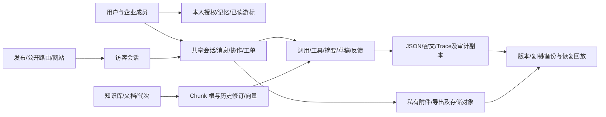

# 最终产品验收与质量收口

日期：2026-11-13。结论：**本轮源码修复和静态交付完成，实际可用性尚未验收，不能据此宣称生产就绪。** 未发现可确认的新增 P0；确认的检索入口/召回问题及部署前置缺口已处理。完整物理擦除继续 BLOCKED，运行、模型、浏览器和实际部署均 NOT_RUN。

`FIXED` 指代码或配置已修改；`PASS` 只覆盖明确列出的静态检查；`VERIFIED` 须有对应实际验证证据，本轮没有业务运行 VERIFIED 项。`NOT_RUN` 是未执行，`BLOCKED` 是缺少授权/完整性或外部条件，`DEFERRED` 是明确延期。历史运行记录不能作为当前版本验收证据。

## 1. 基线和全项目审查结论

- 实际仓库为 `support-agent-platform`，分支 `main`，HEAD `49fc85fbb5ba827507e4a6334a3a4daf995beb73`；进入本轮时暂存区为空、工作区已有大量修改/删除及未跟踪成果。修改前记录 263 个现存发布文件的内容和 SHA-256，不把全部 Git diff 归入本轮。
- 已阅读 AGENTS.md、README、两阶段交付、DEEP_AUDIT_REPORT、PRODUCT_QUALITY_ACCEPTANCE 及相关当前实现/diff。历史报告中的旧 head、表数和验收结果按其时间理解；当前以 0019、44 个 ORM 表和 37 张 FORCE RLS 表为准。
- 全项目文件清单和静态扫描覆盖 Python/API/Schema/services/ORM、全部 0001–0019 迁移、React/Adapter/Demo/旧网页/Widget、部署/CI/依赖/许可证/文档。深读重点为身份与撤权、知识历史交付、消息接管与幂等、Agent/工具/记忆/预算、擦除阻断以及新检索/部署增量；不是逐分支形式化证明。
- 复核保留 FastAPI → services → SQLAlchemy/PostgreSQL、React → Adapter、静态 Demo 分离架构。三个已授权 Terra 只读复核流覆盖 P0 后端、Agent/费用和前端闭环，未确认额外高置信 P0/P1；检索改动另作调用方与边界复核。未由子智能体修改文件或执行运行验收。
- 迁移/ORM/db、依赖清单与锁、基础 Compose、两阶段报告共 29 项散列不变；所有 React、Provider、记忆、工具、预算及此前来源追溯实现保留。本轮没有新依赖、新迁移、重构、测试体系或远端写入。

## 2. 核心客服业务闭环

下表为当前源码路径核对，统一状态为 **PASS（源码/契约审查）+ NOT_RUN（实际业务）**，不等于业务已验收。完整擦除例外明确列为 BLOCKED。

| 环节 | 当前实现与主要核对点 |
| --- | --- |
| 1. 管理员创建/配置 Agent | agents、model_configs、React Agents；服务端管理员、版本和配置快照 |
| 2. Provider/凭证 | model_access、credentials、providers、ModelRouting；密文、精确端点、能力及价格，不交付秘密 |
| 3. 知识创建/处理 | knowledge、ingestion、storage；格式/体积/进程限制、去重、发布、处理 token/租约 |
| 4. Agent 知识授权 | agent_knowledge_bases、workspace、knowledge_provenance；当前授权交集与交付复核 |
| 5. 发布/Widget 初始化 | public_delivery、widget_identity、widget.js；发布/网站版本、一次性签名及身份握手 |
| 6. 访客进入 | VisitorPage、bootstrap、VisitorSession；访客与员工身份隔离、令牌作用域 |
| 7. 理解/检索 | chat、agent_turns、search、retrieval；有界词法/向量、当前来源、多轮输入预算 |
| 8. 回答/引用交付 | 来源依赖、原文/代次/授权复核、安全摘录、撤权遮蔽；引用不证明语义正确 |
| 9. 多轮追问 | 当前问题、筛选历史、用户来源摘要、可选个人记忆；复杂指代效果未验收 |
| 10. 工具调用 | 静态注册、Schema、逐次授权、风险/审批、同批重复预检、预算/幂等/审计 |
| 11. 转人工 | operations、handoff、human_handoff、访客操作；未解决结果与接管入口、持久事实交接 |
| 12. 人工期访客消息 | 独立 messages 入口，会话锁、稳定键、限频、发布/访客当前授权 |
| 13. 客服连续回复 | conversation messages、ChatPage；必填 UUID 幂等键、同键异内容冲突、历史恢复 |
| 14. 恢复 AI | handling 状态/负责人/版本检查；关闭会话保留低频刷新以观察恢复 |
| 15. 历史/游标/未读 | 单调用户游标、稳定分页/去重、消息来源交付；仅可见最新页按呈现位置更新已读 |
| 16. 备注/协作 | 员工备注与公开消息隔离；备注不成为模型可信用户事实、不计访客未读 |
| 17. 满意度/回答反馈 | visitor_feedback、answer_feedback、FeedbackInbox；身份固定、版本冲突及来源关联 |
| 18. Trace/运营 | 无正文的本人/管理员时间线、费用按币种、未知状态；无接收成功或账单承诺 |
| 19. 个人记忆 | 显式同意/保存、来源/版本/有效期、本人 RLS、撤回与交付依赖；不自动保存 |
| 20. 保留/擦除 | retention 的有界确认与可执行子集保留；会话/用户/文档及关联副本完整擦除 BLOCKED |

源码具备这些闭环入口，但真实双端同步、并发、异常恢复和 UX 仍必须逐项人工验收。取消等待不意味着服务器未执行；未知请求先查记录并使用原键恢复，不能凭超时生成新键重复业务操作。

## 3. AI 能力与安全边界

- **RAG**：保留中文二字组/英文词法、显式同义表达、多库共同候选、pgvector 1536 维空间绑定、RRF 和可选有价重排。每条 FTS 通道最多 60 候选；向量与重排继续有界。不增加无界召回、新模型或独立向量库。
- **本轮 FIXED**：多个孤立汉字（如 `猫 狗`）没有二字组/英文表达式，原先在内部检索静默为空；改为复用受限汉字路径，多个字符以 AND 约束。单字仍适用；有 FTS 词项的混合查询继续在现有候选上过滤孤立字，不放大范围。
- **本轮 FIXED**：直接知识搜索 API 根据原始 query 判断是否单字，导致 `怎么退`、`退？` 等虽已规范化为单字仍被前置拒绝；现在按规范化 groups 判断，与检索层一致。纯停用词/标点仍返回 unsupported_query；超范围明确报 query_too_broad，不冒充知识无答案。
- 汉字回退保留最多 1000 个当前可见 Chunk、最多 60 个匹配、1 秒 statement_timeout、返回 1–10；第二次查询限定首次选出的 IDs 并重复当前状态/授权范围条件，LIKE 使用绑定值。真实 SQL 计划、超时和并发行为 NOT_RUN。
- **回答**：证据选择/ID/原文/代次和权限校验后输出安全摘录；无证据或无法可靠组织时保持未解决。`evidence_synthesis` 仍为未经语义验证的综合草稿，事实/推断/不确定分类和逐项来源不构成语义证明，`semantic_verified=false`。保守冲突规则不能识别所有自然语言矛盾。
- **工具**：复用现有客服/客户/工单/知识工具与固定服务命令。模型不能授权自己，访客禁用内部能力；R2/R3 继续由风险策略和必要的独立审批限制。无任意代码、Shell、SQL、处理器路径或任意网络地址执行入口。未知结果不盲重试，跨轮业务幂等仍由具体命令治理。
- **上下文/记忆**：当前问题优先，摘要仅使用合规用户来源，不把助手/备注/工具结果提升为可信事实。空摘要推进水位、实际输入记忆绑定、版本/过期/同意撤回和有界预算成果保留。复杂条件修改、话题切换和记忆相关性不能仅由静态检查证明。

## 4. 数据生命周期与迁移兼容性

完整 44 表 FK 清单及所有权分析复用 [第一阶段生命周期图](FINALIZATION_PHASE_1.md#3-数据生命周期与完整依赖关系)；本轮 ORM 和迁移无变化。主要依赖仍为：

| 数据类别 | 当前策略与阻断 |
| --- | --- |
| 个人数据 | 本人记忆/授权/游标受 tenant+user RLS；管理员无法枚举他人记录，隐藏计数 UNKNOWN，不能据级联删除推定完整擦除 |
| 企业共享数据 | 会话、知识、工单及多参与人记录不能简单归属于请求人；需要批准的共享归属/留存/脱敏规则 |
| 历史副本 | Chunk/引用、调用与工具 JSON、草稿原文、摘要、导出及审批密文须主体感知清单；FK 图不足以证明无副本 |
| 审计 | 保留既有最短保留与有界确认，擦除请求只记录标识/原因/阻断；个体脱敏及法定保留政策 DEFERRED |
| 文件/外部副本 | 本地 pending→fsync→不覆盖发布及幂等协调保留；S3 所有版本/副本、备份到期及恢复删除抑制 BLOCKED |

整体删除不生成可执行的“不完整确认”。既有可执行保留操作将对象和内容摘要绑定确认，锁内复核，不自动扩大至新数据。完整擦除须先补足主体/共享归属、RLS 下完整枚举、版本冻结清单、数据库/文件幂等阶段账本、失败恢复及备份回放规则；不绕过 RLS、不使用超级用户擦除、不扩大运行角色权限。

迁移链 0001–0019 保持不变；本轮不新增 0020，也没有执行任何迁移。0013 的 PublicRoute/Publication 同租户、Chunk 修订根及当前版本约束保留；0019 的 5 个唯一键、14 个复合外键和 1 个 CHECK 保留，绑定会话/Agent/访客/网站及申请人与 AuthSession。完整增量和不兼容项见 [0019 升级闸门](DEPLOYMENT.md#第一阶段升级闸门0019未执行)。

升级须先审查真实 revision、未提交草稿是否曾应用、历史不一致行、约束扫描/锁开销并停写排空和一致备份，再在另行授权的隔离新库确认。0018 前必须启用 vector；0019 不一致历史行将拒绝升级，不自动清理、stamp 或改写旧迁移。新代码不能直接连接旧 Schema，不能新旧知识写入代码并行运行。实际运行角色、扩展权限、RLS 和升级兼容性均 NOT_RUN。

## 5. 性能、路由与成本

本轮没有性能实测或比例结论。继续保留第二阶段已有优化：摘要前置后仅构造一次检索上下文；同端点/模型空间请求内复用查询向量（包括失败）；个人记忆来源 JOIN；草稿列表复用会话 digest；索引最终状态批量复核；自然边界切片和片段 join；空证据/无工具直接未解决。

模型能力/主备路由、调用数/Token/金额预留和整轮截止时间保持；未知外部结果不盲换模型重试，未知用量和费用不补零。价格来自调用时精确端点的有时限快照；未确认成本上界或金额策略不开启付费调用。Token 逐步按上下文+输出上界保守预留，未知/运行中占用跨日保留，旧 UTC 日请求不新增付费步骤。历史未知占用和供应商账单仍需人工核对。

运营费用按币种显示已知小计与完整性，不跨币种相加、不按今天价格重算历史。大查询、SSE 连接/队列/心跳、前端轮询退避、关闭会话低频刷新、文件解析进程及输出/RSS 限制保持。实际查询计划、峰值资源、费用与供应商能力均未测量。

## 6. 前端、Demo 与 Pages

React 19 / HeroUI v3 / Tailwind v4 保持，无新增页面、依赖或视觉重构。源码复核账号/租户重挂载、草稿隔离、请求代次/取消、人工与 AI 切换、游标去重/未读、Trace 刷新、知识诊断 busy 状态及 Widget 关闭重开；本轮不修改前端。

Demo 使用虚构本地状态，编译别名选 Demo Adapter，构建图检查禁止网络 Adapter 混入；正式包反向禁止 Demo 数据。静态审查 Demo 状态重置/访客失效及 Widget 演示资产，保留存储不可用时无法跨上下文共享内存的限制。CSP 的 connect-src 为 none，正式 API、数据库和真实模型不属于 Demo 路径；这些是源码配置结论，实际 CSP、构建产物和浏览器效果 NOT_RUN。

保留 [GitHub Pages 公开入口](https://koajsj.github.io/kefuagent/)和手动 pages-demo 工作流。本轮未打开站点、获取线上产物、触发工作流或发布，不能声称公开站点当前正常或包含本轮代码。人工/访客双向通信、复制、滚动、重置、iframe 和跨站限制均待授权验收。

## 7. 部署配置和依赖

- **FIXED（配置/说明）**：新增显式 [pgvector 隔离叠加配置](../docker/compose.pgvector.yaml)，固定 PostgreSQL 17 / pgvector 0.8.7 / Bookworm；强制显式设置新数据库卷和新文档卷名称。基础 compose.yaml 不变，不自动选择、启动、启用扩展或迁移。已对照 [官方版本说明](https://github.com/pgvector/pgvector/blob/v0.8.7/README.md#docker)与 [Dockerfile](https://github.com/pgvector/pgvector/blob/v0.8.7/Dockerfile)，实际 digest/架构/加载仍 NOT_RUN。
- 部署文档明确扩展文件安装与库内启用的区别、独立受控维护身份、先扩展后 0001–0019、所有命令保留新项目/叠加文件/新卷参数；QUICK_START 补齐本机 INIT 不安装扩展的前置；P8 旧 17 表计数更新为当前 37。只有未占用的新项目与卷可采用此方案，配置不能自动证明卷名未占用。
- **BLOCKED（既有环境）**：基础 postgres:17 仍不能直接满足 vector；不能把叠加配置指向已有业务卷解决。既有数据库镜像/发行版/locale/大版本和扩展变更、权限及恢复兼容性须单独审查，不能通过新增配置宣称已修复实际环境。
- Dockerfile 仍分阶段构建、UID 10001 运行，应用不持有迁移凭证；数据库无宿主公开端口，文档目录私有；Nginx 规范 Host/HTTPS/覆盖代理头、限制体积/连接、关闭 SSE 缓冲。静态阅读不替代 nginx -t、TLS、实际文件权限/ACL 和网络验收。
- Python 3.11–3.14、PostgreSQL 15+ 是兼容声明，本轮仅语法/方言编译；wheel 资源声明、旧网页/React 交付路径及许可证复制保留。没有构建 wheel/镜像或读取不存在的产物来宣称交付成功。
- uv/npm 清单和锁一致，未安装依赖或升级版本；40 个本机 Python 精确版本及声明许可文件可见，greenlet/tzdata 未安装；npm 锁中非根条目均有许可声明。许可存在不是完整法律合规或无漏洞证明。
- Actions 8 处引用/6 个唯一 action 均固定 40 位 SHA；Dependabot 的 actions/npm/uv/docker 配置保留。未核验 SHA 上游身份或当前 CVE/OSV/npm audit、镜像层，未触发 CI。

## 8. 本轮缺陷和修改清单

| 优先级/状态 | 根因、影响与修复 |
| --- | --- |
| P1 / FIXED | 中文规范化结果与 API 原始单字判断不一致，部分可检索问句被拒绝；入口改按 groups 判定 |
| P1 / FIXED | 多个孤立汉字没有 FTS 表达式时静默空结果；复用原有界汉字查询，多字 AND，资源与授权上限不变 |
| P1 / FIXED（配置） | 默认 PostgreSQL 镜像缺 pgvector 且快速开始未披露前置；增加显式隔离配置/固定扩展版本和升级说明，实际部署 NOT_RUN |
| P1 / FIXED（操作说明） | P8 示例直接复制可能落到默认 Compose 项目；迁移、检查、启动及停止/恢复均显式携带必填隔离项目与叠加配置，并要求迁移连接指向该新项目的数据库 |

相对本轮进入时的脏基线，仅以下 8 个文件产生增量：

- `src/support_agent/api/knowledge.py`
- `src/support_agent/retrieval.py`
- `docker/compose.pgvector.yaml`（新增）
- `docs/DEPLOYMENT.md`
- `docs/P8_DEPLOYMENT.md`
- `docs/QUICK_START.md`
- `docs/FINAL_PRODUCT_ACCEPTANCE.md`（新增）
- `README.md`

没有改写两阶段成果、历史迁移、运行数据库、已有文件/备份或密钥，没有提交、推送、发布或部署。

## 9. 本轮静态检查

| 实际检查 | 结果与边界 |
| --- | --- |
| `.venv/bin/python scripts/check.py` | PASS：Ruff、165 格式目标、128 Python AST、19 线性迁移及离线 SQL/RLS 声明；未连接数据库 |
| `npm run check --prefix frontend` | PASS：tsc --noEmit，未构建或运行 React |
| `.venv/bin/python scripts/check_delivery.py` | PASS：JavaScript node --check/静态模块链接、HTML 资源、265 发布文件、Markdown 本地链接及已知秘密模式；产物/wheel NOT_RUN |
| PostgreSQL 元数据编译 | PASS：44 表、48 个显式索引；不是实际建表/执行或迁移结构全等证明 |
| API/OpenAPI 元数据 | PASS：只导入路由/Schema，127 路径、174 操作、159 Schema；消息幂等字段必填及费用字段仍存在，无应用实例、HTTP 或业务执行 |
| Python 3.11 AST | PASS：128 文件按 feature_version=3.11 解析；非 Python 版本运行矩阵 |
| YAML / Shell | PASS：Ruby YAML 解析 6 文件；sh -n 检查本机脚本，未执行脚本或 Compose |
| 依赖/许可/Actions | PASS：42 个外部 Python 锁包，40 本机精确版本及声明许可文件；npm 214 锁条目/根依赖一致/非根许可元数据；8 处 SHA 格式。未安装的 2 包及实时安全库 NOT_RUN |
| 成果保护 / Diff | PASS：29 项受保护文件散列一致，另核对全部本轮增量和未跟踪报告/配置行尾；git diff --check，暂存区为空、HEAD 不变 |
| 静态安全模式与调用链 | PASS（指定范围）：检查动态执行、Shell/反序列化、HTML 注入、网络入口及关键权限链；发现的子进程为固定生产隔离入口，无新增通用执行能力。不是完整安全证明 |

一次许可元数据检查最初按旧 dist-info 根路径查找 LICENSE，因安装包采用 dist-info/licenses 布局而失败；改按安装 RECORD 声明核对后通过，没有修改依赖或伪造许可文件。源码核心检查没有失败。所有 PASS 仅限本表范围。

最终独立文档复核指出 P8 可复制命令尚未完整携带隔离参数，已统一修正；项目名本身不能约束迁移 URL，文档另外要求逐项核对运行/迁移连接只指向获准的新库。仅为将来人工操作模板，未执行其中命令。

## 10. 待单独授权的隔离人工验收

以下是待执行的人工项目，**本轮均 NOT_RUN，未获当前授权前不能开展**；不创建自动化套件、夹具、探针或压力任务。每项事先记录隔离项目、全新路径/库/卷/存储前缀、端口、账号范围和动作授权，确认不引用现有业务或生产环境、配置/密钥/备份。

| 授权项目 | 最小人工验收内容与应保留证据 |
| --- | --- |
| A. 交付产物 | 在独立目录构建正式 React、Demo、wheel/镜像；记录版本/资源清单/许可证，确认正式与 Demo 互斥、包内资源完整，无外部模型 |
| B. 新隔离库 | 确认镜像 digest、PostgreSQL/pgvector 版本；独立维护身份启用扩展，迁移身份从空库应用 0001–0019；运行身份验证非 owner/NOBYPASSRLS、37 策略、复合约束及错误写入拒绝；需升级行为时另建旧版本合成库，不复制业务数据 |
| C. 身份与消息 | 合成企业/成员/访客，在独立浏览器上下文人工检查越权/撤权、AI→人工→连续双端消息→恢复 AI、关闭/恢复、同键恢复/异内容冲突、两端同时操作、游标/未读/备注隔离；记录消息/调用 ID 与实际状态，不运行自动化并发脚本 |
| D. 文件与恢复 | 合成文档/附件，人工确认解析边界、版本/重处理、引用撤权、任务中断/原键恢复、数据库关联与私有文件；S3 另用新 bucket/prefix 和受限专用身份。不可用真实备份替代合成材料，不实施 BLOCKED 擦除 |
| E. 前端与 Demo | 人工检查加载/空/错误/过期请求、账号切换、个人记忆和 Trace；Demo 禁网络/无正式凭证，确认 CSP/零正式 API、虚构数据、人工接管、Widget 及重置；线上 Pages 核对须另行确定只读站点范围，不自动发布 |
| F. AI 与费用 | 真实模型需额外明确 Provider、模型、精确 Endpoint、凭证范围、币种及本次总费用上限（含 Embedding/重排/摘要/备用）。先确认服务端价格/预算/供应商硬上限，再人工评审复杂中文、多来源条件、冲突/拒答、追问修改、记忆、授权工具/失败及 unknown；保留脱敏来源、步骤/usage/费用证据，不自动改知识/存记忆 |

没有 Provider/模型/Endpoint/费用上限的明确批准，不因获准启动隔离服务而调用真实模型。隔离环境验证后也不能自动解除完整擦除阻断；各项失败记录真实分类。任何新数据/卷的最终清理也需在当时明确范围，不自动删除环境、既有备份或用户材料。

## 11. BLOCKED、NOT_RUN 与 DEFERRED

- **BLOCKED**：整体会话/用户/共享知识与全部副本物理擦除；S3 版本/复制/备份和恢复抑制；尚未审查的既有数据库升级与镜像转换；真实外部连接器缺少接口/权限资料。没有通过放宽权限或虚报 UNKNOWN 解除。
- **NOT_RUN**：测试（按永久禁令不执行）、构建、服务/容器启动、任何数据库连接/迁移执行/RLS/并发/恢复、模型/Provider 调用、浏览器/Pages 可用性、实际 CSP/Widget、镜像/wheel 运行、nginx -t/TLS、真实性能/费用、实时漏洞库、上游 SHA 身份、VPS 和部署。静态工具及官方公开文档查阅不包含这些操作。
- **DEFERRED**：通用语义蕴含/矛盾验证、长表与多列 PDF 语义质量、记忆语义排序和复杂指代效果、审计主体脱敏制度、供应商账单/历史未知预留对账、多实例实际容量与故障治理。未用新架构代替必要证据。

## 12. 最终遗留风险与交付边界

当前源码/契约具备主要客服闭环并保留安全闸门；本轮没有发现足以确认的新 P0，不能推导出系统不存在 P0。RLS、复合 FK、锁顺序、消息时序、未知结果恢复及文件/数据库一致性仍需隔离实证。AI 能理解复杂问题、正确选择工具和可靠综合的效果不能由 AST、引用或 Schema 证明。公开 Pages 是否正常也尚未确认。

新隔离 pgvector 配置补足可审阅部署方案，既有实例仍需按授权升级；完整删除未满足完整性前继续阻断。完成本轮交付后停止，等待用户审阅与下一步明确授权，不自动进入运行验收、提交、推送或部署。
