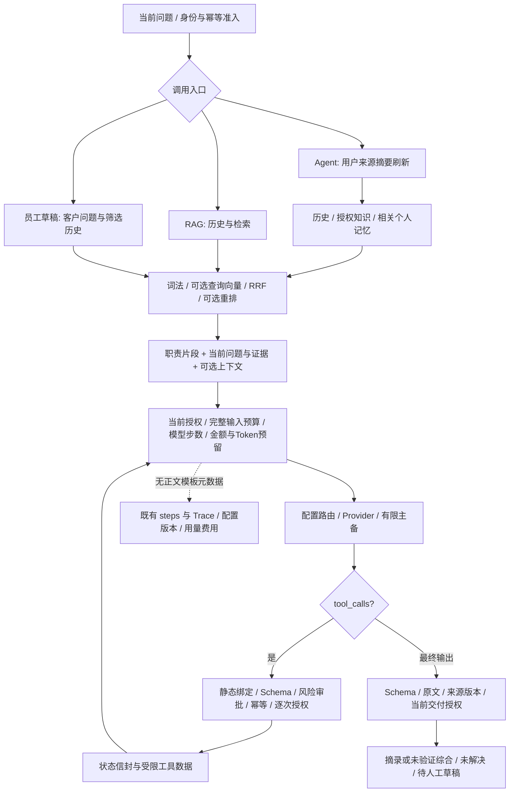

# Prompt 质量与有界 Agent 执行优化

日期：2026-11-13。**FIXED 表示源码修改完成，PASS 仅指列明的静态检查；真实模型理解、工具选择、回答质量和 Token 节省均 NOT_RUN。** 不以本报告宣称模型效果或生产可用性已验收。

## 1. 基线与范围

实际仓库 `support-agent-platform`，分支 `main`，HEAD `49fc85fbb5ba827507e4a6334a3a4daf995beb73`，暂存区为空；进入本轮前已有大量修改、删除和未跟踪成果。修改前保存 265 个现存交付文件的内容与 SHA-256，按该脏基线核对本轮增量，没有重置用户文件。

已阅读 AGENTS.md、README、FINAL_PRODUCT_ACCEPTANCE、两阶段 FINALIZATION、DEEP_AUDIT_REPORT 和受影响源码/diff。盘点覆盖所有 `model_runtime.complete` 调用、Provider 传输、Agent/RAG/摘要/个人与客户记忆、检索/重排/向量、工具绑定/Schema/授权/交付、Trace 和 React 时间线。两位获授权 Terra 分别只读复核工具/网关和 RAG/记忆，没有子代理写文件或执行动态验证。

保留 FastAPI → services → PostgreSQL、React → Adapter、静态 Demo、P15、两阶段和最终验收成果；不重写 Runtime、不引入框架、依赖、模型或新版本表。历史迁移 0001–0019、ORM、RLS、费用账本和运行角色不变。

## 2. 完整 Prompt 与模型输入清单

所有文本 Prompt 都经 `services/model_runtime.complete` → `providers.OpenAICompatibleProvider`；离线配置走现有 DemoProvider。下表的 ID 在 `prompting.PROMPT_VERSIONS` 中静态注册，初始版本均为 1；可选综合指令另由模板散列区分。Embedding 没有自然语言 Prompt，不伪造模板版本。

| 模板/定义与调用位置 | 场景、输入与依赖 | 输出/能力 | 预算与降级 |
| --- | --- | --- | --- |
| `agent.conversation`；`agent_turns.SYSTEM/prompt/turn` | 当前问题、企业职责/语言偏好、最多四轮历史、可用摘要/相关个人记忆、逐次授权的工具 Schema；依赖摘要及可选检索 | 无知识模式的最终文本，或 Provider tool_calls；声明支持工具才派发工具 Schema | 五次总模型派发、四次工具、120 秒整轮；按当前配置输入/输出和调用剩余时间；Schema/授权/预算失败明确终止 |
| `agent.knowledge`；同上 + `prompting.EVIDENCE_OUTPUT` | 上述输入加当前授权的有界证据和必要用户原话追问上下文 | 每次最终回复均为 EvidenceSelection JSON；可选 AnswerClaim 草稿；工具中间轮仍用 tool_calls | 同一总预算；不合规或无依据转未解决，合法引用才构造原文回答，不无限修复 |
| `rag.selection`；`chat.SYSTEM/prompt_messages/turn` | 原始问题、词法追问上下文、偏好、当前 Chunk、历史及相关个人记忆 | JSON：answerable、最多三条 citations、conflict；仅显式综合模式允许最多六条 claims | `RuntimeConfig` 输入上限、输出上限 1–32768、1–120 秒配置截止时间；无证据/冲突不发回答模型请求，失败不伪造答案 |
| 综合片段；`chat.synthesis_instructions/compose_answer` | 仅 `answer_mode=evidence_synthesis` 且知识模式使用；依赖已选 citations | 1–600 字 statement、fact/inference/uncertain、1–3 个不同的已选 Chunk ID；最多六项 | 不另发模型请求；结构/来源不符退回原文；始终 semantic_verified=false |
| `memory.summary`；`memory.SYSTEM/summary_messages/refresh` | 已重验的旧用户摘录及新用户消息；不输入助手/工具/内部备注/个人记忆 | MemorySelection：最多十二项，完整原文段落≤300 字、message_id、kind | 最多十六条新来源、配置输入上限、输出≤1000、时间≤20秒及剩余时间；无合规来源不调用；非法结果禁用本轮摘要且不推进水位 |
| `retrieval.rerank`；`search.run` | 查询原文、最多二十个完整融合候选；依赖当前授权/代次和可选索引配置 | EvidenceRanking JSON；每个已供 ID 恰好一次，无遗漏/重复/新 ID；不使用工具 | 输入先按完整序列化预算检查、输出≤1200、检索剩余时间；不能完整比较则沿用 RRF，记录失败原因 |
| `staff.draft`；`drafts.process_one` 内的任务 Prompt | 当前客户问题、员工可见且已筛选的历史、企业偏好和检索证据；不注入个人/客户持久记忆 | JSON reply/answerable/conflict/最多三条引用；草稿须人工逐句审核 | 当前配置输入/输出上限、调用≤120秒及网关租约；无工具、无自动发消息；非法/无依据草稿不冒充可靠回复 |
| `provider.connection`；`prompting.CONNECTION_PROMPT` → `chat.test_connection` | 固定 `Return JSON {"ok":true}.`；不带会话/记忆 | ConnectionReply JSON，ok=true；只证明该响应契约，不证明语义/工具/上下文能力 | 输出≤32、当前配置超时/费用策略；非法 JSON/字段不能显示 connected；本轮没有执行该产品诊断 |
| 无 Prompt；`search.run` 的 query_embedding | 当前完整查询，精确端点/索引模型空间；请求内复用成功或失败结果 | 已有 1536 维有界有限向量/用量契约 | 查询输入字节+128、检索截止时间、金额/Token 上界；失败词法回退、未知不重试 |
| 无 Prompt；`vector_index.process_one` 的 index_embedding | 已发布来源检查下的完整 Chunk、固定索引空间 | 同一向量协议，版本/租约匹配后发布 | 输出设零（无生成文本），≤120秒及租约/输入/费用限制；失败记录任务状态，不升级旧向量 |

没有独立的模型意图分类、模型任务规划、查询改写、自动个人记忆写入、备用模型“修复 Prompt”或单独最终润色调用。`autonomy.plan`、`model_runtime.infer_task` 是明确标 UNKNOWN 语义确定性的本地词法启发式；`chat.retrieval_question` 仅在短指代追问时附加最近用户原话，不取助手文字，不删除当前问题条件。主备复用同一 messages/tools 和输出验证。

## 3. 实际调用关系

不可信数据位于 user JSON、历史角色消息或 tool 数据中；公共基础规范、任务职责及条件启用的输出契约组成 system。基础规范不反复作为历史注入；多轮工具请求仍须发送当前协议上下文，不假设 Provider 支持服务器会话或 Prompt 缓存。

## 4. 确认问题、根因与修改影响

| 状态/原问题 | 修改原因及预期行为 | 上下文/调用链影响 | 异常与降级 |
| --- | --- | --- | --- |
| FIXED：知识 Agent 写“After any tool calls”才要求 JSON，实际所有最终输出都按 JSON 校验；未写三条引用上限 | 复用明确的 EVIDENCE_OUTPUT，无工具调用也必须 JSON；字段/引用/claims 数量与 Schema 对齐 | RAG/知识 Agent 共用输出片段；无知识模式不再附加综合 claims 指令；不增加调用 | 保留 invalid_grounding、冲突和摘录回退；不循环请求修复 |
| FIXED：构造层只算 messages，发送层还算外层对象/tools；草稿先按 RAG Prompt 裁剪再替换并重复扣预算 | 共用 input_size；草稿直接使用实际 system，不再替换和双重预留 | 构造、摘要、工具裁剪、重排、派发口径一致；可能多保留或少保留可选上下文，取决于真实大小 | 当前问题/规则本身超限则明确拒绝，不截断安全规范 |
| FIXED：Agent 加工具 Schema 后只能删历史/记忆，删掉低排名完整证据本可容纳却直接失败 | 首次推理派发前允许删除最低排名的整块证据；其后不改已发送证据和工具协议 | 实际保留证据裁剪后才绑定本次来源；已用于历史/重排的依赖继续保留；不重检索 | 仍不能容纳时 input_budget_exceeded；不截断 Chunk 里的条件 |
| FIXED：摘要只验证任意子串，可把“不要退款”选成“退款” | 服务端扩展为完整有界段落，新旧摘要均重验；新结果按来源/段落去重 | 至多十二项、每项≤300；完整段落可能比原短摘录占更多输入；不写个人记忆 | 段落过长/来源不符则 invalid_summary、保留旧水位且本轮禁用；旧不安全条目不再注入；段落外条件仍不能据此证明完整 |
| FIXED：重排硬裁每个 Chunk 前2000字符，可能漏掉尾部限制；JSON 未经有界 Schema，未明确启用 JSON 模式 | 使用完整候选、EvidenceRanking 和 Provider JSON 模式；明确保留条件、只排相关性 | 超预算在模型调用和来源绑定之前退回 RRF；完整输入可能更长，但不会无界扩召回 | 超时/拒答/无效列表明确失败；失败不再发“修复排名”请求，已发送来源不清除 |
| FIXED：个人记忆不论问题均注入全部最多二十条，相同来源摘录可重复 | 复用 query_groups，对有效本人记忆做词法相关筛选、来源摘录去重，至多六条，按匹配/更新时间排序 | 无可用多字符词项或无匹配则不注入；依赖只绑定入选集合，预算再剔除时清空未派发依赖 | 不调用模型、不改保存记录；可能漏同义但无词法重合的记忆，不宣称语义排序已验证 |
| FIXED：草稿检索无条件把当前问题截到1000字符 | 检索接收完整当前问题，避免截断尾部否定/时间/金额 | 保留原词法候选上限；向量输入照常受网关预算限制；问题原文仍在回答输入 | 向量输入超限可词法回退，生成输入过大明确失败，不偷偷截尾 |
| FIXED：五次外层推理循环未包含 fallback、Embedding 和重排派发 | 共享 MAX_MODEL_STEPS=5，在每次网关派发前以已持久化步骤核对，含摘要/检索/主备 | 可选上下文模型最多占四次，为最终回答留一次；未知/运行中占位，预检拒绝不占；复杂任务可能更早明确终止 | reasoning_limit_exceeded；不改变金额/Token 预留结算、四次工具和120秒上限；不撤销已成功工具 |
| FIXED：连接诊断期待 JSON 却接受任意非空回复为 connected | ConnectionReply Schema 校验；离线产品 Provider 对固定请求返回同一格式 | 不增调用；离线零用量不代表真实 Provider，未执行诊断 | 非法结构记 invalid_response；原已持久化用量仍保留，无修复重试 |
| FIXED：memory → model_runtime → user_memory → memory 的顶层循环依赖，直接导入摘要 Schema 报 partially initialized module | 将摘要运行网关依赖延迟到 refresh 内导入，解除导入顺序要求 | 不改变摘要调用或预算，不新增层/模块 | Schema 可独立导入；业务运行未执行 |
| FIXED：历史步骤无 Prompt 身份，代码变更后无法区分模板 | 在 steps JSON 增加静态 ID/revision/hash 与 task；Trace 白名单交付，React 显示 | 复用 config_version/模型/Provider/目的/状态/用量，无新表/迁移；hash仅静态模板，不含用户/记忆/工具结果 | 旧记录为 null/未知，Embedding 无文本模板；不回填虚构版本 |

## 5. System Prompt、意图与任务规划

`prompting.BASE` 只负责共同信任/职责/当前条件/输出克制规则；`chat.SYSTEM` 负责证据选择，`agent_turns.SYSTEM` 负责有界工具决策，摘要、重排和员工草稿保留各自职责，没有合并成单个巨型 Prompt。

关键变化示例：原“After any tool calls, final content MUST be JSON”改为“Every final reply, with or without tool calls, MUST be JSON”；原“Use only supplied tools when useful”补足解释/假设不等于写请求、缺参先问、不猜 ID、只执行必要依赖步骤、结果足够即停止。工具状态区分执行成功与业务空结果；当前条件优先于旧摘要，话题变化不继承无关条件。企业配置可设置职责/语言/风格，不能改授权或安全规则。

没有增加模型分类或展示思维链。复杂任务效果、必要澄清质量和假设/真实写请求判断仍须真实模型人工评审；最终授权、审批与业务幂等不能依赖上述文字。

## 6. 工具契约与执行安全

静态目录的五项通用只读/文本能力及六项客服能力保留。模型获得的名称、描述和 parameters 来自本轮当前授权工具；绑定要求 key/version、execution_type、输入/输出 Schema 与部署能力一致。参数 JSON/大小/未知字段、租户与具体资源、风险/独立审批、版本、幂等和撤权继续由服务器逐次检查。

空参数工具由服务器绑定当前会话，不要求模型生成租户/用户/会话 ID；ticket_update 必须已有 ticket_id/expected_version，不能从自然语言猜测。工具外层 status/error_category 是执行元数据，data 只是业务数据；succeeded 不等于 found=true 或存在票据。unknown/超时不盲重试，同轮重复规范化参数在整批执行前阻断，转人工成功同事务结束循环。没有新工具、任意代码/Shell/SQL或权限扩张。

## 7. RAG、引用和综合回答

保留当前问题原文、必要用户原话追问扩展、中文/英文词法、pgvector、RRF 和既有范围/候选上限。没有付费查询改写、多查询规划、额外生成或新检索服务。重排不再局部截断候选；超预算保留确定的融合顺序，不凭排名认定来源真实或化解冲突。

每个结论的结构关联仍由 EvidenceSelection/AnswerClaim、已输入 Chunk 集合、原文完整段落、generation/修订身份、当前授权与来源状态检查约束。Prompt 输入的引用身份是不可变 Chunk UUID；文档/代次/修订和历史追溯继续由服务器维护，不让模型生成可信版本。互补/冲突、否定和适用条件有明确指令，但没有通用语义蕴含证明。无依据不编造政策；综合草稿继续 `semantic_verified=false`，可疑结构退回安全摘录，必要时明确未解决/人工核实。

## 8. 上下文与记忆

当前问题与证据先保留，再选择完整近期历史轮次，最后尝试摘要和个人记忆；不裁断当前问题或工具消息协议。个人记忆为本人显式保存/同意/有效期内的用户来源摘录，词法相关性不改变身份、版本、撤回或每次交付检查。客户记忆仍由员工显式确认，未自动注入模型，也不自动将工具、助手或内部备注写为用户事实。

摘要新结果扩展完整段落并去重，旧摘要在读取时重验；不修改源 Message 或历史摘要正文。合法空 items 仍按上一阶段约定推进可审计水位，避免重复压缩同一无可记忆批次；这是模型选择结果，不证明重要条件没有漏选。长段落、跨段依赖、隐式指代、条件冲突/主题切换及词法记忆漏选仍属未验证风险；不因静态修复宣称语义完整。

## 9. Token 与模型调用效率

`input_size` 使用完整 `{"messages":...,"tools":...}` 的 UTF-8 JSON 字节加每条128字节 framing，是保守准入口径，**不是供应商 tokenizer 的实测 Token**。Embedding 继续使用输入字节+128。实际用量/金额以原步骤记录和价格快照结算，未知不补零；旧跨日占用与供应商账单核对仍保留。

静态提取的 System 字符串大小：RAG 1291→1306字节、无知识 Agent 1230→1290字节、摘要814→1093字节；它们不含动态问题/证据、JSON转义、工具 Schema 和 framing，也不是 Token/成本节省证明。新增规则主要用于消除契约歧义；摘要完整段落可能更长，重排完整候选可能触发有意的跳过。原“RAG system + 草稿 system 双重预留”已去除，记忆最多六条且去重，超预算重排不发请求。未测量总时延、节约比例或回答正确率。

## 10. Prompt Injection 与隐私

源码追踪确认：文档/网页解析只成为知识数据，用户/历史/记忆/工具内容不进入 system；偏好作为受限业务数据，不可覆盖公共规则。模型不能动态注册工具、变更角色、租户或审批。工具 data 即使包含指令，也不会绕过服务器 Schema、授权、预算或固定服务命令。

Prompt 不是权限边界；没有宣称能凭指令防住所有注入、事实幻觉或敏感文本复述。保持访客/员工隔离、内部备注不进访客/摘要、私有文件与历史来源当前授权、撤权后结果复查。Trace/审计新增内容仅模板身份/散列、任务和模型元数据，不保存完整 Prompt、正文、个人记忆或密钥。原模型输入/业务记录的保留和完整擦除仍受既有 BLOCKED 约束。

## 11. Provider 与输出兼容性

| 能力 | 当前契约与限制 |
| --- | --- |
| System/角色 | Chat Completions 风格 system/user/assistant/tool；不擅自把 system 降为普通 user，不推断其他协议兼容性 |
| Tool Calling | 使用配置声明 supports_tools；主/备都须满足；静态 Schema、parallel_tool_calls=false、服务端仍拒绝重复/越权 |
| JSON/结构化结果 | 无工具的 RAG/摘要/重排/草稿使用既有 json_object 模式；有工具的知识 Agent 用 Prompt 加服务端 Schema，不假设 strict structured output；无效输出不无限修复 |
| 模型参数/上下文 | 配置声明 token_parameter/send_temperature；不按模型名称猜测；max_input_tokens 是操作员保守上界，不是自动探测的真实上下文容量 |
| 用量/费用 | 缺 usage 或价格保持未知；失败仍保留已知计费信息，未知执行不重复派发 |
| 超时/主备 | 原明确 model_unavailable/tools_not_supported 才有一次备用；timeout/network/invalid_response 等不盲重试；备用也受同一模板、Schema、权限及五次总派发门限 |
| 流式 | 当前上游 stream=false；SSE 只展示本地阶段，校验后交付，不宣称上游 token streaming |

没有新能力探测请求或新 Provider 能力字段。仅声明 supports_tools 不足以证明某端点支持 system/json_object/真实上下文长度，部署方须另行人工确认；不支持既有协议的端点仍不可用，不能靠改 Prompt 冒充兼容。

## 12. Trace 与版本追溯

最小增量使用既有 `ModelCall.steps` JSON 的 prompt_id、prompt_version、prompt_hash、task，保留 provider/model/purpose、主备选择、usage、错误及时间；TraceEvent 增加可空字段并在 React 时间线呈现，仍限本人/管理员。Agent 配置版本使用原 config_version，工具版本和策略使用原执行/审批记录，不建第二套版本系统。

hash 针对静态 system 模板序列；固定连接请求针对 CONNECTION_PROMPT。可选综合片段改变 hash，不散列动态用户/记忆/证据，也不把 hash 当全文归档、语义证明或秘密脱敏方案。历史代码/版本映射应随发布保留；旧步骤不回填，Embedding 无文本模板、缺信息显示未知。模板/共享片段后续修改须更新受影响 revision，hash 提供额外差异线索。客户端是否收到结果仍 UNKNOWN。

## 13. 修改文件与依赖

本轮增量相对进入时保存的脏基线：

- 新增 `src/support_agent/prompting.py`、本报告。
- 修改 `src/support_agent/autonomy.py`、`demo_provider.py`、`rag_schemas.py`、`trace_schemas.py`。
- 修改 `src/support_agent/services/agent_turns.py`、`chat.py`、`drafts.py`、`memory.py`、`model_runtime.py`、`search.py`、`traces.py`、`user_memory.py`、`vector_index.py`。
- 修改 `frontend/src/features/chat/TracePanel.tsx` 和 `README.md` 的报告入口。

没有依赖/锁文件、数据库结构、历史迁移、运行角色、Docker/Pages 配置变更；没有恢复评测/测试体系。

## 14. 静态检查记录

| 实际检查 | 结果与证据边界 |
| --- | --- |
| `.venv/bin/python scripts/check.py` | PASS：Ruff、168 个格式目标、129 个 Python AST、19 线性迁移/离线 Alembic SQL/RLS 与外键唯一目标声明；没有数据库连接 |
| `npm run check --prefix frontend` | PASS：TypeScript `tsc --noEmit`，包含新增时间线字段；没有构建/浏览器 |
| `.venv/bin/python scripts/check_delivery.py` | PASS：267 个交付文件、本地 Markdown/HTML 链接、JavaScript node --check/模块静态链接、已知秘密模式；React 构建产物和 wheel NOT_RUN |
| Python 3.11 AST | PASS：129 文件按 feature_version=3.11 解析；非多版本运行矩阵 |
| Prompt AST 契约 | PASS：八个网关调用位置均显式提供 messages/prompt_id；七个静态模板 ID 均被引用，无未知 ID，两个 Embedding 位置明确 None；不运行 Prompt 构造或 Provider |
| JSON Schema 元数据 | PASS：AnswerClaim、EvidenceSelection、EvidenceRanking、ConnectionReply、MemorySelection、ToolSpec、TraceEvent 共七类 Schema 通过 Draft202012 声明检查；排名数量上限/Trace 前后端字段映射已核对，没有构造测试样本或执行模型输出验证用例 |
| OpenAPI 元数据 | PASS：只导入路由与 Schema，127 路径、174 操作、159 API Schema；未创建应用、调用 endpoint 或连接数据库 |
| 权限/预算调用链 | PASS（源码审查）：静态绑定/Schema相等、逐次服务端授权、审批、来源/记忆交付、主备失败类别和五次派发门限；真实并发/撤权/模型行为 NOT_RUN |
| 基线保护 | PASS：39 个受保护文件散列一致，含迁移/ORM/db、依赖锁、Provider/工具/审批/预算/限流和此前报告；本轮17个增量文件，无基线文件删除、HEAD未变、暂存区为空 |
| Diff/新增文本 | PASS：git diff --check；本轮新增和原未跟踪的增量文本另查末尾换行/行尾空白 |

过程中 Ruff 先发现一处未使用导入和一次格式未更新，均修正后全量静态入口通过。首次 Schema 元数据导入暴露 memory/model_runtime/user_memory 的既有循环依赖；修复为函数内导入后，同一元数据命令完成。它是实际发现并修复的问题，没有把失败当通过。未新增检查脚本、测试、评测数据或测试依赖；依赖/许可证清单和锁未变，实时漏洞库未刷新。

独立只读复核建议中，“合法空摘要必须失败”没有直接采纳：上一阶段已明确允许合法空 items 推进水位，不能仅凭可能漏选的泛化风险恢复原重复摘要缺陷；该语义风险保留在第8/15节。证据绑定时机、真实派发上限与重排预算前置建议已核实并实施。

## 15. 未验证能力与剩余边界

- **NOT_RUN**：真实 Provider/模型、JSON/工具能力和长上下文兼容性；中文复杂问题、参数选择、多轮条件/冲突、综合与拒答质量、Prompt Injection 效果；真实 Token、账单与时延；数据库/RLS/并发/恢复；浏览器/Widget/Pages/产品 Demo 交互。
- **BLOCKED**：完整用户/会话/知识与对象版本/备份擦除继续保留最终验收报告中的缺口；本轮没有改变删除、RLS 或授予额外权限。
- **DEFERRED**：通用语义相关性/矛盾/蕴含验证、长表和跨段条件完整性、真实模型效果与实际成本对照。词法筛选可能漏重要个人偏好；合法空摘要可能漏选条件；有界上下文不足时应明确澄清/人工处理。
- 当前是 Prompt/Schema/预算及来源链的源码修复，不证明 AI 已正确理解所有意图、不保证安全摘录一定足以回答。模型执行未知结果仍须核对持久化记录，不能凭访客取消推定未执行业务。

## 16. 交付与操作边界

本轮不运行任何测试、构建、服务、容器、应用/Adapter/Provider 探针、数据库连接/迁移、浏览器或真实模型；不操作 VPS、现有数据/备份，不提交、推送或部署。后续真实模型人工评审须单独明确 Provider、模型、精确 Endpoint、费用上限及隔离环境；不恢复自动化评测套件。完成静态交付后停止，等待用户审阅。
